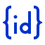
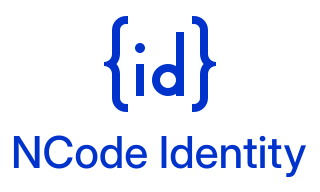

# NCode Identity Logo Kit

The NCode Identity mark is `{id}`: `id` for identity, between the curly braces of the NCode Group's mark, `{N}`. This
folder holds it as vector masters and as the PNG and ICO files that each place it appears in asks for. `build.py` draws
every file here ([ADR-1492](../docs/decisions/1492-the-familys-id-logo-is-drawn-by-one-script-and-every-web-app-shows-its-icon.md)).

| Tile, blue | Tile, white | Tile, dark | Mark | Lockup | Lockup, stacked |
|---|---|---|---|---|---|
|  |  |  |  |  |  |

## Which File for What

Where a row names a folder's blue tile, the folder also holds the other variants ([Variants](#variants)).

| Use | File | What it is |
|---|---|---|
| NuGet package icon | `nuget/ncode-identity-nuget-tile-blue.png`, which `Directory.Build.targets` packs into every package of the family | 128 by 128, the size NuGet recommends. Clients scale it down, to as little as 32 pixels, on a white page and in a dark IDE alike, which is why it is a tile |
| Helm chart icon | `tile/ncode-identity-tile-blue-256.png`, which `charts/ncode-identity-host/Chart.yaml` names by its address on `main` | 256 by 256 with rounded corners, for Artifact Hub and the cluster dashboards that list a chart |
| The repository's README | `lockup/ncode-identity-lockup-blue.svg` and `-light.svg`, as under [In a README](#in-a-readme) | The mark beside the wordmark, in the color that suits the reader's GitHub theme |
| GitHub repository social preview | `github/ncode-identity-github-social-light.png`, `-dark.png` or `-blue.png`, uploaded in the repository's settings | 1280 by 640, the size GitHub recommends: the lockup over the descriptor |
| GitHub organization, user or app picture | `github/ncode-identity-github-avatar-tile-blue.png` | 500 by 500, the size GitHub recommends, with no transparency. For a picture GitHub cuts to a circle, take `profile/` |
| GitLab group or project avatar | `gitlab/ncode-identity-gitlab-avatar-tile-blue.png` | 192 by 192, GitLab's ideal size, far below its 200 KiB limit |
| GitLab project avatar, from the repository | `gitlab/logo.png`, copied to the repository's root | GitLab shows a `logo.png` at the root as the project's avatar until one is uploaded |
| My Apps and the Microsoft 365 app launcher | `myapps/ncode-identity-myapps-tile-blue.png` | Exactly 215 by 215, PNG, with a solid background, as Microsoft Entra asks. No transparent variant, for that reason |
| Website favicon | Every file in `favicon/`, with the tags under [Favicon](#favicon) | An ICO with its own drawing for each of 16, 20, 24, 32, 40, 48 and 64 pixels, an SVG, the 180-pixel icon iOS takes, and the 192- and 512-pixel icons a web manifest names, one of them maskable |
| Profile picture cut to a circle | `profile/ncode-identity-profile-tile-blue.png` | 1024 by 1024, with the mark inside the circle: GitHub and GitLab users, Gravatar, X, LinkedIn |
| Badge logo | `badge/shields-logo-white.txt`, as under [Badges](#badges) | The mark cropped to its edges, as the value of Shields.io's `logo` parameter |
| Link preview | `social/ncode-identity-og-light.png`, `-dark.png` or `-blue.png` | 1200 by 630, the Open Graph size: the lockup over the descriptor |
| Profile banner | `social/ncode-identity-banner-light.png`, `-dark.png` or `-blue.png` | 1500 by 500: the lockup alone |
| Windows application icon | `windows/ncode-identity.ico` | 16 to 64 pixels as 32-bit bitmaps and 256 as PNG, the layout a Windows application icon has, for `<ApplicationIcon>` in a project file |
| A sign-in page, an email, documentation, slides, print | The SVG files in `lockup/`, `mark/` and `tile/` | Vector, at any size. Each also comes as PNG, which an email needs. `lockup-stacked` is for a space nearer a square |

## Variants

| Name | Background | Mark | Use it on |
|---|---|---|---|
| `tile-blue` | NCode Blue | White | Anything: the default wherever the background isn't yours to choose |
| `tile-white` | White | NCode Blue | Anything, where a blue tile is too loud |
| `tile-dark` | NCode Navy | NCode Blue Light | Anything; made for dark pages |
| `mark-blue`, `lockup-blue` | Transparent | NCode Blue | Light backgrounds only: on a dark page its contrast is 2 to 1 |
| `mark-light`, `lockup-light` | Transparent | NCode Blue Light | Dark backgrounds only |
| `-white`, `-black` | Transparent | White, black | One color: over a photograph or a color, in print, as a mask |
| `-auto` (SVG only) | Transparent | NCode Blue, or NCode Blue Light in a dark color scheme | A page that follows the reader's system setting |

`lockup` is the mark beside the wordmark, and `lockup-stacked` the mark at twice that size above it; each comes in every
color of the mark.

A tile's file has rounded corners with transparent pixels outside them where the picture is shown as it is (NuGet,
favicons, `tile/`), and fills the whole square where the platform cuts its own shape (`github/`, `gitlab/`, `myapps/`,
`profile/`, `apple-touch-icon.png`, the maskable icon, and the `-square` files in `tile/`).

The mark sits at one of three sizes in its square: across seven eighths of it where the picture is shown small (NuGet,
favicons, badges), a little smaller on tiles and avatars, and inside the center circle of 80% of the width where a
circle is cut from it (`profile/`, the maskable icon).

## Colors

The palette is the NCode Group's: one hue at three lightnesses.

| Name | Hex | RGB | HSL | Use |
|---|---|---|---|---|
| NCode Blue | `#0033CC` | 0, 51, 204 | 225° 100% 40% | The mark on light backgrounds; the tile |
| NCode Blue Light | `#809FFF` | 128, 159, 255 | 225° 100% 75% | The mark on dark backgrounds |
| NCode Navy | `#0A1F5C` | 10, 31, 92 | 225° 80% 20% | The dark tile and the dark cards |
| White | `#FFFFFF` | 255, 255, 255 | | The mark on NCode Blue |

Contrast, as WCAG measures it: NCode Blue on white, and white on NCode Blue, 8.9 to 1; NCode Blue Light on GitHub's dark
page (`#0D1117`) 7.5 to 1, on Visual Studio's dark theme (`#1E1E1E`) 6.6 to 1 and on NCode Navy 6.1 to 1. NCode Blue on
a dark page is 2.1 to 1, too low to read: use the light mark or a tile there.

## The Drawing

- The master is drawn on a grid of 64 units from straight lines and circular arcs. The braces are the NCode Group
  mark's: a stroke of 4 units, 48 high. The letters have the same stroke: the d is 16 wide and 32 high, with a ring 16
  across as its bowl, and the i is as high as the bowl, under a dot 5 across. Every stem lies on a whole unit, so the
  mark is sharp at 64 pixels and at its multiples.
- At 16, 20, 24, 32, 40 and 48 pixels the mark has a drawing of its own, with each stem on whole pixels. A scaled-down
  master puts them between pixels, which is what makes a small icon look soft. Up to 24 pixels the bowl is three bars
  around a hole, and up to 32 the dot is a square. The ICO files and `favicon.svg` use these drawings.
- The wordmark is "NCode Identity", two words, in Inter Display Medium, with capitals as tall as the mark's d. The
  package and namespace names keep their dot: `NCode.Identity`. The descriptor on the link previews, "OpenID Connect
  and OAuth 2.x for .NET", is in Inter Display Regular. Both are outlines, so no file needs the font: `outlines.py`
  converts them from the Inter release it pins and writes `outlines.json`, which `build.py` reads. Inter is copyright
  The Inter Project Authors and licensed under the SIL Open Font License 1.1, as
  [`THIRD-PARTY-NOTICES.md`](../THIRD-PARTY-NOTICES.md) records.
- Leave clear space around the mark of at least the width of one brace, 12 of its 64 units. The files in `mark/`
  already hold 4 units of it at the sides and 8 above and below.
- The smallest drawing is 16 pixels, 14 across its ink, which is also the size a badge shows the cropped mark at. Below
  that the letters can't be told apart. Keep the lockup at least 24 pixels high, and the stacked lockup at least 72.
- Don't stretch the mark, recolor it outside the palette, outline it, or set the braces or the letters in a font: a
  font's and the mark's differ.

## Favicon

Copy `favicon/` to the site's root and add:

```html
<link rel="icon" href="/favicon.ico" sizes="32x32">
<link rel="icon" href="/favicon.svg" type="image/svg+xml">
<link rel="apple-touch-icon" href="/apple-touch-icon.png">
<link rel="manifest" href="/site.webmanifest">
```

`favicon/transparent/` is the mark without a tile: blue in `favicon.ico`, light blue in `favicon-dark.ico`, and either
in `favicon.svg`, by the reader's color scheme.

```html
<link rel="icon" href="/favicon.ico" sizes="32x32" media="(prefers-color-scheme: light)">
<link rel="icon" href="/favicon-dark.ico" sizes="32x32" media="(prefers-color-scheme: dark)">
<link rel="icon" href="/favicon.svg" type="image/svg+xml">
```

The four web apps under `frontend/apps` link `favicon.ico`, `favicon.svg` and `apple-touch-icon.png` with the first
three tags, written relative to their `index.html` (`./favicon/favicon.ico`), and carry copies of them in their own
`favicon/` folders, because an image build's context holds no `brand/`. Each build gives the copies content-hashed names in the
assets its host serves, and no app links the manifest
([ADR-1492](../docs/decisions/1492-the-familys-id-logo-is-drawn-by-one-script-and-every-web-app-shows-its-icon.md)). The
`favicon copies` stage of `./build/dod.ps1` fails when a copy differs from the file here, so after `build.py` changes
one, copy it to every app:

```powershell
foreach ($app in 'auth', 'conformance', 'mgmt', 'playground') { Copy-Item brand/favicon/favicon.ico, brand/favicon/favicon.svg, brand/favicon/apple-touch-icon.png "frontend/apps/$app/favicon/" }
```

## Badges

Shields.io takes a logo of its own as a data URI in the `logo` parameter and can't recolor it, so the mark comes in
three colors: white for a badge's default gray label, blue and light blue for a label color of your own. Each
`badge/shields-logo-<color>.txt` holds one line, ready to follow `logo=`:

```markdown

```

## In a README

GitHub shows the image that matches the reader's GitHub theme when a `<picture>` names both. Inside this repository the
addresses are relative; from another one they are the files' addresses on `main`:

```html
<picture>
  <source media="(prefers-color-scheme: dark)" srcset="https://raw.githubusercontent.com/NCodeGroup/identity/main/brand/lockup/ncode-identity-lockup-light.svg">
  
</picture>
```

## Build

```powershell
uv run brand/build.py
```

uv installs the two packages the script pins, numpy and Pillow, for that run. Without uv, install them and run
`python brand/build.py`. The script rewrites every file in the folders here, and neither this file, the two scripts nor
`outlines.json`. It reads every PNG and every ICO entry back and stops when one doesn't decode to the picture it drew.
It also stops when a file breaks its platform's limit: more than 100 KB for My Apps, 200 KiB for GitLab or 1 MB for
NuGet and GitHub, or a transparent pixel where the platform takes none. `--output <folder>` writes the kit elsewhere.

To change the mark, edit `MASTER` and `FITTED` in `build.py`; to change a color, the constants above them. To change the
wordmark or the descriptor, edit `LINES` in `outlines.py`, then run both scripts:

```powershell
uv run brand/outlines.py
uv run brand/build.py
```

`outlines.py` downloads the Inter release it pins, verifies the archive's SHA-256 and that of each font file it reads,
and writes `outlines.json`; `--archive <file>` takes a release that is already downloaded. Both scripts' output is
deterministic, so a run that changes no input changes no file.
