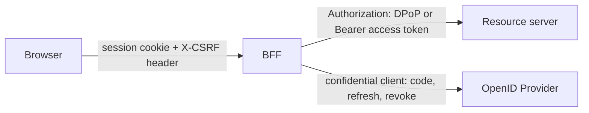
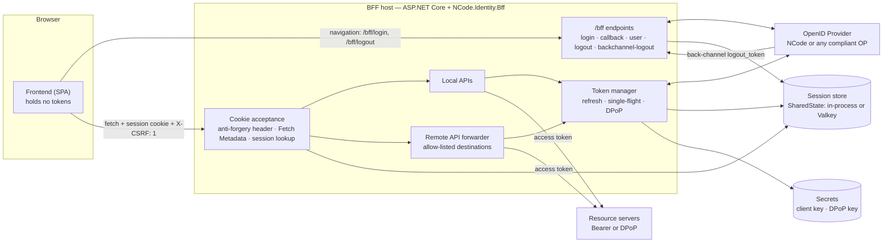
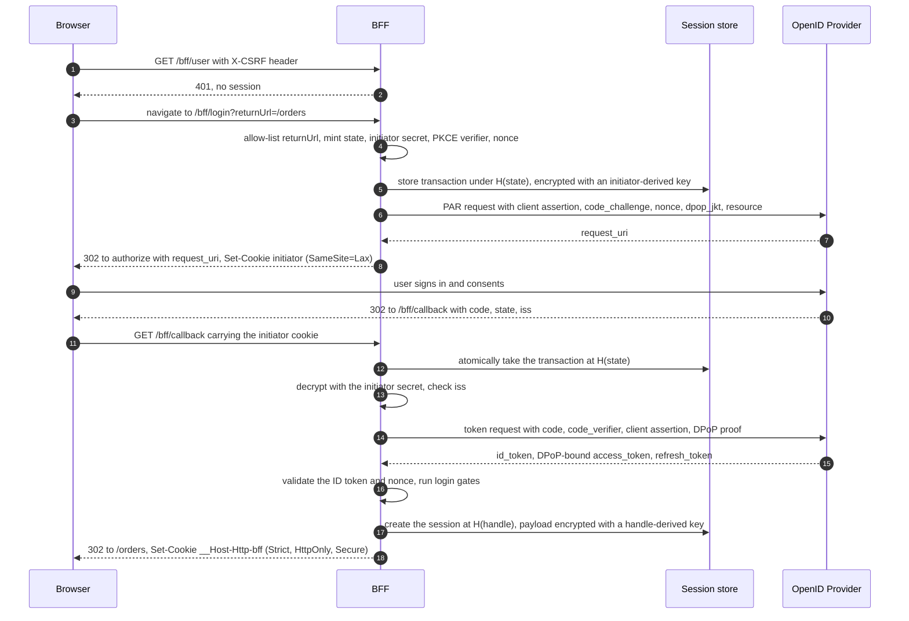
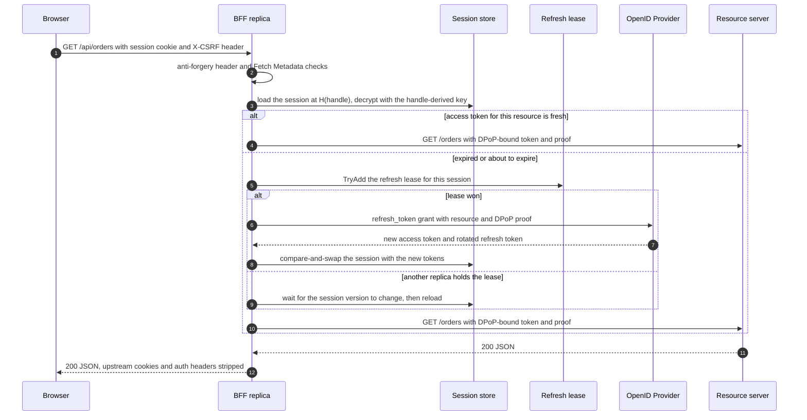

# Backend for Frontend (BFF) — cookie sessions with server-side token custody

- **Status:** Proposed, and delivered in phases. Phase 0 (SharedState) is delivered:
  [ADR-0267](decisions/0267-replicas-share-versioned-expiring-values-and-membership-indexes.md). Phase 1 (the protocol
  client) is delivered, and so is phase 2 (the `NCode.Identity.Bff` core):
  [ADR-0290](decisions/0290-the-bff-keeps-each-session-as-an-encrypted-server-side-record-under-a-cookie-handle.md),
  [ADR-0291](decisions/0291-the-bff-refreshes-a-session-single-flight-under-a-lease-on-its-refresh-token.md),
  [ADR-0292](decisions/0292-the-bff-accepts-its-cookie-only-with-a-static-header-and-fetch-metadata.md) and
  [ADR-0293](decisions/0293-the-bff-ends-sessions-by-guarded-logout-and-by-back-channel-logout-through-indexes.md). The
  library is tracked as issue [#123](https://github.com/NCodeGroup/Identity/issues/123), and moving the management
  console onto it is tracked as [#158](https://github.com/NCodeGroup/Identity/issues/158). When each phase lands, its
  decisions ([§8](#8-decisions-and-options-considered)) become ADRs.
- **Date:** 2026-10-20
- **Scope:** a new **server-side** library that turns an ASP.NET Core application into the Backend for Frontend (BFF)
  of a browser frontend. The BFF is the OAuth client. It keeps tokens on the server, gives the browser only an
  `HttpOnly` session cookie, accepts that cookie on API calls, and attaches the right access token when it calls
  resource servers. No browser-side library is proposed (see [§3.2](#32-non-goals)).

## Summary

Browser applications today usually follow the **bearer-token pattern**. The single-page application (SPA) is a public
OAuth client: it runs the authorization-code flow in JavaScript, keeps the access token and refresh token in memory
that script can reach, and sends `Authorization: Bearer …` to each API. Any injected script runs with the
application's privileges, so it can read those tokens and use them anywhere. The browser platform has also removed
the third-party cookies that iframe-based silent renewal depended on.

[RFC 10017](https://www.rfc-editor.org/rfc/rfc10017) (BCP 212, August 2026), _OAuth 2.0 for Browser-Based
Applications_, recommends the **BFF pattern** instead. A server-side component of the frontend is a **confidential
client**. It manages the tokens in a cookie-based session and forwards API calls with the right access token attached,
so the browser never holds a token.

This document proposes `NCode.Identity.Bff`, an Apache-2.0 BFF library for the NCode.Identity family that works with
any compliant OpenID Provider (OP). The NCode OP is its reference partner and test oracle. Its central decisions:

1. **Tokens stay on the server.** The session cookie is an opaque, 256-bit handle. Tokens live in a server-side
   session store under a hash of the handle, encrypted with a key derived from the handle. A store dump alone yields
   no usable token ([D1](#d1-token-custody), [§5.3](#53-the-session-cookie-and-the-server-side-record)).
2. **No Data Protection key ring.** The login transaction and the session are server-side records keyed by random
   values. The BFF therefore has no shared key ring to keep and rotate ([D2](#d2-login-state-and-cookie-protection)).
3. **The OAuth client follows current best practice.** It authenticates with `private_key_jwt` and uses
   authorization code + PKCE `S256`. It uses PAR when the OP offers it, checks the RFC 9207 `iss` response parameter,
   and binds tokens with DPoP when the OP supports it ([§5.1](#51-the-bff-as-a-confidential-client)).
4. **Refresh is single-flight across the whole cluster.** A rotated refresh token presented twice trips reuse
   detection, and the NCode OP then revokes the whole token family by default
   ([ADR-0087](decisions/0087-refresh-token-reuse-detection-and-family-revocation.md)). Only one replica may refresh a given
   session at a time ([D6](#d6-refresh-concurrency), [§5.5](#55-token-management)).
5. **The BFF accepts the cookie through a layered CSRF defense.** It requires a static custom header, denies
   cross-origin calls by default, checks Fetch Metadata, and sets `SameSite=Strict`, as RFC 10017 §6.1.3.3 describes
   ([D3](#d3-csrf-defense), [§5.6](#56-accepting-the-bff-cookie-on-apis)).
6. **Remote APIs are forwarded only to an explicit allow-list.** Paths are normalized, inbound credentials are
   stripped, and redirects are never followed (RFC 10017 §6.1.3.6, [§5.6](#56-accepting-the-bff-cookie-on-apis)).
7. **Sessions end server-side.** User logout revokes the refresh token and runs RP-initiated logout. The BFF also
   receives back-channel `logout_token`s and ends the matching sessions ([§5.8](#58-logout-and-back-channel-logout)).
8. **Every vocabulary is open.** Token requirements, client-authentication methods, frontends, login gates, and claim
   shaping are registered strategies, not closed switches
   ([ADR-0150](decisions/0150-vocabularies-are-open-unless-provably-closed.md), [§5.11](#511-extensibility-seams)).

## Contents

1. [Why](#1-why)
2. [Bearer-token pattern vs BFF/cookie pattern](#2-bearer-token-pattern-vs-bffcookie-pattern)
3. [Goals, non-goals, and constraints](#3-goals-non-goals-and-constraints)
4. [Architecture](#4-architecture)
5. [Detailed design](#5-detailed-design)
6. [Security analysis](#6-security-analysis)
7. [Failure modes](#7-failure-modes)
8. [Decisions and options considered](#8-decisions-and-options-considered)
9. [Delivery plan](#9-delivery-plan)
10. [Testing and conformance](#10-testing-and-conformance)
11. [Open questions](#11-open-questions)
12. [Glossary](#12-glossary)
13. [References](#13-references)

---

## 1. Why

### 1.1 Tokens in the browser are the weak point

RFC 10017 §5 starts from one observation: **malicious JavaScript has the same privileges as the legitimate
application code.** It gets there through cross-site scripting (XSS), a compromised dependency, or a tampered CDN
asset. When the application holds OAuth tokens, that code can:

- **Steal a token once or keep stealing it** (§5.1.1 and §5.1.2). It reads the access token or refresh token from
  memory, `sessionStorage`, or `localStorage` and uses it from the attacker's machine. Nobody can detect or stop that
  use until the token expires or is revoked.
- **Get new tokens** (§5.1.3). It runs a fresh silent authorization flow in a hidden iframe. A public client has no
  credential, so the attacker can redeem the code.
- **Use the application from the user's browser** (§5.1.4). This attack exists for every web application, and no token
  architecture removes it.

The browser platform has moved too. Safari blocks third-party cookies, Firefox partitions them, and Chrome is
deprecating them. Silent renewal with `prompt=none` in an iframe therefore fails for a growing share of users. This is
the same reason [ADR-0074](decisions/0074-session-management-and-logout.md) prefers back-channel logout over the iframe
mechanisms.

### 1.2 Where NCode stands today

The **OpenID Provider side** already provides everything a BFF needs:

| BFF needs                                    | The NCode OP provides                                                                                                                                       |
| -------------------------------------------- | ----------------------------------------------------------------------------------------------------------------------------------------------------------- |
| Confidential-client authentication           | `private_key_jwt` ([ADR-0102](decisions/0102-jwt-bearer-client-authentication.md)) and mutual TLS ([ADR-0107](decisions/0107-mutual-tls-client-authentication.md))      |
| Authorization requests kept off the URL      | Pushed authorization requests (PAR) ([ADR-0089](decisions/0089-pushed-authorization-requests.md))                                                                 |
| Sender-constrained tokens                    | DPoP, including `dpop_jkt` and refresh-token binding continuity ([ADR-0097](decisions/0097-sender-constrained-access-tokens-dpop-and-mtls.md))                    |
| Audience-restricted tokens per API           | RFC 8707 resource indicators, including down-scoping on refresh ([ADR-0158](decisions/0158-an-access-token-is-bound-by-its-client-and-every-resource-server-it-targets.md)) |
| Safe refresh tokens                          | Rotation with reuse detection that revokes the family ([ADR-0087](decisions/0087-refresh-token-reuse-detection-and-family-revocation.md))                         |
| Sessions the server can end                  | `sid`, RP-initiated logout, and back-channel logout ([ADR-0074](decisions/0074-session-management-and-logout.md), [ADR-0077](decisions/0077-session-scoped-grant-revocation-on-logout.md)) |
| Revocation and exchange                      | Refresh-token revocation ([ADR-0028](decisions/0028-token-revocation-refresh-tokens-only.md)) and token exchange ([ADR-0101](decisions/0101-oauth-token-exchange-rfc8693.md))   |

The family has **no relying-party library**, though: no package helps an application consume the OP. Its own
management console (`src/frontend/apps/mgmt`) is a browser public client. `@ncode/auth` runs authorization code +
PKCE in JavaScript, the access token and refresh token live in the Redux store, and `@ncode/store` attaches
`Authorization: Bearer` to every management API call. That is the shape RFC 10017 discourages, and it guards the most
privileged surface the family has.

---

## 2. Bearer-token pattern vs BFF/cookie pattern

| Concern                         | Bearer-token pattern (token in the browser)                                         | BFF/cookie pattern                                                                                      |
| ------------------------------- | ----------------------------------------------------------------------------------- | ------------------------------------------------------------------------------------------------------- |
| Who is the OAuth client         | The SPA                                                                             | The BFF, a server-side part of the frontend                                                             |
| Client type                     | Public (no credential)                                                              | Confidential (`private_key_jwt` or mTLS)                                                                |
| Where tokens live               | Browser memory or storage                                                           | Server-side session store only                                                                          |
| What the browser sends          | `Authorization: Bearer <token>`                                                     | An `HttpOnly` session cookie plus a static anti-forgery header                                          |
| XSS consequence                 | Token theft, use from anywhere, new tokens through silent flows                     | Requests only from the victim's browser while the page is open; no token to steal                       |
| CSRF exposure                   | None, because browsers do not attach `Authorization` automatically                  | Real, so the BFF must defend against it ([§5.9](#59-browser-facing-hardening))                          |
| Session renewal                 | Refresh token in JavaScript, or iframe `prompt=none` that browsers are breaking     | The BFF refreshes server-side; no iframes and no third-party cookies                                    |
| Revocation                      | Wait for the token to expire                                                        | End the session server-side, revoke the refresh token, and receive back-channel logout                  |
| Sender constraint               | A browser DPoP key, even a non-extractable WebCrypto key, still signs proofs for injected script | The DPoP key is held by the BFF, outside the browser                                                    |
| Infrastructure                  | Static hosting only                                                                 | A BFF host and, with several replicas, a shared session store                                           |

**The two patterns compose rather than compete.** The cookie covers only the hop between the browser and the BFF.
From the BFF to a resource server, the call is still an ordinary OAuth call with a bearer or DPoP access token, and a
resource server cannot tell that a BFF is in front of it. A resource server therefore keeps validating access tokens
as it does today. Only the frontend changes.



**The token-mediating backend** (RFC 10017 §6.2) is a halfway shape: a backend runs the grant and then **hands the
access token to the browser**. It is not offered, because the token still reaches script.

**Where the bearer pattern stays right:**

- Native and mobile apps, which are public clients with platform key storage.
- Service-to-service calls.
- The NCode **Playground**, whose purpose is to show the tokens a flow produces
  ([ADR-0082](decisions/0082-playground-and-conformance-surfaces.md)).

---

## 3. Goals, non-goals, and constraints

### 3.1 Goals

- **G1 — Tokens never reach the browser.** No endpoint, header, or cookie carries an access, refresh, or ID token to
  the browser.
- **G2 — Correct by default, with no off switch.** The callback binding, cookie attributes, CSRF checks, return-URL
  allow-list, and proxy allow-list cannot be disabled. A setting may only choose something equal or stronger.
- **G3 — Works with any compliant OP.** The library uses only standard metadata and endpoints. The NCode OP is the
  reference and the test oracle, not a dependency.
- **G4 — Correct with several replicas.** A login can complete on any replica, refresh never trips reuse detection,
  and logout takes effect on every replica.
- **G5 — Little to learn.** One composition call, one configuration section, and one endpoint mapping give a working
  BFF. A SPA needs only `fetch` with one extra header.
- **G6 — Open for extension.** Every vocabulary is registered, never switched on.
- **G7 — Observable without leaking.** Events, metrics, and traces never carry tokens, handles, subjects, or paths.

### 3.2 Non-goals

- **A browser library.** The SPA contract is small: a navigation to log in, a navigation to log out, a session probe,
  and a header on API calls. It is documented ([§5.7](#57-bff-endpoints)), and the frontend platform can wrap it in a
  few lines. A separate package is not justified.
- **A resource-server validation library.** APIs behind the BFF validate bearer or DPoP tokens as they do today. A
  reusable library for that is a separate concern.
- **The token-mediating backend** (RFC 10017 §6.2), and **implicit, hybrid, or password flows**.
- **Adapters for one identity provider.** Anything a standard OP needs is metadata-driven.
- **Front-channel logout and session-management iframes**, for the same reasons as
  [ADR-0074](decisions/0074-session-management-and-logout.md).
- **Framework-specific glue** for Blazor or server-rendered page frameworks, beyond what an ASP.NET Core
  authentication scheme already provides ([§11](#11-open-questions)).

### 3.3 Constraints

- .NET 10 and ASP.NET Core, following the family's conventions: interfaces public with internal `Default*`
  implementations, sealed options classes with validators, and the `IServiceBuilder<TMarker>` composition idiom.
- No dependency on the OP packages (`NCode.Identity.OpenId.Authentication*`). The BFF is a relying party.
- Shared state goes through the existing `NCode.Identity.SharedState` port and its adapters
  ([ADR-0164](decisions/0164-replicas-share-single-use-state-through-an-atomic-expiring-key-set.md)), not a second
  integration with the same infrastructure.

---

## 4. Architecture



The flow follows RFC 10017 Figure 1:

1. **Probe.** The SPA loads and calls `GET /bff/user` with the anti-forgery header. A `401` means there is no session.
2. **Login.** The SPA navigates to `/bff/login?returnUrl=…`. The BFF starts the code flow (through PAR when the OP
   offers it) and redirects to the OP.
3. **Callback.** The OP redirects to `/bff/callback`. The BFF checks the binding, exchanges the code, validates the ID
   token, creates the session, sets the cookie, and redirects to the allow-listed return URL.
4. **API calls.** The SPA calls local or remote APIs with the cookie and the header. The BFF resolves the session,
   obtains the right access token (refreshing it if needed), and either runs the local endpoint or forwards the call.
5. **Logout.** The SPA navigates to the `logout_url` from step 1. The BFF revokes the refresh token, deletes the
   session, and redirects to the OP's `end_session_endpoint`. When the session ends at the OP, a back-channel
   `logout_token` ends it at the BFF too.

### 4.1 Packages

| Package                                         | Depends on                                                      | Holds                                                                                                                                                                                                                                                                       |
| ----------------------------------------------- | --------------------------------------------------------------- | --------------------------------------------------------------------------------------------------------------------------------------------------------------------------------------------------------------------------------------------------------------------------- |
| `NCode.Identity.OpenId.Protocol.Abstractions`   | nothing                                                         | The OAuth 2.0 / OpenID Connect **wire vocabulary** (`OpenIdProtocol`): parameter, error, grant type, media type and metadata names, shared by the OP and the protocol client ([ADR-0276](decisions/0276-the-oauth-and-openid-connect-wire-vocabulary-lives-in-a-dependency-free-package.md)). |
| `NCode.Identity.OpenId.Client.Abstractions`     | `NCode.Identity.Jose.Abstractions`, `NCode.Identity.Jwt.Abstractions`, `NCode.Identity.OpenId.Protocol.Abstractions`, `NCode.Json` | Contracts for an OAuth/OIDC **protocol client**: discovery document, token-endpoint requests and responses, client-authentication strategies, DPoP proof creation, ID-token and logout-token validation results.                                                            |
| `NCode.Identity.OpenId.Client`                  | the above, `.SharedState.Abstractions` (abstractions only, ADR-0016)    | Default implementations: cached discovery and JWKS, PAR, code / refresh / client-credentials / token-exchange requests, revocation, `private_key_jwt` and mTLS client authentication, DPoP with nonce handling, and ID-token and logout-token validation under the family's JWT policy ([ADR-0154](decisions/0154-jwts-are-validated-as-signed-tokens-under-explicit-algorithm-and-key-policy.md)). It is useful on its own to any server-side client. It needs no ASP.NET Core runtime ([ADR-0285](decisions/0285-the-openid-protocol-client-needs-no-aspnet-core-runtime.md)). |
| `NCode.Identity.Bff.Abstractions`               | the ASP.NET Core shared framework, `NCode.Identity.OpenId.Client.Abstractions`, `NCode.Identity.Events.Abstractions`, `NCode.Registration` | BFF contracts: the session record and `IBffSessionStore`, token requirements and `IBffTokenAccessor`, login gates and session validators, `[BffApi]`, the audit event, problem types and name constants ([ADR-0290](decisions/0290-the-bff-keeps-each-session-as-an-encrypted-server-side-record-under-a-cookie-handle.md)). |
| `NCode.Identity.Bff`                            | the above, `NCode.Identity.SharedState.Abstractions` (abstractions only, ADR-0016) | The ASP.NET Core authentication scheme, the `/bff` endpoints, `UseBff()` with the cookie-acceptance checks, the token manager and `AddBffAccessTokenHandler`, local-API endpoint metadata (`AsBffApi`), and the back-channel logout receiver. Composed with `AddBffLibrary(events)` on the protocol client's builder and `AddBffConfiguration(configuration)`; the host registers the protocol client, events and shared-state implementations. Phase 3 adds the remote-API forwarder (YARP's `IHttpForwarder`). |
| `NCode.Identity.Bff.Yarp`                       | `NCode.Identity.Bff`, YARP                                      | Optional. Attaches tokens to routes defined in YARP configuration and applies the anti-forgery check to them.                                                                                                                                                               |
| `NCode.Identity.SharedState(.Abstractions/.Valkey)` | (existing)                                                   | **Extended** with a versioned, expiring value primitive and expiring membership indexes ([§5.4](#54-state-every-replica-sees)).                                                                                                                                             |

Dependencies point one way: `Bff` → `OpenId.Client` → JOSE, Secrets, and SharedState. Nothing depends on the OP
packages, so a BFF in front of a non-NCode OP pulls in no server code: the client depends on
`NCode.Identity.OpenId.Protocol.Abstractions`, which carries no server code.

---

## 5. Detailed design

### 5.1 The BFF as a confidential client

**Client authentication.** Client-authentication methods form an open strategy collection, keyed by the registered
`token_endpoint_auth_method` name. The method is chosen per frontend:

- `private_key_jwt` is the default. The signing key comes from `NCode.Identity.Secrets`, so it can rotate and be backed
  by a key-management service. The BFF can publish its public keys at an optional `/bff/jwks` endpoint, and a client
  registered with that `jwks_uri` rotates without re-registration (the NCode OP resolves `jwks_uri` at runtime, per
  [ADR-0106](decisions/0106-runtime-jwks-uri-client-key-resolution-and-shared-ssrf-guard.md)).
- `tls_client_auth` and `self_signed_tls_client_auth` use a client certificate from the secrets subsystem.
- `client_secret_basic` and `client_secret_post` are registered for OPs that support nothing stronger. The secret
  comes from the secrets subsystem, never from `appsettings`.

**Authorization request.**

- `response_type=code`, PKCE `S256` on every request, a fresh `state` and `nonce`, and `response_mode=query`.
- `scope` is `openid` plus the configured scopes. It includes `offline_access` whenever any token requirement needs a
  user token beyond the first access token.
- `resource` lists the RFC 8707 resource indicators for the frontend's APIs.
- `dpop_jkt` is sent when DPoP is in use.
- The request goes through **PAR** whenever the OP advertises `pushed_authorization_request_endpoint`. PAR is mandatory
  when the OP advertises `require_pushed_authorization_requests`. Only `client_id` and `request_uri` then travel on the
  front channel. The protocol client's `IAuthorizationRequestClient` applies this rule, and also honors the client's own
  `require_pushed_authorization_requests` registration
  ([ADR-0275](decisions/0275-the-protocol-client-pushes-authorization-requests-whenever-the-provider-offers-par.md)).
- Extra parameters (`prompt`, `max_age`, `acr_values`, `login_hint`, `ui_locales`) pass through from
  `/bff/login` **only when the frontend allow-lists them**.

**Authorization response.**

- When the OP advertises `authorization_response_iss_parameter_supported`, the `iss` parameter must equal the expected
  issuer, which defends against mix-up attacks (RFC 9207).
- An `error` response becomes a login-failed outcome. It never issues a session.

**Token request.** The BFF sends the code with the `code_verifier`, the client authentication, and a DPoP proof.

**ID token validation.** The ID token is validated with `NCode.Identity.Jose` under an explicit algorithm and key
policy:

- The signature must verify against the OP's JWKS. `none` and symmetric algorithms are never accepted.
- `iss` must equal the discovered issuer, and `aud` must contain the `client_id`, with `azp` checked when present.
- `exp`, `iat`, and `nonce` are checked, and `auth_time` when `max_age` was requested.
- `at_hash`, `c_hash` and `s_hash`, when present, are checked through the signing algorithm's token hash, in constant
  time ([ADR-0273](decisions/0273-the-protocol-client-validates-id-tokens-under-an-asymmetric-algorithm-policy.md)).
- When the client registers ID-token encryption, the ID token must be a Nested JWT that decrypts with the asymmetric
  keys of the client's key ring under its registered `alg` and `enc` (RSA-OAEP or ECDH-ES only)
  ([ADR-0280](decisions/0280-the-protocol-client-decrypts-id-and-logout-tokens-with-its-key-ring.md)).

The family therefore has one JOSE stack for every token the BFF validates.

**Discovery.** Discovery is fetched lazily and cached, and the issuer must equal the configured authority (OIDC
Discovery §4.3). The JWKS is refreshed when a token carries an unknown `kid`.

**UserInfo.** UserInfo is called once at login only when the frontend asks for it. The session's claims otherwise come
from the ID token.

### 5.2 Login transaction and callback binding

The login transaction is a **server-side record**, not a protected cookie or a protected `state` blob:

- `/bff/login` mints a 256-bit `state` and a 256-bit **initiator secret**.
- The transaction (PKCE verifier, nonce, return URL, frontend, DPoP key id, allow-listed parameters) is stored
  **under a hash of `state`**, encrypted with a key derived from the initiator secret. Its lifetime is short, 10
  minutes by default.
- The initiator secret goes to the browser in a `__Host-Http-bff-login` cookie (`Secure`, `HttpOnly`, `Path=/`,
  `SameSite=Lax`, ten-minute `Max-Age`). It must be `Lax`, because the callback arrives as a cross-site top-level
  `GET` navigation from the OP, and `Lax` cookies are sent on those.

The callback checks these guarantees **before** any token exchange:

| #   | Guarantee                | How                                                                                                                                                       |
| --- | ------------------------ | --------------------------------------------------------------------------------------------------------------------------------------------------------- |
| 1   | `state` is authentic     | An unknown `state` has no record, so the callback fails. The value is 256 random bits.                                                                    |
| 2   | `state` is used once     | The record is taken **atomically** (read and delete in one operation). A second callback on any replica finds nothing.                                    |
| 3   | PKCE binding             | The `code_verifier` exists only in the encrypted record.                                                                                                  |
| 4   | ID-token `nonce`         | It is stored in the record and compared after the exchange.                                                                                               |
| 5   | Initiator binding        | The record decrypts only with the initiator cookie's secret. An intercepted `code` and `state` replayed from another browser cannot be read.               |
| 6   | Issuer (mix-up)          | The RFC 9207 `iss` response parameter must match the transaction's issuer.                                                                                |
| 7   | Return URL               | It comes from the record, where it was allow-listed at `/bff/login`, never from the callback query.                                                       |

After the token response validates, the **login gates** run ([§5.11](#511-extensibility-seams)). They can reject the
login but cannot weaken any check. On success the BFF **always mints a new session handle**, so it never adopts a
handle the browser already presented. It deletes any session the browser's old cookie pointed to, deletes the
initiator cookie, and sets the session cookie. Every failure ends with a `bff.login.failed` event carrying a reason
name from an open vocabulary (`unknown_state`, `initiator_mismatch`, `issuer_mismatch`, `token_error`,
`id_token_invalid`, `nonce_mismatch`, `rejected_by_gate`, …). The browser is then redirected to the frontend's
configured error path, and no session is issued. The protocol client names why an ID token failed in
`IdTokenValidationResult.FailureCode`, from the open `TokenValidationFailureCodes` vocabulary (`nonce_mismatch`,
`expired`, `invalid_signature`, …), so the BFF picks the reason name without matching on text
([ADR-0278](decisions/0278-token-validation-failures-carry-a-machine-readable-code.md)).



### 5.3 The session cookie and the server-side record

**The cookie** follows RFC 10017 §6.1.3.2 to the letter:

| Attribute  | Value                                                     | Note                                                                                                                         |
| ---------- | --------------------------------------------------------- | ---------------------------------------------------------------------------------------------------------------------------- |
| Name       | `__Host-Http-bff`, with a suffix per frontend when there are several | A browser that does not yet enforce the `__Host-Http-` prefix still enforces `__Host-`, because the name begins with it. |
| Value      | A base64url 256-bit random handle                         | It is a reference, not data. It is never logged and never stored.                                                            |
| `Secure`   | Always                                                    |                                                                                                                              |
| `HttpOnly` | Always                                                    |                                                                                                                              |
| `SameSite` | `Strict` by default; `Lax` may be chosen                  | `None` is not accepted. `Lax` is for hosts that serve authenticated pages on cross-site navigations, and must be justified.    |
| `Path`     | `/`                                                       | Required by `__Host-`.                                                                                                       |
| `Domain`   | Never set                                                 | Required by `__Host-`. It also stops a sibling subdomain from fixing the session.                                            |
| `Max-Age`  | The time left until the session's absolute expiry         | The session survives a browser restart but never outlives its server-side record.                                           |

**The record** is stored under `store key = HKDF-SHA-256(handle, "ncode.bff.session.id")` and has two parts:

- **Metadata, in plaintext.** It is needed without the handle: the frontend, `iss`, `sub`, the OP `sid`, creation and
  last-access times, absolute and idle expiry, and a version for compare-and-swap.
- **Payload, encrypted** with AES-256-GCM under `HKDF-SHA-256(handle, "ncode.bff.session.payload")`, with the store
  key and version as associated data. It holds the session principal's claims, the ID token (later sent as
  `id_token_hint`), the refresh token, the access-token cache ([§5.5](#55-token-management)), the DPoP key id, and the
  **logout guard** ([§5.8](#58-logout-and-back-channel-logout)).

The consequences:

- A dump of the store holds only hashes and ciphertext. Reading any token needs the browser's cookie.
- With DPoP ([§5.5](#55-token-management)), a decrypted token is still useless without the BFF's DPoP key, which lives
  in the secrets subsystem rather than in the store.
- The BFF never needs the handle for bulk operations. Back-channel logout and "end all sessions for this subject" work
  on metadata and indexes alone.
- One capability is deliberately lost: the BFF cannot refresh a session in the background, because it cannot decrypt
  the session without the request that carries the cookie. Refresh happens inline, which RFC 10017 §6.1.2.2 calls the
  typical approach.

**Lifetimes.** The `AbsoluteLifetime` defaults to 8 hours and the `IdleTimeout` to 1 hour. The idle window slides on
API calls. It does **not** slide on a plain `/bff/user` probe, so a background poll cannot keep an abandoned session
alive. Last-access writes are throttled: the BFF writes only once a set fraction of the idle window has passed. When a
refresh comes back `invalid_grant`, the session ends ([§5.5](#55-token-management)). RFC 10017 §6.1.2.2 recommends
ending the session when its refresh token dies.

**`HttpContext.User`.** For a cookie request, `HttpContext.User` is the session principal under the BFF scheme name.
`[Authorize]`, authorization policies, and `IAuthorizationService` therefore work unchanged.

### 5.4 State every replica sees

`IExpiringKeySet` ([ADR-0164](decisions/0164-replicas-share-single-use-state-through-an-atomic-expiring-key-set.md)) records
only whether a key is present. That is enough for the logout-token `jti` replay check and the refresh lease. It cannot
hold a session or a login transaction. SharedState therefore gains a second primitive next to it:

- **Versioned expiring values** (`IExpiringValueSet`). `TryAddAsync` succeeds only when the key is absent. `GetAsync`
  returns the value and its version. `TryReplaceAsync` succeeds only when the version still matches. `TryTakeAsync`
  reads and removes in one atomic step. `RemoveAsync` deletes. Each value carries an absolute expiry.
- **Expiring membership indexes** (`IExpiringIndexSet`: `AddMemberAsync`, `GetMembersAsync`, `RemoveMemberAsync`,
  `RemoveAsync`). These are sets of keys under an index key, so the BFF can find every session for an OP `sid` or a
  `sub` without scanning.

The in-process adapter implements both primitives and stays the default. As ADR-0164 decided for the OP, it is correct
for a single replica, including a single-replica production deployment. Several replicas register the **Valkey**
adapter, which implements the primitives with `SET NX PX`, `GETDEL`, and a compare-and-swap script, and the index is a sorted set scored by member expiry
([ADR-0267](decisions/0267-replicas-share-versioned-expiring-values-and-membership-indexes.md)). The BFF thus
shares the OP's Valkey integration rather than adding its own. If the store fails, the BFF **fails closed with
`503`**. It never treats the request as signed out, because a `401` would send the SPA into a login loop against a
broken store.

### 5.5 Token management

**What a token is cached under.** An access token is cached under its **token requirement** plus its resource and
scope sets. Each entry holds the value, the `token_type` (`Bearer` or `DPoP`), its expiry, and the bound `jkt`. One
refresh token per session therefore yields **audience-restricted** access tokens for each API: the BFF down-scopes on
refresh with the RFC 8707 `resource` parameter, as RFC 8707 §2.2 allows.

**When it refreshes.** A token is refreshed when it is missing, expired, or within `RefreshBeforeExpiry` of expiring
(60 seconds by default).

**Single-flight across the cluster.** With rotation, presenting the same refresh token twice is the signature of
theft. The NCode OP's default `refresh_token_reuse_policy=revoke_all` then **revokes the whole family**
([ADR-0087](decisions/0087-refresh-token-reuse-detection-and-family-revocation.md)). Two browser tabs, or two parallel
`fetch` calls landing on different replicas, would log the user out. The BFF prevents that:

1. Within one replica, an async lock per session collapses concurrent refreshes into one.
2. Across replicas, the replica that refreshes must first win a **lease**: `IExpiringKeySet.TryAddAsync` on a
   session-scoped key, with an expiry just past the token request's timeout.
3. The winner refreshes, then writes the rotated refresh token and the new access token with a version-checked
   `TryReplace`.
4. The losers wait (with bounded backoff) for the session version to change, reload, and use the new token. If the
   wait times out, they answer `503`. They **never** retry the refresh with the old refresh token.



**When refresh fails.**

- `invalid_grant` ends the session (reason `refresh_failed`) and deletes the record. The API call answers `401`, and
  the SPA sends the user to log in again.
- A transient failure (`5xx` or a timeout) answers `502` or `503` and keeps the session.

**Token requirements** form an open vocabulary of registered strategies. Each is chosen by name for each local or
remote API:

| Name             | Behavior                                                                                                                                            |
| ---------------- | --------------------------------------------------------------------------------------------------------------------------------------------------- |
| `user`           | A session is required, and the call uses the session's user token. Without a session the call answers `401`.                                        |
| `user_or_client` | Uses the user token when a session exists, and otherwise a `client_credentials` token.                                                              |
| `client`         | Uses a `client_credentials` token, cached BFF-wide for each resource and scope set and refreshed single-flight. The session is still required, because the cookie gates the API. |
| `exchange`       | Uses a token-exchange grant (RFC 8693) with the session's access token as the `subject_token`, for an audience the refresh down-scoping cannot reach. |
| `none`           | Forwards with no token. The session and anti-forgery checks still apply.                                                                           |

**DPoP.**

- **When.** The `DPoP` mode is `when_supported` by default: the BFF uses DPoP whenever the OP advertises
  `dpop_signing_alg_values_supported` and that list includes the BFF key's algorithm. The other value is `required`,
  which fails at startup if the OP does not support DPoP. There is no mode that turns DPoP off where the OP supports
  it.
- **Which key.** The key is a **BFF-wide key ring** from `NCode.Identity.Secrets`, not a key per session. The
  separation is the point: tokens live in the store and the key lives elsewhere, possibly as a non-exportable key in a
  key-management service.
- **Rotation.** Each session records the `jkt` it was bound with. The NCode OP keeps a refresh token bound to its
  original key across rotation ([ADR-0097](decisions/0097-sender-constrained-access-tokens-dpop-and-mtls.md)), so a session
  keeps using its original key until it ends. New sessions use the current key, and retired keys are kept for at
  least the maximum session lifetime.
- **Proofs.** A fresh proof (`htm`, `htu`, `iat`, `jti`, `ath`) accompanies every token-endpoint call and resource
  call. A `use_dpop_nonce` challenge is retried **once** with the nonce, and nonces are cached per origin.
- **Protocol client.** The protocol client implements these rules through `ClientRegistration.DPoPKeyRing` and
  `DPoPBoundAccessTokens`, the `DPoPJwkThumbprint` members and `IDPoPProofFactory`
  ([ADR-0286](decisions/0286-the-protocol-client-binds-tokens-with-dpop-whenever-the-provider-supports-it.md)).

**Token hygiene.** Tokens exist only in the encrypted payload and in memory during a request. They are never logged,
never placed in `HttpContext.Items` beyond the request, and never returned by any endpoint.

### 5.6 Accepting the BFF cookie on APIs

This is where the BFF **accepts its own cookie** and turns it into an outbound access token. There are two kinds of
API.

**Local APIs** are endpoints the BFF host serves itself. Marking an endpoint with `.AsBffApi()` (or `[BffApi]` on a
controller) adds metadata that the cookie-acceptance middleware enforces:

- The request authenticates with the BFF scheme, and the anti-forgery header and Fetch Metadata are checked
  ([§5.9](#59-browser-facing-hardening)).
- A challenge returns **`401`** and a forbid returns **`403`**, both as `application/problem+json`. An API never gets a
  `302` to the login page.
- The endpoint uses `HttpContext.User`, and calls downstream APIs through an `HttpClient` that has the
  `AddBffAccessTokenHandler(requirement, resource)` delegating handler. The handler attaches the token and DPoP proof
  and handles DPoP nonce retries. Code that needs the raw token value can ask `IBffTokenAccessor` for it, but should
  not need to.

**Remote APIs** are forwarded to an allow-listed destination. `MapBffRemoteApi("/api/orders", destination, options)`
binds a local path prefix to **one** destination base URL. The forwarder:

- Accepts only configured destinations. It never derives a host from the request, and dynamic routing goes through a
  resolver that must return an allow-listed destination (RFC 10017 §6.1.3.6).
- Normalizes the remaining path and **rejects** dot segments, encoded slashes (`%2F`, `%5C`), backslashes, and anything
  that would leave the destination's base path.
- Applies an optional method allow-list for each API.
- Strips inbound `Cookie`, `Authorization`, the anti-forgery header, and any `DPoP` header, then attaches the token
  and proof for the API's requirement.
- Strips `Set-Cookie` from upstream responses, so an API cannot plant cookies on the BFF's origin.
- Never follows upstream redirects. Responses stream through, and each API has its own timeouts.
- Retries **once** on an upstream `WWW-Authenticate: DPoP error="use_dpop_nonce"`.

`NCode.Identity.Bff.Yarp` brings the same token attachment and anti-forgery checks to routes in YARP configuration,
through route metadata such as `Bff:TokenRequirement` and `Bff:Resource`. The destination allow-list is then YARP's
cluster configuration.

**The SPA contract.** Every request to `/bff/user`, local APIs, and remote APIs carries the configured anti-forgery
header with its static value (`X-CSRF: 1` by default). Requests are same-origin and send credentials (the `fetch`
default for same-origin). A `401` means "no session, navigate to `/bff/login`". A `403` with the
`antiforgery_header_missing` problem type means the client is broken, not that the user is signed out.

### 5.7 BFF endpoints

The endpoints sit under a relocatable prefix (`/bff`), a reserved sibling of the application's `/api`. They are mapped
`AllowAnonymous`, so an application's fallback policy cannot preempt them. Each handler authenticates the session
itself where it needs to. Each carries OpenAPI metadata (tag `Bff`, stable operation ids), and
`.ExcludeFromDescription()` on the returned convention builder hides them. Every response sends
`Cache-Control: no-store`.

| Endpoint                       | Method              | Purpose                                                                     | Protection                                                                                                                       |
| ------------------------------ | ------------------- | --------------------------------------------------------------------------- | -------------------------------------------------------------------------------------------------------------------------------- |
| `/bff/login?returnUrl=`        | `GET`, navigation   | Starts the code flow and redirects to the OP                                 | `returnUrl` must be an allow-listed relative path. Login CSRF is stopped by the binding in [§5.2](#52-login-transaction-and-callback-binding). |
| `/bff/callback`                | `GET`, navigation   | The `redirect_uri`. Completes login and redirects to the return URL          | The guarantees in [§5.2](#52-login-transaction-and-callback-binding)                                                             |
| `/bff/user`                    | `GET`, `fetch`      | Session probe: allow-listed claims, expiry, `logout_url`                    | Anti-forgery header and Fetch Metadata. Answers `401` JSON when there is no session, never a redirect.                            |
| `/bff/logout?sid=&returnUrl=`  | `GET`, navigation   | Ends the session and runs RP-initiated logout                                | `sid` must equal the session's logout guard ([§5.8](#58-logout-and-back-channel-logout)). `returnUrl` is allow-listed.             |
| `/bff/backchannel-logout`      | `POST` form         | Receives the OP's `logout_token`                                             | Validates the logout token ([§5.8](#58-logout-and-back-channel-logout)). No cookie or CSRF check, because it is a server-to-server call. |
| `/bff/jwks`                    | `GET`               | Optional. The BFF's public client-authentication keys                        | Public data                                                                                                                      |

`GET /bff/user` returns:

```jsonc
{
  "sub": "248289761001",
  "name": "Jane Doe",
  "claims": { "email": "jane@example.com", "role": ["admin", "auditor"] }, // the frontend's allow-listed claims
  "session": { "expiresAt": 1792540800, "idleExpiresAt": 1792515600 },
  "logoutUrl": "/bff/logout?sid=Qm9v…" // carries the logout guard
}
```

A claim leaves the BFF only when the frontend allow-lists it. Contributors may add computed fields
([§5.11](#511-extensibility-seams)), but the `sub`, `name`, `session`, and `logoutUrl` keys are reserved. The `iss`,
`sid`, `at_hash`, `nonce`, and token claims are never returned.

**Return URLs** must be relative and start with exactly one `/`. They are rejected when they contain `//`, a backslash,
a scheme, or a `..` segment. After normalization, a URL must equal an allow-listed entry or extend it at a segment
boundary. Where an absolute URL is required (`post_logout_redirect_uri`), the BFF builds it from the request origin and
the allow-listed path. That URL must also be registered with the OP.

### 5.8 Logout and back-channel logout

**User logout** is `GET /bff/logout?sid=<guard>&returnUrl=<path>`:

1. When a session exists, `sid` must equal the session's **logout guard**: a random value minted at login and exposed
   only through `/bff/user`. The comparison is constant-time. A mismatch answers `400`, so a cross-site page cannot log
   the user out. The `Strict` cookie already stops cross-site navigations; the guard covers same-site ones.
2. The BFF revokes the refresh token at the OP's `revocation_endpoint` with `token_type_hint=refresh_token`
   (RFC 7009). This is best effort, because the OP's end-session step revokes the session's grants anyway
   ([ADR-0077](decisions/0077-session-scoped-grant-revocation-on-logout.md)).
3. The BFF deletes the session record and its index entries, deletes the cookie, and records `bff.session.ended` with
   reason `logged_out`.
4. It redirects to the OP's `end_session_endpoint` with `id_token_hint`, `client_id`, a `post_logout_redirect_uri` that
   resolves to the allow-listed `returnUrl`, and `state`. When the OP has no end-session endpoint, it redirects
   straight to the return URL.

Without a session, logout is idempotent: it redirects to the allow-listed return URL and does not answer `401`.

**Back-channel logout** (OpenID Connect Back-Channel Logout 1.0) is `POST /bff/backchannel-logout` with a
`logout_token`. The BFF validates the token with the protocol client:

- The token must be a signed JWT under the OP's algorithm allow-list, with `none` refused.
- `iss` is the OP, `aud` contains the `client_id`, and `iat` is within the accepted window.
- The `events` claim must contain `http://schemas.openid.net/event/backchannel-logout`, and the token must contain
  `sid`, `sub`, or both, and must **not** contain `nonce`.
- When the token is explicitly typed, the type must be `logout+jwt`. An untyped token is accepted, because the
  `events` and `nonce` checks already tell it apart from an ID token (spec §2.6).
- When the client registers ID-token encryption, the logout token must be encrypted the same way (spec §2.6;
  [ADR-0280](decisions/0280-the-protocol-client-decrypts-id-and-logout-tokens-with-its-key-ring.md)).
- A `jti` already recorded in `IExpiringKeySet` is refused as a replay.

The protocol client's `ILogoutTokenValidator` performs all of these checks, including the `jti` lookup, and bounds a
token's lifetime to 10 minutes ([ADR-0274](decisions/0274-the-protocol-client-validates-logout-tokens-and-rejects-replays.md)).
It looks the `jti` up but does not record it: the BFF calls `TryRecordHandledAsync` only after it has ended the sessions
([ADR-0284](decisions/0284-a-logout-token-is-recorded-only-after-the-client-handles-it.md)).

A token with a `sid` ends every session holding that OP `sid`. A token with only `sub` ends every session of that
subject from that issuer. The BFF finds them through the membership indexes ([§5.4](#54-state-every-replica-sees)),
without needing any handle. It answers `200` once the sessions are ended and the `jti` is recorded, and `400` on an
invalid token or when ending the sessions fails, so the OP retries a failed delivery and the retry validates again.
Every answer carries `Cache-Control: no-store`. The client is registered with `backchannel_logout_uri` and `backchannel_logout_session_required=true`, so the OP
always sends `sid`.

The two paths combine: when the user logs out of **another** application at the NCode OP, the OP revokes the session's
grants and posts a logout token to this BFF ([ADR-0074](decisions/0074-session-management-and-logout.md)). The BFF then ends
its session on every replica at once.

### 5.9 Browser-facing hardening

**CSRF defense in depth** (RFC 10017 §6.1.3.3):

1. **`SameSite=Strict`** keeps the session cookie off every cross-site request.
2. **A required static header** (`X-CSRF: 1` by default; the name is configurable). A cross-origin request with a
   custom header always triggers a CORS preflight, which turns CORS into a real CSRF defense even for requests that
   would otherwise be "CORS-safelisted", such as a bodiless `POST`. The requirement covers every BFF API request, of
   every method.
3. **CORS denies by default.** The library registers no CORS policy. An application that needs cross-origin
   first-party callers adds its own: explicit origins, credentials allowed, **never `*`** (ASP.NET Core refuses that
   combination anyway).
4. **Fetch Metadata.** A request whose `Sec-Fetch-Site` is `cross-site` is rejected. `same-site` is rejected unless the
   origin is allowed by the application's CORS policy. This stops a compromised sibling subdomain, which counts as same
   site, from forging requests (RFC 10017 §6.1.3.3.1). When the header is absent (an older browser), layers 1 to 3
   still apply.

**Middleware order.** CORS is outermost, then `UseBff()` (anti-forgery and Fetch Metadata), then authentication and
authorization. A `403` from the CSRF check must travel back out through CORS so the browser shows the real error
rather than a generic CORS failure. The library checks the order and the presence of its endpoints at startup, and
throws if `UseBff()` or `MapBffEndpoints()` is missing, so CSRF protection cannot be left out silently.

**Security headers.** `UseBffSecurityHeaders()` is opt-in. It sets a strict Content-Security-Policy as a starting point
(`default-src 'self'`, `object-src 'none'`, `base-uri 'none'`, `frame-ancestors 'none'`), plus
`X-Content-Type-Options: nosniff`, a strict `Referrer-Policy`, and `Cross-Origin-Opener-Policy: same-origin`. CSP
contents depend on the application, so the library offers this helper but never imposes it. CSP is the only control
that limits XSS riding the session (RFC 10017 §6.1.4.1).

**Topology.** The paved path is **one origin**: the SPA and the BFF behind one reverse proxy, so no call needs a
preflight. The origin and scheme come from the request through `ForwardedHeadersMiddleware`, with known proxies
configured. Startup fails outside Development if the derived `redirect_uri` would not be `https`. Because `__Host-`
forbids `Domain`, a split across subdomains needs one BFF per host.

### 5.10 Frontends

A **frontend** is a registered descriptor. It holds a name, a selection rule, the client registration (`client_id`,
authentication method and key), scopes and resources, the cookie name suffix, return-URL allow-lists, the claim
allow-list for `/bff/user`, and its remote APIs. Configuration supplies one default frontend.

Several frontends give one BFF deployment several isolated sessions, each with its own cookie name and its own client
registration. Selection is an open strategy collection with two built-in rules:

- `host` selects by request host.
- `path` selects by path prefix. The cookie still uses `Path=/` as `__Host-` requires, so isolation comes from the
  cookie **name**.

Naming the cookie per frontend applies the same rule issue [#89](https://github.com/NCodeGroup/Identity/issues/89) sets for the OP's own interactive surface: two
path-addressed surfaces on one origin must never share a session cookie.

### 5.11 Extensibility seams

Each seam follows [ADR-0001](decisions/0001-mediator-vs-dependency-injection-logic-classes.md): a **service** where there is
one answer, a **strategy collection** where several named members exist, and a **mediator** command where a pipeline
runs.

| Seam                                     | Kind                          | Purpose                                                                                                                       |
| ---------------------------------------- | ----------------------------- | ----------------------------------------------------------------------------------------------------------------------------- |
| `IBffSessionStore`                       | Service                       | Session and transaction persistence over the SharedState primitives. It can be replaced, for example by a durable database adapter. |
| Client-authentication methods            | Strategy collection, by name  | How the BFF authenticates to the token, PAR, and revocation endpoints.                                                        |
| Token requirements (`IBffTokenRequirement`) | Strategy collection, by name | How a local or remote API obtains its outbound token ([§5.5](#55-token-management)).                                          |
| Frontend selection                       | Strategy collection, by name  | Which frontend a request belongs to.                                                                                          |
| Login gates (`IBffLoginGate`)            | Strategy collection           | Reject a validated login before a session exists, for example a disabled account or a missing `acr`. **Reject only.**        |
| Session claim contributors               | Strategy collection           | Shape the session principal **once**, at login. A good place for an expensive lookup.                                          |
| Session validators (`IBffSessionValidator`) | Strategy collection        | Per-request checks that can only end a session, for example re-checking account status at an interval.                        |
| `/bff/user` contributors                 | Strategy collection           | Add computed fields to the session probe, never into the reserved keys.                                                       |
| Remote-API destination resolver          | Service                       | Dynamic routing. It must return an allow-listed destination.                                                                  |
| Events                                   | `NCode.Identity.Events`       | Lifecycle events go through the family's `IEventPublisher`, and audit-worthy ones are `IAuditEvent`s.                        |

**Invariants that no seam can break.** No seam can skip the callback binding, the cookie attributes, the CSRF checks,
the return-URL or destination allow-lists, or the logout guard. Every strategy validates its own options, and a name
that is not registered is rejected at startup.

### 5.12 Composition and configuration

The sketch below shows the phase-2 composition; `MapBffRemoteApi` and `RemoteApis` arrive in phase 3.

```csharp
var services = builder.Services;
services.AddSharedStateServices()                       // or the Valkey adapters when running several replicas
    .AddInProcessExpiringKeySet().AddInProcessExpiringValueSet().AddInProcessExpiringIndexSet();
var events = services.AddEventServices();
services.AddSecretsLibrary().AddJoseLibrary().AddJwtLibrary()
    .AddOpenIdClientLibrary()                           // the protocol client (phase 1)
    .AddBffLibrary(events)                              // IServiceBuilder<BffLibrary>
    .AddBffConfiguration(builder.Configuration);        // binds the "Bff" section strictly

var app = builder.Build();
app.UseForwardedHeaders();
app.UseCors(myCorsPolicy);                              // optional, and always outermost
app.UseBff();                                           // anti-forgery header + Fetch Metadata + session resolution
app.UseAuthentication();
app.UseAuthorization();

app.MapBffEndpoints();                                  // /bff/login, /callback, /user, /logout, /backchannel-logout
app.MapGet("/api/me", (ClaimsPrincipal user) => user.FindFirstValue("sub")).AsBffApi();
app.MapBffRemoteApi("/api/orders", "https://orders.example.com/", api =>
{
    api.TokenRequirement = BffTokenRequirementNames.User;
    api.Resource = "https://orders.example.com";
});
app.MapFallbackToFile("index.html");                    // the SPA itself, same origin
```

```jsonc
{
  "Bff": {
    "Authority": "https://id.example.com/",
    "ClientId": "orders-web",
    "ClientAuthentication": { "Method": "private_key_jwt", "KeyRing": "orders-web-client-key" }, // key from Secrets
    "Scopes": ["openid", "profile", "email", "offline_access"],
    "ReturnUrls": ["/"],
    "UserClaims": ["email", "role"],
    "TrustedOrigins": ["https://admin.example.com"],              // same-site origins allowed to call the APIs
    "Session": { "AbsoluteLifetime": "08:00:00", "IdleTimeout": "01:00:00", "SameSite": "Strict" },
    "DPoP": { "Mode": "when_supported", "KeyRing": "orders-web-dpop" },
    "RemoteApis": {
      "orders": {
        "Path": "/api/orders",
        "Destination": "https://orders.example.com/",
        "TokenRequirement": "user",
        "Resource": "https://orders.example.com",
      },
    },
  },
}
```

**Startup validation** (`ValidateOnStart`) fails when:

- `Authority` is not `https` (outside Development), or `ClientId` is blank.
- The client-authentication method or the token requirement names something not registered.
- There are no `ReturnUrls`, or an entry is not a same-origin relative path.
- A remote API's destination is not `https` (outside Development) or overlaps another API's local prefix.
- `SameSite` is `None`.
- `AbsoluteLifetime` is shorter than `IdleTimeout`.
- `DPoP.Mode` is `required` and the OP does not support DPoP. This check runs when discovery is first fetched, not at
  startup.

### 5.13 Observability

**Events** go through `NCode.Identity.Events`:

- `bff.login.succeeded` and `bff.login.failed`, with a reason name.
- `bff.session.ended`, with a reason: `logged_out`, `idle_timeout`, `absolute_expiry`, `refresh_failed`,
  `backchannel_logout`, `replaced`, or `ended_by_validator`.
- `bff.token.refresh_failed`, `bff.backchannel_logout.received` and `.rejected`, `bff.antiforgery.rejected`, and
  `bff.proxy.destination_rejected`.

Reason names are open string constants, so a new reason never breaks a consumer.

**Metrics and traces** use one meter and one `ActivitySource`, both named `NCode.Identity.Bff`
(`BffTelemetry.MeterName`, `BffTelemetry.ActivitySourceName`), and each signal has one owner
([ADR-0197](decisions/0197-protocol-metrics-have-one-owner-per-signal-and-only-bounded-dimensions.md),
[ADR-0298](decisions/0298-a-package-traces-its-own-mechanisms-through-one-activity-source-named-like-its-meter.md)):

- Logins, session ends, refresh failures and rejections are audit events, so `ncode.identity.events.published` counts
  them, by event name and by the event's reason (`ncode.identity.bff.reason`).
- `ncode.identity.bff.token.refresh.duration` and its span time a refresh as the request experiences it, lock and lease
  waits included, with the result `refreshed`, `joined` or `failed`.
- `ncode.identity.bff.session_store.operation.duration` and its span time every operation against the registered
  `IBffSessionStore`.
- The token endpoint calls are `System.Net.Http`'s client spans and `http.client.request.duration`, and the endpoints
  are ASP.NET Core's request spans and `http.server.request.duration`. Forwarding arrives with phase 3.

Tags are low-cardinality constants: operation, result, reason, and error type. They never carry subjects, handles,
tokens, client ids, or paths. [`docs/metrics.md`](metrics.md) catalogs every instrument and span.

**Logs** use source-generated `LoggerMessage`, and never write a token, handle, or cookie value.

---

## 6. Security analysis

| Threat                                                         | Mitigation                                                                                                                                                                                                 | What remains                                                                                                                       |
| -------------------------------------------------------------- | ---------------------------------------------------------------------------------------------------------------------------------------------------------------------------------------------------------- | ---------------------------------------------------------------------------------------------------------------------------------- |
| XSS steals a token once or keeps stealing it (RFC 10017 §5.1.1, §5.1.2) | No token ever reaches the browser.                                                                                                                                                                | None                                                                                                                               |
| XSS obtains new tokens through a silent flow (§5.1.3)          | The BFF is a confidential client, so a stolen code cannot be redeemed. PKCE binds the code.                                                                                                                | None                                                                                                                               |
| XSS uses the app from the victim's browser (§5.1.4)            | CSP (opt-in helper), an idle timeout, and the BFF as the place for rate limits and anomaly detection.                                                                                                      | Inherent to web applications (RFC 10017 §6.1.4.1)                                                                                  |
| CSRF on APIs                                                   | `SameSite=Strict`, the static header with deny-by-default CORS, and Fetch Metadata ([§5.9](#59-browser-facing-hardening)).                                                                                 | None known                                                                                                                         |
| Login CSRF and code injection                                  | Initiator binding, PKCE, nonce, and single-use `state` ([§5.2](#52-login-transaction-and-callback-binding)).                                                                                              | None known                                                                                                                         |
| Mix-up attack                                                  | The RFC 9207 `iss` check and an issuer pinned in each transaction.                                                                                                                                         | OPs that do not support RFC 9207 rely on one issuer per frontend.                                                                  |
| Open redirect                                                  | Allow-listed relative return URLs, chosen at login and stored server-side.                                                                                                                                 | None                                                                                                                               |
| SSRF or token leak through the forwarder                       | Static destinations, path normalization, method allow-lists, no redirects followed, inbound credentials stripped.                                                                                         | A misconfigured allow-list. Startup checks catch prefix overlaps.                                                                  |
| Session fixation                                               | A new handle at every login, never accepted from a URL, and `__Host-` blocks subdomain cookie injection.                                                                                                  | None                                                                                                                               |
| Session cookie stolen from disk by malware                     | `HttpOnly` and `Secure`, with the idle and absolute lifetimes and back-channel logout bounding its use.                                                                                                   | Hijack until the session ends. This is inherent (RFC 10017 §6.1.3.2).                                                              |
| Session store dumped                                           | Store keys are hashes, payloads are encrypted with handle-derived keys, and tokens are DPoP-bound to a key held elsewhere.                                                                                | None without the cookies as well                                                                                                   |
| BFF host compromised                                           | DPoP with a non-exportable key confines stolen tokens to the host.                                                                                                                                        | Live sessions can be used while the host is compromised.                                                                           |
| Concurrent refresh triggers family revocation                  | Cluster-wide single-flight refresh ([§5.5](#55-token-management)).                                                                                                                                        | A store outage turns a refresh into `503`, never into a second refresh with the same token.                                         |
| `logout_token` replayed                                        | `jti` recorded in `IExpiringKeySet`, plus `iat` window checks.                                                                                                                                            | None                                                                                                                               |
| Login transactions flooded to exhaust the store                | Short-lived records, and `/bff/login` exposes a convention builder so the app can apply its rate limiter.                                                                                                 | Handled by the application's rate limiting                                                                                         |
| BFF sees every API call (privacy, RFC 10017 §6.1.3.4)          | The BFF is part of the frontend and deployed by the same party.                                                                                                                                           | A third-party-hosted BFF is out of scope.                                                                                          |

---

## 7. Failure modes

| Failure                                                      | Impact                                                    | Detection                                                         | Response                                                                                                         |
| ------------------------------------------------------------ | --------------------------------------------------------- | ----------------------------------------------------------------- | ---------------------------------------------------------------------------------------------------------------- |
| OP discovery or JWKS unreachable                             | Logins and refreshes fail                                 | Failure counters and a health check                               | Serve the last good JWKS within a bounded TTL. Never relax validation. Logins fail with a clear error page.       |
| Session store unreachable                                    | No session can be resolved                                | Store-operation error rate                                        | Fail closed with `503`, never `401` ([§5.4](#54-state-every-replica-sees)).                                       |
| Several replicas on the in-process store                     | Callbacks fail on other replicas; sessions appear random  | `login.failed` with reason `unknown_state` spikes                  | Register the Valkey adapter. The in-process default is documented as single-replica only.                         |
| Refresh lease wait times out                                 | That call fails                                           | Lease-wait histogram                                              | `503`. Never refresh again with the old token.                                                                   |
| `invalid_grant` on refresh (revoked, expired, or reuse found) | The session ends                                          | `session.ended` with reason `refresh_failed`                       | `401`, and the SPA logs in again.                                                                                 |
| The OP rotates its signing key                               | Brief validation misses                                   | Unknown-`kid` refreshes                                           | Refresh the JWKS on an unknown `kid`, rate-limited.                                                               |
| The BFF's DPoP or client key rotates                         | Existing sessions could break                             | Errors at the token endpoint                                      | Sessions keep their recorded key, and retired keys are kept for the maximum session lifetime ([§5.5](#55-token-management)). |
| `UseBff()` or `MapBffEndpoints()` missing, or out of order   | CSRF would be unenforced, or endpoints would `404`        | Startup check                                                     | The host refuses to start.                                                                                       |
| The proxy strips `Sec-Fetch-*` or `Origin`                   | Fetch Metadata layer inactive                             | Absent-header counters                                            | Layers 1 to 3 of [§5.9](#59-browser-facing-hardening) still hold.                                                 |
| Clock skew between the BFF and the OP                        | `iat` or `exp` rejections                                 | Validation failure reasons                                        | A bounded, configurable skew (60 seconds at most, matching the family's ceiling).                                 |

---

## 8. Decisions and options considered

### D1. Token custody

- **Options:**
  - (a) Server-side record, encrypted with a key derived from the handle.
  - (b) An encrypted cookie that carries the tokens.
  - (c) Discard the tokens after login.
  - (d) A token-mediating backend.
- **Decision: (a).**
- **Why:**
  - (c) defeats the purpose stated in RFC 10017 §6.1, which is forwarding the user's token.
  - (d) puts tokens back in the browser.
  - (b) **cannot be made correct with refresh-token rotation and reuse detection.** Two parallel requests carry the
    same cookie, so both hold the same refresh token. Whichever refreshes second presents a rotated token, and with the
    NCode default the OP revokes the family. The rotated token also exists only in one response's `Set-Cookie`, which
    a parallel request cannot see. Making (b) work needs server-side state anyway. Back-channel logout with (b) needs a
    shared deny-list, so (b) saves no infrastructure once there are several replicas.
  - (a) also keeps the cookie small (no chunking, no header-size risk), allows immediate revocation, and never writes a
    token to the browser's disk.
  - RFC 10017 §6.1.2.3 calls server-side sessions suitable "only in small-scale scenarios" because they need sticky
    sessions or replication. A shared expiring store (Valkey, which the family already uses) removes both needs.

### D2. Login state and cookie protection

- **Options:**
  - (a) Server-side transaction and session records keyed by random values.
  - (b) ASP.NET Core Data Protection for `state`, correlation and nonce cookies, and the cookie ticket.
- **Decision: (a).**
- **Why:**
  - (b) requires a shared, persistent, rotated key ring. If it is missing or not shared, every replica silently fails
    to read cookies minted by the others, so the deployment must operate that key storage and guard it at startup.
  - (a) needs a shared store, which the BFF already has, and makes single-use `state` a **true** atomic take that
    every replica sees, rather than a check each replica makes on its own.

### D3. CSRF defense

- **Options:**
  - (a) A static custom header with deny-by-default CORS, Fetch Metadata, and `SameSite=Strict`.
  - (b) A per-session double-submit secret.
  - (c) `SameSite` alone.
- **Decision: (a).**
- **Why:**
  - RFC 10017 §6.1.3.3.2 recommends the custom-header approach, and says (b) is "not necessarily recommended over the
    CORS approach".
  - (c) fails against same-site subdomains (§6.1.3.3.1).
  - (a) is stateless and needs no bootstrap read before the first request. Fetch Metadata closes the same-site gap that
    `SameSite` leaves.

### D4. `SameSite` for the session cookie

- **Options:** `Strict` or `Lax`.
- **Decision:** `Strict` by default, `Lax` selectable, `None` refused.
- **Why:**
  - RFC 10017 §6.1.3.2 says SHOULD for `Strict`.
  - A SPA does not need the cookie on a cross-site top-level navigation, because its first authenticated call is a
    same-origin `fetch`.
  - `Lax` stays available for hosts that render authenticated pages on navigation.
  - The login cookie is always `Lax`, because the callback needs it.

### D5. Protocol plumbing

- **Options:**
  - (a) An own authentication scheme handler and protocol client on `NCode.Identity.Jose`.
  - (b) Compose the ASP.NET Core Cookie and OpenID Connect handlers.
- **Decision: (a).**
- **Why:**
  - (b) validates ID tokens with a second JOSE stack (Microsoft.IdentityModel), while the back-channel logout token
    must be validated by the BFF anyway. That would put two stacks and two key policies on one OP's keys, against
    [ADR-0154](decisions/0154-jwts-are-validated-as-signed-tokens-under-explicit-algorithm-and-key-policy.md).
  - (b) requires Data Protection key custody (D2).
  - (b) needs event hooks to add `private_key_jwt`, DPoP on the token request, RFC 9207, and per-resource refresh, which
    are the core of this design.
  - (a) still plugs into ASP.NET Core's authentication **abstractions** (`IAuthenticationHandler`, `[Authorize]`,
    `ChallengeAsync`, `SignOutAsync`), so applications see a standard scheme.
- **Cost:** more protocol code for the family to own. It is offset by testing against the real NCode OP and the
  OpenID Foundation RP conformance tests ([§10](#10-testing-and-conformance)). The protocol client is also reusable
  outside the BFF.

### D6. Refresh concurrency

- **Options:**
  - (a) Cluster-wide single-flight refresh in the BFF.
  - (b) A reuse grace window at the OP.
  - (c) Turn off refresh-token rotation for BFF clients.
- **Decision: (a).**
- **Why:**
  - (b) weakens detection for every client and depends on the OP, and other OPs may offer no such window.
  - (c) gives up a defense RFC 9700 §4.14.2 recommends.
  - (a) is correct against any OP and needs only the lease primitive SharedState already has.

### D7. DPoP key custody

- **Options:**
  - (a) A BFF-wide, rotatable key ring from `NCode.Identity.Secrets`, with the `jkt` recorded per session.
  - (b) One key per session, stored in the session.
  - (c) No DPoP.
- **Decision: (a).**
- **Why:**
  - (b) stores the key next to the tokens it protects.
  - (c) leaves tokens replayable if they leak from the store, logs, or a resource server.
  - (a) keeps the key apart from the tokens, and allows a non-exportable key.

### D8. Forwarding

- **Options:**
  - (a) A built-in forwarder on YARP's `IHttpForwarder`, plus an optional YARP configuration package.
  - (b) YARP configuration only.
  - (c) Forwarding with a hand-written `HttpClient`.
- **Decision: (a).**
- **Why:**
  - `IHttpForwarder` handles streaming, hop-by-hop headers, and protocol edge cases correctly.
  - The simple case needs no YARP configuration.
  - The YARP package serves deployments that already describe their routes in YARP.

### D9. Endpoint prefix

- **Decision:** `/bff`, a reserved sibling of `/api` and relocatable. It matches RFC 10017's examples, and
  keeps API-scoped middleware (versioning, JSON challenges) away from navigation endpoints.

---

## 9. Delivery plan

Each phase is shippable on its own, ends green under `./build/dod.ps1`, and promotes its decisions to ADRs.

| Phase | Delivers                                                                                                                                                                                                         |
| ----- | ---------------------------------------------------------------------------------------------------------------------------------------------------------------------------------------------------------------- |
| 0     | SharedState: versioned expiring values with atomic take and compare-and-swap, plus membership indexes, in the in-process and Valkey adapters ([§5.4](#54-state-every-replica-sees)). Delivered ([ADR-0267](decisions/0267-replicas-share-versioned-expiring-values-and-membership-indexes.md)). |
| 1     | `NCode.Identity.OpenId.Client`: discovery and JWKS caching, PAR, code / refresh / client-credentials / token-exchange requests, revocation, client authentication strategies, DPoP, and ID-token and logout-token validation. Phase 1a delivered ([ADR-0270](decisions/0270-the-openid-protocol-client-uses-the-familys-jose-stack-and-named-key-rings.md)): discovery, JWKS, client authentication, token and revocation requests. mTLS client authentication is delivered ([ADR-0288](decisions/0288-the-protocol-client-authenticates-with-a-tls-client-certificate-from-its-key-ring.md)); ID-token validation (ADR-0273) and logout-token validation ([ADR-0274](decisions/0274-the-protocol-client-validates-logout-tokens-and-rejects-replays.md)) are delivered. PAR is delivered ([ADR-0275](decisions/0275-the-protocol-client-pushes-authorization-requests-whenever-the-provider-offers-par.md)). Encrypted ID and logout tokens are delivered ([ADR-0280](decisions/0280-the-protocol-client-decrypts-id-and-logout-tokens-with-its-key-ring.md)). DPoP is delivered ([ADR-0286](decisions/0286-the-protocol-client-binds-tokens-with-dpop-whenever-the-provider-supports-it.md)). |
| 2     | `NCode.Identity.Bff` core: the scheme handler, login and callback, the session store, `/bff/user`, logout, back-channel logout, local APIs, the CSRF layers, and the `user` token requirement with single-flight refresh and DPoP. Delivered ([ADR-0290](decisions/0290-the-bff-keeps-each-session-as-an-encrypted-server-side-record-under-a-cookie-handle.md), [ADR-0291](decisions/0291-the-bff-refreshes-a-session-single-flight-under-a-lease-on-its-refresh-token.md), [ADR-0292](decisions/0292-the-bff-accepts-its-cookie-only-with-a-static-header-and-fetch-metadata.md), [ADR-0293](decisions/0293-the-bff-ends-sessions-by-guarded-logout-and-by-back-channel-logout-through-indexes.md)). |
| 3     | Remote APIs through the forwarder, the `client`, `user_or_client`, `exchange`, and `none` requirements, and `NCode.Identity.Bff.Yarp`.                                                                           |
| 4     | Multiple frontends, `UseBffSecurityHeaders()`, and the `/bff/jwks` endpoint.                                                                                                                                     |
| 5     | [#158](https://github.com/NCodeGroup/Identity/issues/158): the management console moves onto the BFF. The reference host serves the console through the BFF as a confidential client of its own root tenant, and the console's `@ncode/auth` token custody is retired. The Playground stays a public client on purpose. |

---

## 10. Testing and conformance

- **Unit tests** follow the family's testing conventions: hermetic, `MockBehavior.Strict`, and
  `Method_State_Expected` names.
- **End-to-end against the real OP.** A BFF and an NCode OP run in-process together under `WebApplicationFactory`.
  Owning both ends lets the tests prove what matters most:
  - The negative matrix for every callback guarantee.
  - Concurrent refresh from two simulated replicas **does not** trip reuse detection.
  - Back-channel logout ends a session on every replica.
  - DPoP nonce challenges are answered.
  - Rotating the BFF's keys keeps live sessions working.
- **Interop.** One other OP runs in a container, so the library is proven not to depend on NCode behavior.
- **OpenID Foundation conformance.** The relying-party test plans (OIDC Basic RP, and FAPI 2.0 client where it
  applies) certify the protocol client from the other side of the suite the OP already targets (issue [#124](https://github.com/NCodeGroup/Identity/issues/124)).
- **Browser end-to-end.** A Playwright suite checks the cookie attributes, `SameSite` behavior on cross-site
  navigation, CORS and preflight denial, and Fetch Metadata rejection in real browsers.

---

## 11. Open questions

1. **A `bff` client profile at the OP.** Should the NCode OP offer a registered security profile that provisions a BFF
   client correctly in one step? It would set confidential `private_key_jwt`, PAR required, DPoP required,
   `backchannel_logout_session_required`, rotation with `revoke_all`, and a refresh-token absolute lifetime aligned
   with the BFF session, in the spirit of the FAPI ceiling ([ADR-0108](decisions/0108-fapi-security-profile-merge-lattice-ceiling-injection.md)).
   Decided: no; a profile is a ceiling, not a provisioning template, so a BFF client registers explicit metadata and a
   deployment that wants a ceiling selects `fapi2`
   ([ADR-0294](decisions/0294-a-bff-client-is-registered-with-explicit-metadata-not-a-bff-security-profile.md)).
2. **Refresh-token lifetime discovery.** OPs do not advertise a refresh token's absolute expiry, so the BFF learns it
   only from `invalid_grant`. Should the NCode OP return a (non-standard) `refresh_token_expires_in`, so the BFF can cap
   the session up front?
   Decided: the BFF honors `refresh_token_expires_in` from any OP that sends it, only to shorten a session
   ([ADR-0291](decisions/0291-the-bff-refreshes-a-session-single-flight-under-a-lease-on-its-refresh-token.md)), and the
   NCode OP sends it as its rotation family's fixed horizon
   ([ADR-0297](decisions/0297-a-refresh-token-family-expires-at-a-fixed-horizon-that-the-token-response-announces.md)).
3. **Telling other tabs that the session ended.** Should a back-channel logout reach open tabs immediately (for
   example through a server-sent-events endpoint), or is the next API `401` soon enough?
4. **Server-rendered and Blazor hosts.** Is an authentication-state provider for Blazor, or guidance for Razor Pages,
   worth a separate package?
5. **Package naming.** Should the packages be `NCode.Identity.Bff` or `NCode.Identity.OpenId.Bff`? The protocol client
   sits under `OpenId` because it is a protocol concern, and the BFF is an application pattern.
   Decided: `NCode.Identity.Bff` and `NCode.Identity.Bff.Abstractions`, because the BFF is an application pattern
   ([ADR-0290](decisions/0290-the-bff-keeps-each-session-as-an-encrypted-server-side-record-under-a-cookie-handle.md)).
6. **The reference host as its own BFF.** For [#158](https://github.com/NCodeGroup/Identity/issues/158), should the console's BFF run in the OP host process (simplest),
   or as a separate host (cleaner separation of the OP and its first-party client)?

---

## 12. Glossary

- **BFF (Backend for Frontend).** A server-side part of a browser application that acts as its confidential OAuth
  client and API forwarder.
- **Confidential client.** An OAuth client that can authenticate to the authorization server with a credential.
- **Handle.** The random value in the session cookie. It refers to the server-side record and is never stored.
- **Token requirement.** The named strategy that decides which access token an API call carries.
- **Single-flight.** At most one refresh per session runs at a time across the whole deployment.
- **Initiator binding.** The guarantee that a callback finishes only in the browser that started the login.
- **DPoP.** Demonstrating Proof of Possession (RFC 9449), which binds a token to a key its holder must prove on each
  use.
- **PAR.** Pushed Authorization Requests (RFC 9126), which send the authorization request to the OP over the back
  channel.
- **Fetch Metadata.** The `Sec-Fetch-*` request headers through which a browser tells the server where a request came
  from.

## 13. References

- [RFC 10017](https://www.rfc-editor.org/rfc/rfc10017) — OAuth 2.0 for Browser-Based Applications (BCP 212), §5 and
  §6.1.
- [RFC 9700](https://www.rfc-editor.org/rfc/rfc9700) — OAuth 2.0 Security Best Current Practice.
- [RFC 6749](https://www.rfc-editor.org/rfc/rfc6749) and [RFC 7636](https://www.rfc-editor.org/rfc/rfc7636) —
  OAuth 2.0 and PKCE.
- [RFC 9126](https://www.rfc-editor.org/rfc/rfc9126) — Pushed Authorization Requests.
- [RFC 9207](https://www.rfc-editor.org/rfc/rfc9207) — Authorization Server Issuer Identification.
- [RFC 9449](https://www.rfc-editor.org/rfc/rfc9449) — DPoP.
- [RFC 8707](https://www.rfc-editor.org/rfc/rfc8707) — Resource Indicators.
- [RFC 8693](https://www.rfc-editor.org/rfc/rfc8693) — Token Exchange.
- [RFC 7009](https://www.rfc-editor.org/rfc/rfc7009) — Token Revocation.
- [RFC 7523](https://www.rfc-editor.org/rfc/rfc7523) — JWT client authentication (`private_key_jwt`).
- [OpenID Connect Core 1.0](https://openid.net/specs/openid-connect-core-1_0.html),
  [RP-Initiated Logout 1.0](https://openid.net/specs/openid-connect-rpinitiated-1_0.html),
  [Back-Channel Logout 1.0](https://openid.net/specs/openid-connect-backchannel-1_0.html).
- [Cookies: HTTP State Management Mechanism (RFC 6265bis)](https://datatracker.ietf.org/doc/draft-ietf-httpbis-rfc6265bis/)
  — the `__Host-` and `__Host-Http-` prefixes and `SameSite`.
- [Fetch Metadata Request Headers](https://www.w3.org/TR/fetch-metadata/).
- Family ADRs: [0001](decisions/0001-mediator-vs-dependency-injection-logic-classes.md),
  [0074](decisions/0074-session-management-and-logout.md), [0077](decisions/0077-session-scoped-grant-revocation-on-logout.md),
  [0087](decisions/0087-refresh-token-reuse-detection-and-family-revocation.md),
  [0089](decisions/0089-pushed-authorization-requests.md),
  [0097](decisions/0097-sender-constrained-access-tokens-dpop-and-mtls.md),
  [0150](decisions/0150-vocabularies-are-open-unless-provably-closed.md),
  [0154](decisions/0154-jwts-are-validated-as-signed-tokens-under-explicit-algorithm-and-key-policy.md),
  [0158](decisions/0158-an-access-token-is-bound-by-its-client-and-every-resource-server-it-targets.md),
  [0164](decisions/0164-replicas-share-single-use-state-through-an-atomic-expiring-key-set.md).
