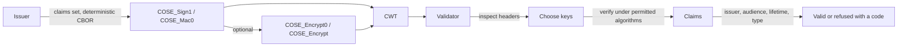

# COSE and CWT

> **Sign, authenticate and encrypt compact binary messages, and issue and validate CBOR Web Tokens, with the same
> algorithms, keys and fail-closed policy as the JOSE and JWT libraries.** A message from a peer is read strictly, its
> work is bounded, and its claims are readable only once its signature, authentication code or authentication tag has
> verified.

|                    |                                                                                                                                                                                                  |
| ------------------ | ------------------------------------------------------------------------------------------------------------------------------------------------------------------------------------------------ |
| **Status**         | Available: `COSE_Sign1`, `COSE_Sign`, `COSE_Mac0`, `COSE_Mac` and `COSE_Encrypt0` and `COSE_Encrypt` (RFC 9052 / 9053), public `COSE_Key`, and CWT issuance and validation (RFC 8392)            |
| **Packages**       | `NCode.Identity.Cose(.Abstractions)` and `NCode.Identity.Cwt(.Abstractions)` over `NCode.Identity.Jose`                                                                                          |
| **Key decisions**  | [ADR-1409](../decisions/1409-cose-messages-are-an-opt-in-package-family-over-system-formats-cbor-and-the-familys-keys-and-algorithms.md), [ADR-1410](../decisions/1410-a-cwt-is-validated-fail-closed-and-its-claims-are-read-only-after-its-cose-layer-verifies.md) |
| **Operator guide** | None: the packages are libraries a host composes with `AddCoseLibrary()` and `AddCwtLibrary()`                                                                                                  |

## The promises

|     | Promise                                                                                                                                                                                                     |
| --- | ----------------------------------------------------------------------------------------------------------------------------------------------------------------------------------------------------------- |
| 1   | No content is readable before its signature, authentication code or authentication tag verifies: inspecting a message returns its type and headers, and the content comes only from verification or decryption. |
| 2   | An algorithm is used only when the caller permits it and the message authenticates it in its protected header bucket; the permitted list is checked before any algorithm or key is looked up.                |
| 3   | A critical header the verifier does not understand refuses the message, and so does a header in both buckets, a Partial IV (which needs a Base IV the family does not support) or a nested recipient.                       |
| 4   | The work a message can demand is bounded: its size, its nesting, its signatures and its recipients are limits the host configures and the start validates, and indefinite-length and malformed CBOR is refused. |
| 5   | Every signature, authentication code, encryption and key wrap is the JOSE library's own implementation, so COSE and JOSE share one set of reviewed cryptography and one key model.                           |
| 6   | An authentication code is compared in fixed time, and a content key lives only in sensitive pooled memory.                                                                                                  |
| 7   | A `COSE_Key` is read and written as a public key only: private parameters are refused, and a symmetric key is never written.                                                                                |
| 8   | A CWT is accepted only from a named issuer, for a named audience, within its lifetime and clock skew, under named algorithms and keys; a token that is protected only by encryption is refused.             |

## Why this matters

COSE is JOSE's model on CBOR, and it carries the credentials of mobile documents (ISO mdoc and mDL), of EUDI wallets
and of constrained devices, where a JSON token is too large and a JSON parser too heavy. A CBOR Web Token is the same
claims as a JWT in that format. A verifier of these messages is at the same trust boundary as a verifier of JWTs, and
the same mistakes apply: trusting the algorithm a message names, reading claims before the signature is checked, and
parsing input of any size and depth.

## How it works, in one picture

1. The issuer writes the claims set in the deterministic encoding and protects it with a `COSE_Sign1` or `COSE_Mac0`
   message, which a `COSE_Encrypt0` or `COSE_Encrypt` message may enclose, with an optional CWT tag.
2. The validator removes the tag, inspects the message, and decrypts when the caller supplied decryption keys.
3. It verifies the authenticated message under the algorithms and keys the caller named.
4. Only then it reads the claims, and checks the token type, the issuer, the audience, the lifetime and the required
   claims.
5. A valid token returns its claims and the verified messages; a refused one returns a code and a fixed reason.

## Why this design

| Concern                  | This design                                                                         | Usual alternative                                              |
| ------------------------ | ----------------------------------------------------------------------------------- | -------------------------------------------------------------- |
| CBOR                     | The platform's `System.Formats.Cbor`, in strict mode with limits                     | A hand-written codec                                           |
| Signing and keys         | The JOSE algorithms and the family's secret keys, selected by registered data       | `System.Security.Cryptography.Cose`, which only signs          |
| Algorithms               | Registered descriptors bound to JOSE algorithms; weaker ones offered, not registered | A fixed list in a switch                                       |
| Cryptography             | One implementation shared with JOSE                                                  | COSE-specific copies that drift                                |
| CWT policy               | The caller's whole policy in the validation parameters, closed by default            | Lists where an empty list permits everything                   |

Options we rejected

See the Options considered of [ADR-1409](../decisions/1409-cose-messages-are-an-opt-in-package-family-over-system-formats-cbor-and-the-familys-keys-and-algorithms.md#options-considered)
and [ADR-1410](../decisions/1410-a-cwt-is-validated-fail-closed-and-its-claims-are-read-only-after-its-cose-layer-verifies.md#options-considered).

## Algorithms as data

A `CoseAlgorithm` descriptor carries the IANA identifier and name, the class (signature, message authentication code,
content encryption or key distribution), the code of the JOSE algorithm that implements it and, for a message
authentication code, its tag size. `AddCoseLibrary()` registers ES256, ES384, ES512, ESP256, ESP384, ESP512, ES256K,
EdDSA, Ed25519, Ed448, PS256, PS384, PS512, ML-DSA-44, ML-DSA-65, ML-DSA-87, HMAC 256/256, HMAC 384/384, HMAC 512/512,
A128GCM, A192GCM, A256GCM, direct, A128KW, A192KW, A256KW and RSAES-OAEP with SHA-256 and SHA-512. A descriptor whose
JOSE algorithm is not registered is left out, as EdDSA is without `AddEdDsa()` and ES256K without `AddSecp256k1()`.
HMAC 256/64, RSAES-OAEP with SHA-1 and RSASSA-PKCS1-v1_5 are offered as `CoseAlgorithms` and registered with
`AddCoseAlgorithm` by an application that needs them.

> [!TIP]
> [ADR-1409](../decisions/1409-cose-messages-are-an-opt-in-package-family-over-system-formats-cbor-and-the-familys-keys-and-algorithms.md)
> decision 4; `CoseAlgorithms` in `NCode.Identity.Cose.Abstractions` and `DefaultCoseAlgorithmCatalog` in
> `NCode.Identity.Cose`.

## Keys mapped onto JSON Web Keys

`ICoseKeyConverter` reads a `COSE_Key` or a `COSE_KeySet` into the family's secret keys and writes the public half of a
key. Key types (`OKP`, `EC2`, `RSA`, `AKP`) and curves are registered descriptors that name the JSON Web Key member each
COSE label maps onto, so a key is imported through the registered secret key types: Ed25519, Ed448, P-256, P-384,
P-521, secp256k1 and ML-DSA keys are read where the platform serves them. A key with private parameters, a symmetric
key or a Base IV is refused, and a key set skips a key of a type it cannot use. A `kid` is an opaque byte string: a
key's `KeyId` names it as UTF-8 text, or in CBOR diagnostic notation (`h'a1b2'`) when the bytes are not text, and keys
are matched by the bytes (`CoseKeyIdentifiers`).

> [!TIP]
> [ADR-1409](../decisions/1409-cose-messages-are-an-opt-in-package-family-over-system-formats-cbor-and-the-familys-keys-and-algorithms.md)
> decision 9; `CoseKeyTypeDescriptors`, `CoseKeyIdentifiers` and `ICoseKeyConverter` in `NCode.Identity.Cose.Abstractions`.

## Message processing

`ICoseSerializer` encodes and processes the six message types with external additional data, detached content and an
optional tag. A reader refuses a message in this order: its size, its shape, its headers (disjoint buckets, known
parameters, `crit`), its algorithm (protected, then permitted, then registered), and its keys, which are chosen from the
keys the caller supplies by `kid`, use, expiry and suitability. A `COSE_Sign` verifies when one permitted signature
verifies, and a recipient of a `COSE_Mac` or `COSE_Encrypt` message yields the content key directly, by key wrap or by
key transport.

> [!TIP]
> [ADR-1409](../decisions/1409-cose-messages-are-an-opt-in-package-family-over-system-formats-cbor-and-the-familys-keys-and-algorithms.md)
> decisions 2, 3 and 5 to 8; `DefaultCoseSerializer`, `CborGuard` and `CborMapWriter` in `NCode.Identity.Cose`.

## CWT validation

`ICwtValidator.ValidateAsync` takes `CwtValidationParameters`, whose permitted algorithms and issuers must be named. The
order is the parameters, the CWT tag, the encryption layer, the keys, the COSE verification, the token type and then the
claims, which are typed strictly: `iss` and `sub` are text, `aud` is text or an array of text, `exp`, `nbf` and `iat`
are integers or finite floating-point numbers, `cti` is a byte string and `cnf` a map. A token that carries `aud` is
refused unless the caller names its audiences. The lifetime rule is the JWT validator's.

> [!TIP]
> [ADR-1410](../decisions/1410-a-cwt-is-validated-fail-closed-and-its-claims-are-read-only-after-its-cose-layer-verifies.md)
> decisions 3 to 8; `DefaultCwtValidator` and `CwtClaimsReader` in `NCode.Identity.Cwt`.

## Limits and roadmap

- ECDH-ES and ECDH-SS recipients with HKDF are not implemented.
- AES-CCM and ChaCha20/Poly1305 content encryption are not implemented, so the encrypted CWT examples of RFC 8392 that
  use them are not covered.
- `x5chain`, `x5bag` and `x5t` headers (RFC 9360) are carried but not processed, so a key is not resolved from a
  certificate chain.
- Countersignatures (RFC 9338) are not implemented, and a countersignature label under `crit` refuses the message.
- CWT claims in COSE headers (RFC 9597) are carried but not processed, and Base IV and Partial IV are not supported.
- The OpenID provider issues and accepts no CWT of its own; the packages are libraries for issuers, wallets and
  verifiers.

## Further reading

- [ADR-1409](../decisions/1409-cose-messages-are-an-opt-in-package-family-over-system-formats-cbor-and-the-familys-keys-and-algorithms.md),
  [ADR-1410](../decisions/1410-a-cwt-is-validated-fail-closed-and-its-claims-are-read-only-after-its-cose-layer-verifies.md)
- [RFC 9052](https://datatracker.ietf.org/doc/html/rfc9052), [RFC 9053](https://datatracker.ietf.org/doc/html/rfc9053),
  [RFC 8392](https://datatracker.ietf.org/doc/html/rfc8392)
- `src/NCode.Identity.Cose`, `src/NCode.Identity.Cwt`, `tests/NCode.Identity.Cose.Tests`,
  `tests/NCode.Identity.Cwt.Tests`
