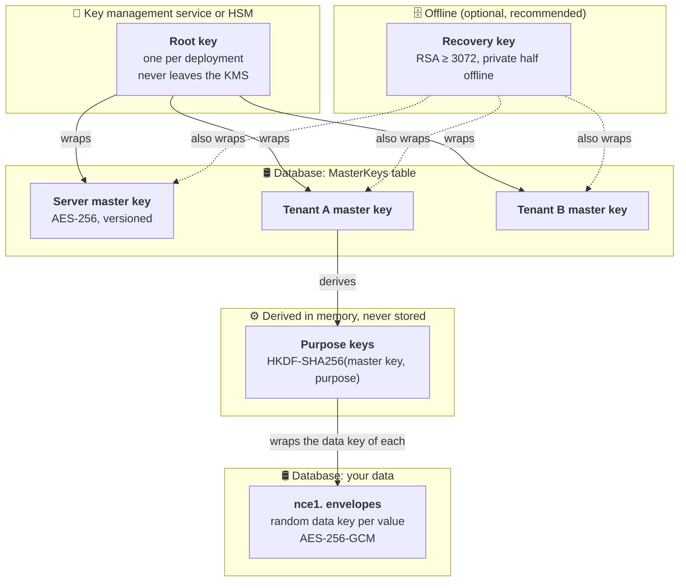
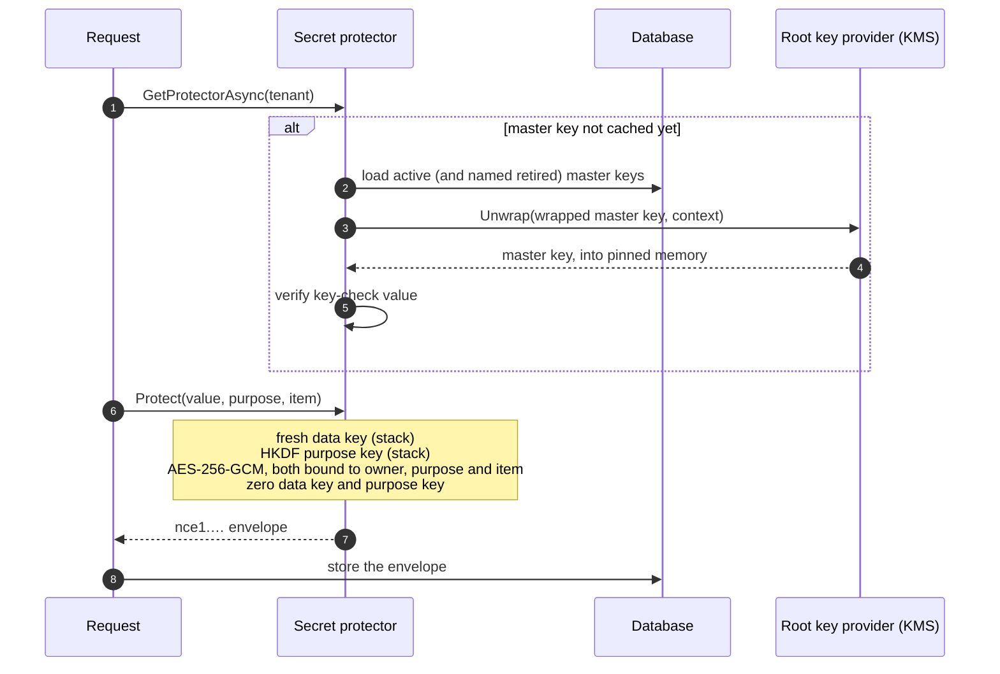

# Encryption at Rest

> **Every secret NCode.Identity stores is encrypted under a key that never lives in its database.** Steal the database,
> a backup or a snapshot and you get ciphertext. Delete a tenant and its data is gone for good, even from the rows you
> forgot about. Inside the running server, secret plaintext stays in pinned memory and is wiped as soon as the server
> stops using it.

|                      |                                                                                                                                                                                                                                                                                                                          |
| -------------------- | ------------------------------------------------------------------------------------------------------------------------------------------------------------------------------------------------------------------------------------------------------------------------------------------------------------------------ |
| **Status**           | Available. Grant payloads, private keys, client secrets and the Data Protection key ring are all covered.                                                                                                                                                                                                                |
| **Packages**         | `NCode.Identity.Secrets.Persistence(.Abstractions)`, plus one opt-in package per cloud: `.AwsKms`, `.AzureKeyVault`, `.GoogleCloudKms`                                                                                                                                                                                   |
| **Key decisions**    | [ADR-0235](../adr/0235-stored-secrets-are-protected-by-a-key-hierarchy-under-an-external-root-key.md) key hierarchy · [ADR-0260](../adr/0260-azure-key-vault-and-google-cloud-kms-are-root-key-providers.md) cloud root keys · [ADR-0265](../adr/0265-grant-payloads-are-protected-under-the-tenant-master-key.md) grant payloads · [ADR-0116](../adr/0116-memory-allocations-and-buffer-operations.md) secure buffers |
| **Operator guide**   | [Helm chart: Secret protection](../../charts/ncode-identity-host/README.md#secret-protection)                                                                                                                                                                                                                            |

## Contents

- [The promises](#the-promises)
- [Why this matters](#why-this-matters)
- [How it works, in one picture](#how-it-works-in-one-picture)
- [What is protected](#what-is-protected)
- [Why this design](#why-this-design)
- [Inside the database: the envelope](#inside-the-database-the-envelope)
- [Inside the process: secure memory](#inside-the-process-secure-memory)
- [The root of trust: root keys and KMS](#the-root-of-trust-root-keys-and-kms)
- [Recovery](#recovery)
- [Safe by default](#safe-by-default)
- [Protect your own data with it](#protect-your-own-data-with-it)
- [Limits and roadmap](#limits-and-roadmap)
- [Further reading](#further-reading)

## The promises

| #   | Promise                                                                                                                                            |
| --- | -------------------------------------------------------------------------------------------------------------------------------------------------- |
| 1   | **A database dump or backup reveals no secret.** You can't decrypt it without the root key, and the root key lives in a KMS or HSM, never in the database. |
| 2   | **Tenants are isolated by cryptography as well as by queries.** Each tenant has its own master key.                                               |
| 3   | **Deleting a tenant crypto-shreds it.** Its master keys are deleted, so every value they protected becomes unreadable, wherever a copy survives in the live database. |
| 4   | **A protected value is bound to where it belongs.** If a value is copied to another row, tenant or purpose, it fails to decrypt.                        |
| 5   | **The KMS is off the hot path.** The KMS is called only to unwrap a master key, roughly once per owner per process, never once per token or request. |
| 6   | **Secret plaintext never sits on the garbage-collected heap.** It lives in pinned or stack memory and is zeroed when released. A secret is never a `string`. |
| 7   | **Production refuses an unsafe setup.** It won't start with a throwaway key, a key in a config file, or no decision about recovery.                   |

## Why this matters

An identity server keeps the most valuable secrets in a system: the private keys that sign every token, the client
secrets that let applications in, and refresh tokens and sessions that are live credentials. Most leaks of that data
don't happen through the running application. They happen through copies of the data:

- a database **backup** left in a bucket, or kept by a backup vendor,
- a **snapshot** or replica taken for analytics, staging or debugging,
- a **logical dump** (`pg_dump`) run by someone with read access,
- an operator or a compromised tool with **SQL access** to production.

Disk encryption and Transparent Data Encryption don't help here: they protect the disk, and every query and every dump
still sees plaintext. NCode.Identity encrypts at the **application layer**, under a key the database never holds, so
the data stays protected wherever a copy of it goes.

> [!NOTE]
> Keep disk encryption and TDE turned on. They protect against a stolen disk, and they work well alongside this
> layer. They just don't stop someone who can run a query.

## How it works, in one picture

NCode.Identity uses **envelope encryption** with four levels of keys. Each level protects the level below it, and only
the top level needs the KMS.



1. The **root key** wraps master keys. It sits in AWS KMS, Azure Key Vault, Google Cloud KMS or a mounted key file,
   and the server only ever asks it to *wrap* or *unwrap* a key.
2. Each **owner** (the server, and every tenant) has its own 256-bit **master key**. It is stored in the database,
   wrapped by the root key, and optionally wrapped a second time by an offline recovery key.
3. **Purpose keys** are derived from a master key for each kind of data (`persisted-secret`, `grant-payload`,
   `data-protection-key-ring`, …). They are derived on demand and never stored.
4. Every stored value gets a fresh random **data key** and is encrypted with AES-256-GCM. The data key is wrapped by
   the purpose key, and the result is written as a self-describing `nce1.` envelope.

## What is protected

| Data                                                                                    | Owner                | At rest                                                                                                    |
| --------------------------------------------------------------------------------------- | -------------------- | ---------------------------------------------------------------------------------------------------------- |
| Server and tenant **private signing and encryption keys**                               | Server / tenant      | `nce1.` envelope                                                                                           |
| **Client secrets** and resource-server keys                                             | Tenant               | `nce1.` envelope                                                                                           |
| **Grant payloads**: authorization codes, refresh tokens, sessions, device, CIBA and PAR requests, DCR tokens | Tenant               | `nce1.` envelope ([ADR-0265](../adr/0265-grant-payloads-are-protected-under-the-tenant-master-key.md))     |
| ASP.NET Core **Data Protection key ring** (sign-in cookies, anti-forgery tokens)        | Server               | Each key in an `nce1.` envelope                                                                            |
| Your own application's sensitive data                                                   | Server / tenant      | `nce1.` envelope ([see below](#protect-your-own-data-with-it))                                             |
| **Public keys** (`spki`, `x509`)                                                        | n/a                  | Clear text, by design: they are public                                                                     |
| Local-account **passwords**                                                             | n/a                  | Never encrypted: hashed one way with PBKDF2-HMAC-SHA256, so nothing can recover them                       |

The rule is enforced in code: a stored secret whose encoding is not public must be an envelope.

## Why this design

There are several common ways to protect secrets at rest. Here is how they compare against the threats above.

|                                                       | Plaintext columns | Disk / TDE only | One app-wide key<br/>(e.g. a certificate-wrapped key ring) | Secrets manager as the store | KMS call per operation | **NCode.Identity** |
| ----------------------------------------------------- | :---------------: | :-------------: | :--------------------------------------------------------: | :--------------------------: | :--------------------: | :----------------: |
| Dump or backup reveals nothing                        |         ❌         |   ❌ (dumps)     |                             ✅                              |              ✅               |           ✅            |         ✅          |
| SQL access reveals nothing                            |         ❌         |        ❌        |                             ✅                              |              ✅               |           ✅            |         ✅          |
| Tenants isolated by key                               |         ❌         |        ❌        |                             ❌                              |              ◐               |           ◐            |         ✅          |
| Delete a tenant = data unreadable                     |         ❌         |        ❌        |                             ❌                              |              ◐               |           ◐            |         ✅          |
| A value moved to another row fails                    |         ❌         |        ❌        |                             ❌                              |              ❌               |           ◐            |         ✅          |
| Root key never leaves the KMS                         |        n/a        |        ◐        |                             ❌                              |              ✅               |           ✅            |         ✅          |
| No network round trip per request                     |         ✅         |        ✅        |                             ✅                              |              ❌               |           ❌            |         ✅          |
| No extra vendor, store or per-secret bill             |         ✅         |        ✅        |                             ✅                              |              ❌               |           ◐            |         ✅          |

✅ yes · ◐ depends on setup · ❌ no

The design follows the same envelope hierarchy as Auth0's *Customer Managed Keys* (root key → tenant master key →
namespace key → data key), so it should feel familiar. It also improves on it in a few places:

- **No stored per-purpose keys.** Purpose keys are derived with HKDF, so there is less state to store, back up and
  rotate.
- **The payload isn't bound to a master key.** Rotating a master key only rewraps 32-byte data keys and never
  re-encrypts payloads.
- **Open provider model.** Any KMS can be a root key provider by registering an `IRootKeyProvider`
  ([ADR-0150](../adr/0150-vocabularies-are-open-unless-provably-closed.md)).
- **Keyless cloud credentials.** Every cloud provider authenticates with workload identity federation, so no cloud
  credential is stored in the cluster.

<details>
<summary><b>Alternatives we rejected, and why</b></summary>

- **Keep the certificate-wrapped Data Protection ring.** It gives one key to every tenant, that key is long-lived and
  rotated by hand, renewing it in place breaks it silently, and it offers no tenant isolation or deletion. It was
  superseded ([ADR-0177](../adr/0177-the-data-protection-key-ring-is-encrypted-at-rest-in-production.md)).
- **A secrets manager (Infisical, Doppler, cloud secret managers) as the store.** It duplicates the store the server
  already has, bills per secret or per identity, and from outside the vendor's cloud it usually needs a stored
  credential. Their KMS offerings can still be root key providers.
- **Sign and decrypt everything inside the KMS.** This is the strongest option against a compromised replica, but it
  adds latency and a fee to every token. It is planned as an opt-in for signing keys
  ([#165](https://github.com/NCodeGroup/Identity/issues/165)).
- **A server key above the tenant keys.** It adds no protection, because every replica holds every tenant's keys
  anyway, and it would block per-tenant root keys (bring your own key) later.

Full reasoning: [ADR-0235 § Options considered](../adr/0235-stored-secrets-are-protected-by-a-key-hierarchy-under-an-external-root-key.md#options-considered).

</details>

## Inside the database: the envelope

Every protected value is a single text column holding an `nce1.` envelope: a version prefix followed by base64url
bytes. The envelope carries everything needed to decrypt it except the keys.

```text
nce1.<base64url( key id | wrap nonce | wrapped data key | wrap tag | payload nonce | payload tag | ciphertext )>
```

| Field              | Size     | Purpose                                                                                             |
| ------------------ | -------- | --------------------------------------------------------------------------------------------------- |
| Master key id      | 16 bytes | Says which master key (and so which version) wrapped the data key, so retired keys still decrypt.   |
| Wrap nonce + tag   | 12 + 16  | AES-256-GCM over the data key, under the purpose key.                                               |
| Wrapped data key   | 32 bytes | A fresh random key for this one value.                                                              |
| Payload nonce + tag| 12 + 16  | AES-256-GCM over the value, under the data key.                                                     |
| Ciphertext         | variable | The encrypted value.                                                                                |

**Binding.** Both AES-GCM operations authenticate **associated data**: a versioned label, the owner type and id, the
purpose and the item id (for example the secret's id, or the grant's hashed lookup key). If a value is copied to
another row, another tenant or another purpose, decryption fails, so an attacker with write access can't swap a
victim's secret into their own row. The data-key wrap also binds the master key id. The payload deliberately doesn't,
which is why rotating a master key never touches payloads.

**Master keys** live in a `MasterKeys` table. Each row holds the key wrapped by the root key, which provider wrapped
it, an optional recovery-wrapped copy, and an HMAC-SHA256 **key-check value** that proves the unwrapped key is the
right one for its owner and version. A partial unique index guarantees **exactly one active master key per owner**.

**Failing closed.** If a grant's payload doesn't decrypt (it was altered, it comes from a foreign row, or its master
key was lost), the server treats the grant as **absent** and logs `GrantPayloadUnreadable`. An unreadable row never
authorizes anything, and never turns into a 500
([ADR-0265](../adr/0265-grant-payloads-are-protected-under-the-tenant-master-key.md)).

> [!TIP]
> Envelope layout and binding are specified in
> [`SecretProtectionFormat`](../../src/NCode.Identity.Secrets.Persistence/Protection/SecretProtectionFormat.cs), and
> the encryption itself is in
> [`DefaultSecretProtector`](../../src/NCode.Identity.Secrets.Persistence/Protection/DefaultSecretProtector.cs).

## Inside the process: secure memory

Encryption at rest is only as strong as the way the process handles plaintext. In .NET, the naive approach (a
`byte[]` or a `string`) leaks: the garbage collector **moves** objects during compaction and leaves stale copies
behind, a `string` is immutable and can't be wiped, and nothing is cleared before memory is reused, swapped or written
to a crash dump. NCode.Identity treats secret memory as a resource with an explicit lifetime
([ADR-0116](../adr/0116-memory-allocations-and-buffer-operations.md)):

| What                                   | Where it lives                                                                                      | When it is wiped                                                       |
| -------------------------------------- | --------------------------------------------------------------------------------------------------- | ---------------------------------------------------------------------- |
| **Data keys and purpose keys**         | `stackalloc` buffers wrapped in a secure lifetime, never on the heap                                | When the protect or unprotect call returns, even on an exception        |
| **Unwrapped master keys**              | A **pinned** array from the secure memory pool, cached per owner                                    | When the key ring is disposed                                           |
| **Secret plaintext** (keys, secrets, grant payloads) | Caller-supplied writers backed by **sensitive pooled buffers**: pinned, so the GC never copies them | When the buffer returns to the pool (`CryptographicOperations.ZeroMemory`) |
| **Secret text**                        | Never a `string`. It is encoded once, at the boundary, with strict UTF-8 that throws on invalid bytes rather than substituting characters. | Same as above                                                           |
| **KMS SDK buffers**                    | Plaintext an SDK returns is copied into secure memory immediately. Azure's input array is pinned.   | Immediately after the copy or the call                                 |

A few rules make this hold everywhere:

- **Sensitivity is an explicit parameter.** Every buffer is rented with `isSensitive: true` or `false`. Secret data
  always comes from the pinned, zero-on-return `SecureMemoryPool`.
- **Producers write, callers own.** APIs write into a caller's `IBufferWriter<T>` instead of returning a fresh
  `byte[]`, so a secret never ends up in an allocation nobody will wipe.
- **Constant-time comparisons.** Client secrets, MACs and password hashes are compared with
  `CryptographicOperations.FixedTimeEquals`.
- **No strings, except at the edge.** A `string` is created only for a value that isn't secret (an envelope, a wrapped
  key, a KMS context) and only where storage or the wire requires one.

**Caching without staleness.** Unwrapped master keys stay cached for the life of the process, so the KMS stays off
the hot path. Changing or deleting a tenant evicts its keys on **every replica** through the tenant-change broadcast.
A replica that may have missed a broadcast evicts every owner's keys. A load that an eviction overtakes is not cached.

**Lazy, authorized acquisition.** Getting a protector is the only step that may reach the KMS, and it happens only
after a request is authorized and validated. A request naming an unknown owner can't make the server create master
keys or call the KMS.

> [!IMPORTANT]
> Secure memory narrows the window in which a secret can be found in a heap dump, swap or core file. It can't stop an
> attacker who controls the running process. For that threat, see [Limits and roadmap](#limits-and-roadmap).

## The root of trust: root keys and KMS

The root key provider is chosen with one setting, `SecretProtection:RootKeyProvider`. Providers are an open
vocabulary: the family ships five, and any package can register its own.

| Provider           | Where the root key lives                                     | Binding                                               | Credentials                         | Use for                                     |
| ------------------ | ------------------------------------------------------------ | ----------------------------------------------------- | ----------------------------------- | ------------------------------------------- |
| `ephemeral`        | Process memory, new on every start                           | AES-GCM associated data                               | n/a                                 | Development and tests. **Refused in Production.** |
| `local`            | An AES-256 key file mounted from a Kubernetes Secret         | AES-GCM associated data                               | Whoever can read the Secret         | Homelab and small self-hosted setups        |
| `aws-kms`          | AWS KMS symmetric key, which never leaves AWS                | KMS encryption context (logged in CloudTrail)         | Web identity federation, keyless    | Production on AWS, or anywhere              |
| `google-cloud-kms` | Google Cloud KMS symmetric key                               | Additional authenticated data, plus CRC32C on every call | Workload identity federation, keyless | Production on Google Cloud, or anywhere   |
| `azure-key-vault`  | Azure Key Vault or Managed HSM RSA key (≥ 3072 bits)         | Key-check value (Key Vault's RSA-OAEP takes no context) | Workload identity, keyless          | Production on Azure                         |



**Cloud details that matter.** Each wrap response is checked to come from the configured key. Google Cloud KMS calls
carry CRC32C checksums end to end, so a corrupted buffer can never be stored as a master key. Key versions are
recorded with each master key, so rotating the key in the KMS needs no configuration change, and older master keys
keep unwrapping under their own version.

> [!TIP]
> Setting each provider up (key policies, workload identity, chart values) is covered in the
> [Helm chart README](../../charts/ncode-identity-host/README.md#secret-protection). The design is in
> [ADR-0235](../adr/0235-stored-secrets-are-protected-by-a-key-hierarchy-under-an-external-root-key.md) and
> [ADR-0260](../adr/0260-azure-key-vault-and-google-cloud-kms-are-root-key-providers.md).

## Recovery

A root key you can't reach means secrets you can't read, so recovery is a decision NCode.Identity makes you take:

- **Recovery key.** Configure an RSA public key (at least 3072 bits) and every master key is also wrapped under it.
  The **private** half never touches the deployment. Keep it offline, for example split among three people with a
  Shamir tool. The server refuses a PEM that contains a private key.
- **Or opt out explicitly.** `SecretProtection:Recovery:Disabled=true` records that losing the root key loses every
  stored secret. In Production, the server won't start until you've chosen one or the other.
- **Data Protection key ring gate.** If the server's master key can't decrypt a live key in the Data Protection key
  ring (for example after a partial restore), the host **stops** instead of silently signing everyone out. The error
  names each affected key, and one setting revokes them
  ([ADR-0247](../adr/0247-a-data-protection-key-the-server-cannot-decrypt-stops-the-host.md)).

## Safe by default

| Environment     | Behavior                                                                                                                                                                                       |
| --------------- | ---------------------------------------------------------------------------------------------------------------------------------------------------------------------------------------------- |
| **Production**  | Refuses to start with the `ephemeral` provider, with a root key written inline in configuration (even if unused), or with no recovery decision. It reports every finding together.              |
| **Helm chart**  | Refuses to render a malformed KMS key ARN, key name or key id, and mounts cloud credentials only for the selected provider ([ADR-0179](../adr/0179-the-host-chart-references-its-secrets-and-refuses-a-release-the-host-would-refuse.md)). |
| **Development** | No root key is ever committed. The LocalDev AppHost generates one per machine, outside the repository. If the root key changes, development pruning heals affected tenants automatically.       |

## Protect your own data with it

The same protection is public API. An application or sibling package protects its own sensitive values through
`ISecretProtectorProvider` and `ISecretProtector`, using a namespaced purpose (`<vendor>/<name>`), and inherits the
root key, tenant isolation, crypto-shredding and row binding at no extra cost.

```csharp
// Acquire once per owner. Pass the envelopes you're about to read, so retired master keys they name get loaded.
var protector = await protectorProvider.GetProtectorAsync(
    SecretOwner.ForTenant(tenantId), protectedValues: [], cancellationToken);

// Bind the value to a purpose and to the row it belongs to.
var context = new SecretProtectionContext("contoso/webhook-secret", webhookId);

protector.Protect(plaintext, context, ref envelopeWriter);   // writes "nce1.…" chars
protector.Unprotect(envelope, context, ref plaintextWriter); // writes into your sensitive buffer
```

The envelope layout, master keys, key derivation and root wrappers stay internal, so they can change (master key
rotation, for example) without breaking you.

## Limits and roadmap

We'd rather say what this doesn't do yet:

- **A compromised running replica** can use the keys it has loaded. Remote signing inside the KMS
  ([#165](https://github.com/NCodeGroup/Identity/issues/165)) and key rollover
  ([#166](https://github.com/NCodeGroup/Identity/issues/166)) narrow that.
- **Backups outlive crypto-shredding.** A backup that still holds a deleted tenant's wrapped master key stays readable
  with the root key until the backup expires.
- **Azure Key Vault doesn't bind or log the owner context.** Only the key-check value catches a master key presented
  for the wrong owner, and that RSA root isn't quantum-resistant (post-quantum recovery wrap:
  [#178](https://github.com/NCodeGroup/Identity/issues/178)).

| Coming next                                       | Issue                                                     |
| ------------------------------------------------- | --------------------------------------------------------- |
| Master key rotation, rekey and status             | [#171](https://github.com/NCodeGroup/Identity/issues/171) |
| Rewrap and recovery tool                          | [#172](https://github.com/NCodeGroup/Identity/issues/172) |
| More root key providers (OpenBao/Vault Transit, PKCS#11, Infisical) | [#173](https://github.com/NCodeGroup/Identity/issues/173) |
| Per-tenant root keys (bring your own key)         | [#174](https://github.com/NCodeGroup/Identity/issues/174) |
| Hash client secrets that only need verifying      | [#163](https://github.com/NCodeGroup/Identity/issues/163) |

## Further reading

**Decisions**

- [ADR-0235](../adr/0235-stored-secrets-are-protected-by-a-key-hierarchy-under-an-external-root-key.md): stored secrets are protected by a key hierarchy under an external root key
- [ADR-0260](../adr/0260-azure-key-vault-and-google-cloud-kms-are-root-key-providers.md): Azure Key Vault and Google Cloud KMS are root key providers
- [ADR-0265](../adr/0265-grant-payloads-are-protected-under-the-tenant-master-key.md): grant payloads are protected under the tenant master key
- [ADR-0247](../adr/0247-a-data-protection-key-the-server-cannot-decrypt-stops-the-host.md): a Data Protection key the server can't decrypt stops the host
- [ADR-0116](../adr/0116-memory-allocations-and-buffer-operations.md): spans, pooled writers and secure lifetimes
- [ADR-0050](../adr/0050-secret-material-revealed-once-on-create.md): secret material is revealed once, on create

**Code**

- [`SecretProtectionFormat`](../../src/NCode.Identity.Secrets.Persistence/Protection/SecretProtectionFormat.cs): envelope, binding and key derivation
- [`DefaultSecretProtector`](../../src/NCode.Identity.Secrets.Persistence/Protection/DefaultSecretProtector.cs): protect and unprotect
- [`DefaultMasterKeyRing`](../../src/NCode.Identity.Secrets.Persistence/Protection/DefaultMasterKeyRing.cs): master key loading and caching
- [`IRootKeyProvider`](../../src/NCode.Identity.Secrets.Persistence.Abstractions/Protection/IRootKeyProvider.cs): the root key provider contract
- [`ProductionSafetyRegistration`](../../src/NCode.Identity.Server/ProductionSafety/ProductionSafetyRegistration.cs): the Production refusals
