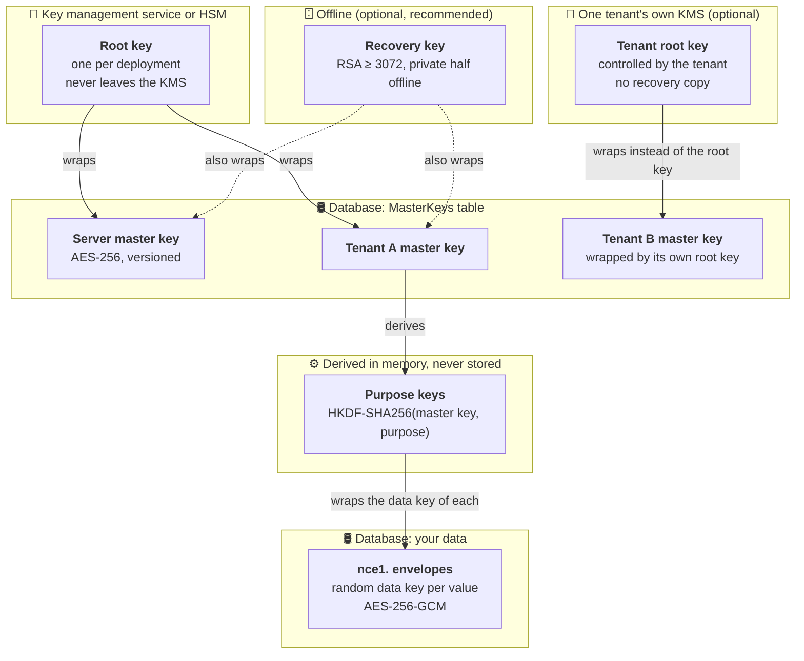
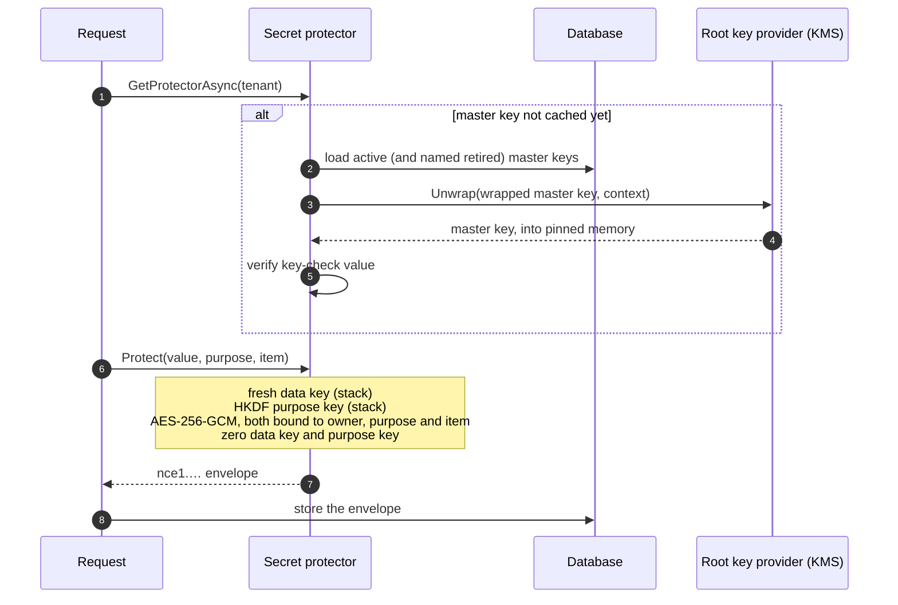
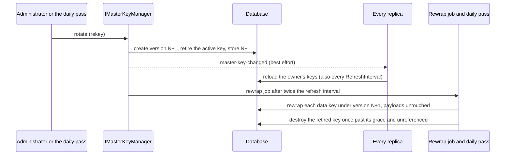

# Encryption at Rest

> **Every secret NCode.Identity stores is encrypted under a key that never lives in its database.** Steal the database,
> a backup or a snapshot and you get ciphertext. Delete a tenant and its data is gone for good, even from the rows you
> forgot about. Inside the running server, secret plaintext stays in pinned memory and is wiped as soon as the server
> stops using it.

|                    |                                                                                                                                                                                                                                                                                                                                                                                                                                                                                                                                                                                                                                                                                                                                                                    |
| ------------------ | ------------------------------------------------------------------------------------------------------------------------------------------------------------------------------------------------------------------------------------------------------------------------------------------------------------------------------------------------------------------------------------------------------------------------------------------------------------------------------------------------------------------------------------------------------------------------------------------------------------------------------------------------------------------------------------------------------------------------------------------------------------------ |
| **Status**         | Available. Grant payloads, private keys, client secrets and the Data Protection key ring are all covered, master keys rotate, rekey and are destroyed once nothing names them, and a tenant can wrap its master keys under a root key it controls.                                                                                                                                                                                                                                                                                                                                                                                                                                                                                                                                                                                 |
| **Packages**       | `NCode.Identity.Secrets.Persistence(.Abstractions)`, plus one opt-in package per cloud: `.AwsKms`, `.AzureKeyVault`, `.GoogleCloudKms`                                                                                                                                                                                                                                                                                                                                                                                                                                                                                                                                                                                                                             |
| **Key decisions**  | [ADR-1235](../decisions/1235-stored-secrets-are-protected-by-a-key-hierarchy-under-an-external-root-key.md) key hierarchy · [ADR-1260](../decisions/1260-azure-key-vault-and-google-cloud-kms-are-root-key-providers.md) cloud root keys · [ADR-1265](../decisions/1265-grant-payloads-are-protected-under-the-tenant-master-key.md) grant payloads · [ADR-1116](../decisions/1116-memory-allocations-and-buffer-operations.md) secure buffers · [ADR-1407](../decisions/1407-a-master-key-rotates-its-data-keys-are-rewrapped-in-the-background-and-it-is-destroyed-once-nothing-names-it.md) master key lifecycle · [ADR-1408](../decisions/1408-an-offline-host-command-rewraps-every-master-key-under-the-configured-root-and-recovery-keys.md) offline rewrap · [ADR-1414](../decisions/1414-a-tenant-can-wrap-its-master-keys-under-a-root-key-it-controls.md) tenant root keys · [ADR-1415](../decisions/1415-a-key-wrapper-can-wrap-under-a-key-the-caller-names.md) wrapping under a named key |
| **Operator guide** | [Helm chart: Secret protection](../../charts/ncode-identity-host/README.md#secret-protection)                                                                                                                                                                                                                                                                                                                                                                                                                                                                                                                                                                                                                                                                      |

## Contents

- [The promises](#the-promises)
- [Why this matters](#why-this-matters)
- [How it works, in one picture](#how-it-works-in-one-picture)
- [What is protected](#what-is-protected)
- [Why this design](#why-this-design)
- [Inside the database: the envelope](#inside-the-database-the-envelope)
- [Inside the process: secure memory](#inside-the-process-secure-memory)
- [The root of trust: root keys and KMS](#the-root-of-trust-root-keys-and-kms)
- [Tenant root keys (bring your own key)](#tenant-root-keys-bring-your-own-key)
- [Rotation, rekey and destroy](#rotation-rekey-and-destroy)
- [Recovery](#recovery)
- [Safe by default](#safe-by-default)
- [Protect your own data with it](#protect-your-own-data-with-it)
- [Limits and roadmap](#limits-and-roadmap)
- [Further reading](#further-reading)

## The promises

| #   | Promise                                                                                                                                            |
| --- | -------------------------------------------------------------------------------------------------------------------------------------------------- |
| 1   | **A database dump or backup reveals no secret.** You can't decrypt it without the root key, and the root key lives in a KMS or HSM, never in the database. |
| 2   | **Tenants are isolated by cryptography as well as by queries.** Each tenant has its own master key.                                               |
| 3   | **Deleting a tenant crypto-shreds it.** Its master keys are deleted, so every value they protected becomes unreadable, wherever a copy survives in the live database. |
| 4   | **A protected value is bound to where it belongs.** If a value is copied to another row, tenant or purpose, it fails to decrypt.                        |
| 5   | **The KMS is off the hot path.** The KMS is called only to unwrap a master key, roughly once per owner per process, never once per token or request. |
| 6   | **Secret plaintext never sits on the garbage-collected heap.** It lives in pinned or stack memory and is zeroed when released. A secret is never a `string`. |
| 7   | **Production refuses an unsafe setup.** It won't start with a throwaway key, a key in a config file, or no decision about recovery.                   |
| 8   | **A master key rotates every year, and a retired one is destroyed once nothing names it.** Rotation rewraps 32-byte data keys and never touches a payload. |
| 9   | **A tenant can hold the key to its own data.** Its master keys are wrapped only by a key in its own KMS, with no operator recovery copy, and revoking or destroying that key makes its data unreadable everywhere within an hour by default. |

## Why this matters

An identity server keeps the most valuable secrets in a system: the private keys that sign every token, the client
secrets that let applications in, and refresh tokens and sessions that are live credentials. Most leaks of that data
don't happen through the running application. They happen through copies of the data:

- a database **backup** left in a bucket, or kept by a backup vendor,
- a **snapshot** or replica taken for analytics, staging or debugging,
- a **logical dump** (`pg_dump`) run by someone with read access,
- an operator or a compromised tool with **SQL access** to production.

Disk encryption and Transparent Data Encryption don't help here: they protect the disk, and every query and every dump
still sees plaintext. NCode.Identity encrypts at the **application layer**, under a key the database never holds, so
the data stays protected wherever a copy of it goes.

> [!NOTE]
> Keep disk encryption and TDE turned on. They protect against a stolen disk, and they work well alongside this
> layer. They just don't stop someone who can run a query.

## How it works, in one picture

NCode.Identity uses **envelope encryption** with four levels of keys. Each level protects the level below it, and only
the top level needs the KMS.



1. The **root key** wraps master keys. It sits in AWS KMS, Azure Key Vault, Google Cloud KMS or a mounted key file,
   and the server only ever asks it to *wrap* or *unwrap* a key.
2. Each **owner** (the server, and every tenant) has its own 256-bit **master key**. It is stored in the database,
   wrapped by the root key, and optionally wrapped a second time by an offline recovery key. A tenant can bring a root
   key of its own that wraps its master key in place of the deployment's root key, with no recovery copy
   ([Tenant root keys](#tenant-root-keys-bring-your-own-key)).
3. **Purpose keys** are derived from a master key for each kind of data (`persisted-secret`, `grant-payload`,
   `data-protection-key-ring`, …). They are derived on demand and never stored.
4. Every stored value gets a fresh random **data key** and is encrypted with AES-256-GCM. The data key is wrapped by
   the purpose key, and the result is written as a self-describing `nce1.` envelope.

## What is protected

| Data                                                                                    | Owner                | At rest                                                                                                    |
| --------------------------------------------------------------------------------------- | -------------------- | ---------------------------------------------------------------------------------------------------------- |
| Server and tenant **private signing and encryption keys**                               | Server / tenant      | `nce1.` envelope                                                                                           |
| **Client secrets** of a client that only compares its secret (`client_secret_basic`, `client_secret_post`) | Tenant | A one-way verifier in an `nce1.` envelope: the server cannot read the secret back. A supplied secret's PBKDF2 verifier can still be searched by whoever holds the root key and the database, so choose a long random one ([ADR-1391](../decisions/1391-a-client-secret-that-is-only-compared-is-stored-as-a-one-way-verifier.md)) |
| **Client secrets** of a client that uses its secret as a key (`client_secret_jwt`), and resource-server keys | Tenant | `nce1.` envelope |
| **Grant payloads**: authorization codes, refresh tokens, sessions, device, CIBA and PAR requests, DCR tokens | Tenant               | `nce1.` envelope ([ADR-1265](../decisions/1265-grant-payloads-are-protected-under-the-tenant-master-key.md))     |
| ASP.NET Core **Data Protection key ring** (sign-in cookies, anti-forgery tokens)        | Server               | Each key in an `nce1.` envelope                                                                            |
| Your own application's sensitive data                                                   | Server / tenant      | `nce1.` envelope ([see below](#protect-your-own-data-with-it))                                             |
| **Public keys** (`spki`, `x509`)                                                        | n/a                  | Clear text, by design: they are public                                                                     |
| Local-account **passwords**                                                             | n/a                  | Never encrypted: hashed one way with PBKDF2-HMAC-SHA256, so nothing can recover them                       |

The rule is enforced in code: a stored secret whose encoding is not public must be an envelope.

## Why this design

There are several common ways to protect secrets at rest. Here is how they compare against the threats above.

|                                                       | Plaintext columns | Disk / TDE only | One app-wide key<br/>(e.g. a certificate-wrapped key ring) | Secrets manager as the store | KMS call per operation | **NCode.Identity** |
| ----------------------------------------------------- | :---------------: | :-------------: | :--------------------------------------------------------: | :--------------------------: | :--------------------: | :----------------: |
| Dump or backup reveals nothing                        |         ❌         |   ❌ (dumps)     |                             ✅                              |              ✅               |           ✅            |         ✅          |
| SQL access reveals nothing                            |         ❌         |        ❌        |                             ✅                              |              ✅               |           ✅            |         ✅          |
| Tenants isolated by key                               |         ❌         |        ❌        |                             ❌                              |              ◐               |           ◐            |         ✅          |
| Delete a tenant = data unreadable                     |         ❌         |        ❌        |                             ❌                              |              ◐               |           ◐            |         ✅          |
| A value moved to another row fails                    |         ❌         |        ❌        |                             ❌                              |              ❌               |           ◐            |         ✅          |
| Root key never leaves the KMS                         |        n/a        |        ◐        |                             ❌                              |              ✅               |           ✅            |         ✅          |
| No network round trip per request                     |         ✅         |        ✅        |                             ✅                              |              ❌               |           ❌            |         ✅          |
| No extra vendor, store or per-secret bill             |         ✅         |        ✅        |                             ✅                              |              ❌               |           ◐            |         ✅          |

✅ yes · ◐ depends on setup · ❌ no

The design follows the same envelope hierarchy as Auth0's *Customer Managed Keys* (root key → tenant master key →
namespace key → data key), so it should feel familiar. It also improves on it in a few places:

- **No stored per-purpose keys.** Purpose keys are derived with HKDF, so there is less state to store, back up and
  rotate.
- **The payload isn't bound to a master key.** Rotating a master key only rewraps 32-byte data keys and never
  re-encrypts payloads.
- **Open provider model.** Any KMS can be a root key provider by registering an `IKeyWrapper`
  ([ADR-1150](../decisions/1150-vocabularies-are-open-unless-provably-closed.md), [ADR-1279](../decisions/1279-key-wrapping-is-a-secrets-abstraction-shared-by-the-root-and-recovery-wrappers.md)).
- **Keyless cloud credentials.** Every cloud provider authenticates with workload identity federation, so no cloud
  credential is stored in the cluster.

<details>
<summary><b>Alternatives we rejected, and why</b></summary>

- **Keep the certificate-wrapped Data Protection ring.** It gives one key to every tenant, that key is long-lived and
  rotated by hand, renewing it in place breaks it silently, and it offers no tenant isolation or deletion. It was
  superseded ([ADR-1177](../decisions/1177-the-data-protection-key-ring-is-encrypted-at-rest-in-production.md)).
- **A secrets manager (Infisical, Doppler, cloud secret managers) as the store.** It duplicates the store the server
  already has, bills per secret or per identity, and from outside the vendor's cloud it usually needs a stored
  credential. Their KMS offerings can still be root key providers.
- **Sign and decrypt everything inside the KMS.** This is the strongest option against a compromised replica, but it
  adds latency and a fee to every token. It is planned as an opt-in for signing keys
  ([#165](https://github.com/NCodeGroup/Identity/issues/165)).
- **A server key above the tenant keys.** It adds no protection, because every replica holds every tenant's keys
  anyway, and it would stop a tenant from bringing its own root key.

Full reasoning: [ADR-1235 § Options considered](../decisions/1235-stored-secrets-are-protected-by-a-key-hierarchy-under-an-external-root-key.md#options-considered).

</details>

## Inside the database: the envelope

Every protected value is a single text column holding an `nce1.` envelope: a version prefix followed by base64url
bytes. The envelope carries everything needed to decrypt it except the keys.

```text
nce1.<base64url( key id | wrap nonce | wrapped data key | wrap tag | payload nonce | payload tag | ciphertext )>
```

| Field              | Size     | Purpose                                                                                             |
| ------------------ | -------- | --------------------------------------------------------------------------------------------------- |
| Master key id      | 16 bytes | Says which master key (and so which version) wrapped the data key, so retired keys still decrypt.   |
| Wrap nonce + tag   | 12 + 16  | AES-256-GCM over the data key, under the purpose key.                                               |
| Wrapped data key   | 32 bytes | A fresh random key for this one value.                                                              |
| Payload nonce + tag| 12 + 16  | AES-256-GCM over the value, under the data key.                                                     |
| Ciphertext         | variable | The encrypted value.                                                                                |

**Binding.** Both AES-GCM operations authenticate **associated data**: a versioned label, the owner type and id, the
purpose and the item id (for example the secret's id, or the grant's hashed lookup key). If a value is copied to
another row, another tenant or another purpose, decryption fails, so an attacker with write access can't swap a
victim's secret into their own row. The data-key wrap also binds the master key id. The payload deliberately doesn't,
which is why rotating a master key never touches payloads.

**Master keys** live in a `MasterKeys` table. Each row holds the key wrapped by the root key, which provider wrapped
it, an optional recovery-wrapped copy, and an HMAC-SHA256 **key-check value** that proves the unwrapped key is the
right one for its owner and version. A partial unique index guarantees **exactly one active master key per owner**.

**Failing closed.** If a grant's payload doesn't decrypt (it was altered, it comes from a foreign row, or its master
key was lost), the server treats the grant as **absent** and logs `GrantPayloadUnreadable`. An unreadable row never
authorizes anything, and never turns into a 500
([ADR-1265](../decisions/1265-grant-payloads-are-protected-under-the-tenant-master-key.md)).

> [!TIP]
> Envelope layout and binding are specified in
> [`SecretProtectionFormat`](../../src/NCode.Identity.Secrets.Persistence/Protection/SecretProtectionFormat.cs), and
> the encryption itself is in
> [`DefaultSecretProtector`](../../src/NCode.Identity.Secrets.Persistence/Protection/DefaultSecretProtector.cs).

## Inside the process: secure memory

Encryption at rest is only as strong as the way the process handles plaintext. In .NET, the naive approach (a
`byte[]` or a `string`) leaks: the garbage collector **moves** objects during compaction and leaves stale copies
behind, a `string` is immutable and can't be wiped, and nothing is cleared before memory is reused, swapped or written
to a crash dump. NCode.Identity treats secret memory as a resource with an explicit lifetime
([ADR-1116](../decisions/1116-memory-allocations-and-buffer-operations.md)):

| What                                   | Where it lives                                                                                      | When it is wiped                                                       |
| -------------------------------------- | --------------------------------------------------------------------------------------------------- | ---------------------------------------------------------------------- |
| **Data keys and purpose keys**         | `stackalloc` buffers wrapped in a secure lifetime, never on the heap                                | When the protect or unprotect call returns, even on an exception        |
| **Unwrapped master keys**              | A **pinned** array from the secure memory pool, cached per owner                                    | When the key ring is disposed                                           |
| **Secret plaintext** (keys, secrets, grant payloads) | Caller-supplied writers backed by **sensitive pooled buffers**: pinned, so the GC never copies them | When the buffer returns to the pool (`CryptographicOperations.ZeroMemory`) |
| **Secret text**                        | Never a `string`. It is encoded once, at the boundary, with strict UTF-8 that throws on invalid bytes rather than substituting characters. | Same as above                                                           |
| **KMS SDK buffers**                    | Plaintext an SDK returns is copied into secure memory immediately. Azure's input array is pinned.   | Immediately after the copy or the call                                 |

A few rules make this hold everywhere:

- **Sensitivity is an explicit parameter.** Every buffer is rented with `isSensitive: true` or `false`. Secret data
  always comes from the pinned, zero-on-return `SecureMemoryPool`.
- **Producers write, callers own.** APIs write into a caller's `IBufferWriter<T>` instead of returning a fresh
  `byte[]`, so a secret never ends up in an allocation nobody will wipe.
- **Constant-time comparisons.** Client secrets, MACs and password hashes are compared with
  `CryptographicOperations.FixedTimeEquals`.
- **No strings, except at the edge.** A `string` is created only for a value that isn't secret (an envelope, a wrapped
  key, a KMS context) and only where storage or the wire requires one.

**Caching without staleness.** Unwrapped master keys stay cached for the life of the process, so the KMS stays off
the hot path. Changing or deleting a tenant evicts its keys on **every replica** through the tenant-change broadcast.
A replica that may have missed a broadcast evicts every owner's keys. A load that an eviction overtakes is not cached.

**Lazy, authorized acquisition.** Getting a protector is the only step that may reach the KMS, and it happens only
after a request is authorized and validated. A request naming an unknown owner can't make the server create master
keys or call the KMS.

> [!IMPORTANT]
> Secure memory narrows the window in which a secret can be found in a heap dump, swap or core file. It can't stop an
> attacker who controls the running process. For that threat, see [Limits and roadmap](#limits-and-roadmap).

## The root of trust: root keys and KMS

The root key provider is chosen with one setting, `SecretProtection:RootKeyProvider`. The setting is required:
a host that leaves it unset stops when it starts. Providers are an open
vocabulary: the family ships five, and any package can register its own.

| Provider           | Where the root key lives                                     | Binding                                               | Credentials                         | Use for                                     |
| ------------------ | ------------------------------------------------------------ | ----------------------------------------------------- | ----------------------------------- | ------------------------------------------- |
| `ephemeral`        | Process memory, new on every start                           | AES-GCM associated data                               | n/a                                 | Development and tests. **Refused in Production.** |
| `local`            | An AES-256 key file mounted from a Kubernetes Secret         | AES-GCM associated data                               | Whoever can read the Secret         | Homelab and small self-hosted setups        |
| `aws-kms`          | AWS KMS symmetric key, which never leaves AWS                | KMS encryption context (logged in CloudTrail)         | Web identity federation, keyless    | Production on AWS, or anywhere              |
| `google-cloud-kms` | Google Cloud KMS symmetric key                               | Additional authenticated data, plus CRC32C on every call | Workload identity federation, keyless | Production on Google Cloud, or anywhere   |
| `azure-key-vault`  | Azure Key Vault or Managed HSM RSA key (≥ 3072 bits)         | Key-check value (Key Vault's RSA-OAEP takes no context) | Workload identity, keyless          | Production on Azure                         |



**Cloud details that matter.** Each wrap response is checked to come from the configured key. Google Cloud KMS calls
carry CRC32C checksums end to end, so a corrupted buffer can never be stored as a master key. Key versions are
recorded with each master key, so rotating the key in the KMS needs no configuration change, and older master keys
keep unwrapping under their own version.

> [!TIP]
> Setting each provider up (key policies, workload identity, chart values) is covered in the
> [Helm chart README](../../charts/ncode-identity-host/README.md#secret-protection). The design is in
> [ADR-1235](../decisions/1235-stored-secrets-are-protected-by-a-key-hierarchy-under-an-external-root-key.md) and
> [ADR-1260](../decisions/1260-azure-key-vault-and-google-cloud-kms-are-root-key-providers.md).

## Tenant root keys (bring your own key)

A tenant that must hold the key to its own data, such as a regulated customer, can name a root key it controls in its
own KMS. The tenant's master keys are then wrapped by that key in place of the deployment's root key, with **no
recovery copy** that the operator holds. Revoking, disabling or destroying the key makes every value written or
rewrapped under it unreadable, in the database and in every backup
([ADR-1414](../decisions/1414-a-tenant-can-wrap-its-master-keys-under-a-root-key-it-controls.md)).

- **Providers.** A tenant chooses among the key wrappers listed in `SecretProtection:OwnerRootKeys:Providers`. The list
  is empty by default, so no tenant can bring a key until the operator opts in: the server calls the tenant's KMS with
  the deployment's own workload identity. A provider has to wrap under a key the caller names, which `aws-kms`,
  `azure-key-vault` and `google-cloud-kms` do ([ADR-1415](../decisions/1415-a-key-wrapper-can-wrap-under-a-key-the-caller-names.md));
  `ephemeral`, `local` and the recovery wrapper hold a deployment secret, never a key a third party controls. A listed
  provider that is not such a wrapper stops the host as it starts. The list governs setting a key only: a tenant bound
  to a provider that leaves the list keeps its key, so its data stays readable.
- **The key reference.** The tenant gives the key wrapper name and a reference its provider understands: a KMS key or
  alias ARN for `aws-kms`, a crypto key name without a version for `google-cloud-kms`, and a key id with or without a
  version for `azure-key-vault`. The tenant grants the deployment's identity only the permission to wrap and unwrap with
  that key ([Helm chart: Tenant root keys](../../charts/ncode-identity-host/README.md#tenant-root-keys)). An Azure Key
  Vault key reference names a host that ends with one of the suffixes in
  `SecretProtection:RootKeyProviders:AzureKeyVault:ReferencedKeyHostSuffixes`, compared without regard to case, so the
  server never calls a host the tenant picked outside Key Vault and Managed HSM. The default suffixes are
  `.vault.azure.net`, `.managedhsm.azure.net`, `.vault.azure.cn`, `.managedhsm.azure.cn`, `.vault.usgovcloudapi.net` and
  `.managedhsm.usgovcloudapi.net`; configuring the list replaces them, and the deployment's own configured key is not
  restricted.
- **Who cannot bring a key.** Which owners can bring a key is decided by the registered `IOwnerRootKeyPolicy`
  strategies: an owner that any of them refuses cannot, and setting a key on it answers `400` with the policy's reason.
  The `server` owner is refused, because its master keys protect the deployment's Data Protection key ring. The
  control-plane tenant is refused too: the management API authenticates every administrator against it
  ([ADR-1191](../decisions/1191-the-management-api-authenticates-against-the-control-plane-tenant.md)), so a revoked
  key would fail every management request, including the ones that restore it, and lock the administrators out. Their
  keys stay under the deployment's root key. A consumer registers its own `IOwnerRootKeyPolicy` to refuse further
  owners.
- **Set or change.** The server probes the key, stores the tenant's binding as `active`, and rotates the tenant's master
  key so that its successor is created under the tenant's key, then rewraps every retired master key under it and drops
  its recovery copy. Rotation is what gives the tenant sole control: the earlier master key material exists in backups
  wrapped by the deployment's root key and its recovery copy, so only material created under the tenant's key is out
  of the operator's reach. The data keys under the retired master keys move to the new active key in the background,
  as in [Rotation, rekey and destroy](#rotation-rekey-and-destroy). A change within twice
  `SecretProtection:MasterKeys:RefreshInterval` of the tenant's last rotation is refused until the interval passes.
- **Remove.** Removing the key moves the tenant's master keys back under the deployment's root key, with a recovery copy
  when one is configured, and deletes the binding once every master key has moved. It does not rotate: the material was
  only ever under the stronger key. A key that cannot unwrap a master key leaves the binding in `removing`, and the host
  retries.
- **The probe.** The server wraps 32 random bytes through the tenant's key under a context label of its own, unwraps
  them, compares the two in constant time and zeroes both. It works through any provider and proves that the key
  exists, is enabled, and that the deployment's identity holds both the encrypt and the decrypt permission. Any
  failure, transient or definitive, fails closed.

| State         | Meaning                                                                                                          |
| ------------- | ---------------------------------------------------------------------------------------------------------------- |
| `active`      | The key wraps every master key of the tenant, and new ones.                                                      |
| `unavailable` | The last probe failed. The tenant fails closed until a probe succeeds.                                           |
| `removing`    | The key is being removed: new master keys are wrapped by the deployment's root key while the rest move back.     |

A state the server does not know reads as `unavailable`. The management API and the console report the reference, the
state, when the key was set, when its state changed, the last successful validation and the last failure, never key
material.

| Setting (`SecretProtection:OwnerRootKeys:`) | Default  | Meaning                                                                                                                                                                      |
| ------------------------------------------- | -------- | ---------------------------------------------------------------------------------------------------------------------------------------------------------------------------- |
| `Providers`                                 | none     | The key wrappers a tenant may choose. Empty means no tenant can bring a key.                                                                                                 |
| `ValidationInterval`                        | 1 hour   | How often an `active` key is probed, and how long a replica reuses master key material unwrapped under a tenant key before it unwraps it again. Between one minute and one day. |
| `RetryInterval`                             | 1 minute | How often an `unavailable` or `removing` key is retried, and how long a replica refuses a tenant whose key failed before it tries again. Between one second and `ValidationInterval`. |

**Failing closed.** One replica, under a lease, probes each key that comes due, and every state change reaches every
replica through the tenant-change broadcast. A replica also unwraps a tenant-keyed master key again at least every
`ValidationInterval`, with no cached material reused, so a revoked or destroyed key stops it within that interval even
when no probe runs. A replica whose unwrap through the key fails logs the failure and refuses the tenant for
`RetryInterval`; only a failed probe sets the stored state to `unavailable`. While a tenant's key is `unavailable`, the
host reads and writes none of the tenant's secrets: the
management API answers `503 Service Unavailable` with a `Retry-After` for that tenant, a protocol request answers as for
any unhandled failure, the host logs the failure, and the audit trail records `root_key.unavailable` (see
[Audit records](../audit-records.md#root-keys)). The next successful probe restores the key
(`root_key.restored`), and the tenant is readable again. Development pruning never deletes a tenant-keyed owner's master
keys.

**Backups.** A backup taken before the key was set holds the earlier master keys under the deployment's root key and
their recovery copies, so the values in it stay readable to whoever holds that backup and the deployment's root key
until it expires. Every value written or rewrapped afterwards exists only under the tenant's key. Destroying the key
loses every such value for good, and no operator can recover it.

**The management API.** All three write routes use the `update:encryption_keys` scope; the read uses
`read:encryption_keys`.

| Route                                                                   | Does                                                                                                                                                                                 |
| ----------------------------------------------------------------------- | ------------------------------------------------------------------------------------------------------------------------------------------------------------------------------------ |
| `GET /api/tenants/{tenantId}/encryption-keys`                           | Reports the keys, the tenant's root key and the providers a tenant may choose.                                                                                                       |
| `PUT /api/tenants/{tenantId}/encryption-keys/root-key`                  | Sets or changes the key from `provider` and `keyReference`. `200`; `400` for a field that is blank, not allowed, not registered or malformed, or for the control-plane tenant; `409` with `Retry-After` for a change too soon after a rotation; `412` when it loses a race; `422` when the probe fails. |
| `DELETE /api/tenants/{tenantId}/encryption-keys/root-key`               | Removes the key. `204` once every master key is under the deployment's root key, also when no key was set; `202` with the key in `removing` while master keys remain under it.      |
| `POST /api/tenants/{tenantId}/encryption-keys/root-key/validate`        | Probes the key on demand. `200` with the key; `404` when the tenant has no key.                                                                                                            |

The console's encryption keys tab for a tenant shows the root key with its state and last failure, and offers "Set root
key", "Validate" and a confirmed "Remove". An `unavailable` key shows an error alert, and a tenant with no provider to
choose shows no set action. The key table names each master key's root key, or "Deployment".

## Rotation, rekey and destroy

A master key does not live forever. Each owner's active master key **rotates** to a new version after
`SecretProtection:MasterKeys:RotationPeriod` (365 days), or at once when an administrator **rekeys** it. The old version
retires. The 32-byte data keys it wrapped are **rewrapped** under the new version in the background, and the retired key
is **destroyed** once its grace has passed and no stored value names it
([ADR-1407](../decisions/1407-a-master-key-rotates-its-data-keys-are-rewrapped-in-the-background-and-it-is-destroyed-once-nothing-names-it.md)).



- **Rekey through the API.** `GET` and `POST /api/tenants/{tenantId}/encryption-keys[/rekey]` and
  `/api/servers/{serverId}/encryption-keys[/rekey]` report the keys and rotate them (Auth0's rekey shape). The response
  names keys by id, version, state, instants, root key provider, root key reference and recovery key id and carries no key material. A rekey
  within twice `RefreshInterval` of the owner's last rotation answers `409` with `Retry-After`, and one that loses a
  race to another rekey answers `412`, as every management write that loses a race does. The management console shows
  both.
- **Every replica follows.** A replica keeps an owner's unwrapped keys for at most
  `SecretProtection:MasterKeys:RefreshInterval` (five minutes). A refresh reuses the keys it holds, so it makes no KMS
  call, and drops destroyed keys. A broadcast makes the others reload at once; a lost one costs at most
  one interval.
- **Rewrap touches only the wrap.** A value already under the active key is left as it is, and a value is bound to its
  owner and purpose, never to a master key, so its payload stays valid. A pass reads each owner's values once and only
  those under a retired key; a value that cannot be rewrapped is logged by record id and keeps its key.
- **Destroy is conservative.** A retired key is destroyed only after `RetirementGrace` (30 days) and when every
  registered `IProtectedValueSource` reports no value that names it. The sources cover stored secrets, grant payloads and
  the Data Protection key ring. A ring key is not re-encrypted, so the retired server key stays while a live ring key
  names it, and always when the ring cannot be read. `SecretProtection:MasterKeys:DestroyRetired=false` keeps retired
  keys for good.
- **Every change is audited.** `master_key.rotated` and `master_key.destroyed` are `key` events without material (see
  [Audit records](../audit-records.md#master-keys)). A status read is not. A tenant's root key changes are audited as
  `root_key.*` events ([Audit records](../audit-records.md#root-keys)).

| Setting (`SecretProtection:MasterKeys:`) | Default   | Meaning                                                              |
| ---------------------------------------- | --------- | -------------------------------------------------------------------- |
| `RotationPeriod`                         | 365 days  | How long an active master key lives before the pass rotates it.      |
| `RefreshInterval`                        | 5 minutes | How long a replica keeps an owner's keys before it reads them again. |
| `RetirementGrace`                        | 30 days   | How long a retired key is kept before it can be destroyed.           |
| `MaintenanceInterval`                    | 1 day     | How often the pass rotates, rewraps and destroys.                    |
| `DestroyRetired`                         | `true`    | `false` keeps retired keys for good.                                 |

## Recovery

A root key you can't reach means secrets you can't read, so recovery is a decision NCode.Identity makes you take:

- **Recovery key.** Configure an RSA public key (at least 3072 bits) and every master key is also wrapped under it.
  The **private** half never touches the deployment. Keep it offline, for example split among three people with a
  Shamir tool. The server refuses a PEM that contains a private key.
- **Or opt out explicitly.** `SecretProtection:Recovery:Disabled=true` records that losing the root key loses every
  stored secret. In Production, the server won't start until you've chosen one or the other.
- **A tenant's own root key has no recovery copy.** A master key wrapped by a key the tenant brings
  ([Tenant root keys](#tenant-root-keys-bring-your-own-key)) is never wrapped by the recovery key, whatever the recovery
  settings say: the tenant's control is the point, so only the tenant's key can unwrap it.
- **Data Protection key ring gate.** If the server's master key can't decrypt a live key in the Data Protection key
  ring (for example after a partial restore), the host **stops** instead of silently signing everyone out. The error
  names each affected key, and one setting revokes them
  ([ADR-1247](../decisions/1247-a-data-protection-key-the-server-cannot-decrypt-stops-the-host.md)).
- **The `secret-protection` command.** `secret-protection rewrap` rewraps every master key under the configured root key
  provider and recovery public key, and `rewrap-recovery` replaces only the recovery copies. Run it once as a Job from
  the host image. When the root key is lost, `--recovery-private-key <file>` unwraps each key from its recovery copy. The
  private key is read from that file only, held in memory that is zeroed when the command ends, and never reaches a
  serving process. `--dry-run` proves recovery without writing. A master key under a tenant's root key stays under it:
  the command never wraps it under the deployment's root key and never adds a recovery copy, and a dry run still unwraps
  it through the tenant's key
  ([ADR-1408](../decisions/1408-an-offline-host-command-rewraps-every-master-key-under-the-configured-root-and-recovery-keys.md); [chart](../../charts/ncode-identity-host/README.md#rewrapping-master-keys)).

## Safe by default

| Environment     | Behavior                                                                                                                                                                                       |
| --------------- | ---------------------------------------------------------------------------------------------------------------------------------------------------------------------------------------------- |
| **Production**  | Refuses to start with the `ephemeral` provider, with a root key written inline in configuration (even if unused), or with no recovery decision. It reports every finding together.              |
| **Helm chart**  | Refuses to render a malformed KMS key ARN, key name or key id, and mounts cloud credentials only for the selected provider ([ADR-1179](../decisions/1179-the-host-chart-references-its-secrets-and-refuses-a-release-the-host-would-refuse.md)). |
| **Development** | No root key or development credential is ever committed, and `ephemeral` is selected only by the host's Development and Conformance overlays. The LocalDev AppHost generates one per machine, outside the repository. If the root key changes, development pruning heals affected tenants automatically.       |

## Protect your own data with it

The same protection is public API. An application or sibling package protects its own sensitive values through
`ISecretProtectorProvider` and `ISecretProtector`, using a namespaced purpose (`<vendor>/<name>`), and inherits the
root key, tenant isolation, crypto-shredding and row binding at no extra cost.

```csharp
// Acquire once per owner. Pass the envelopes you're about to read, so retired master keys they name get loaded.
var protector = await protectorProvider.GetProtectorAsync(
    SecretOwner.ForTenant(tenantId), protectedValues: [], cancellationToken);

// Bind the value to a purpose and to the row it belongs to.
var context = new SecretProtectionContext("contoso/webhook-secret", webhookId);

protector.Protect(plaintext, context, ref envelopeWriter);   // writes "nce1.…" chars
protector.Unprotect(envelope, context, ref plaintextWriter); // writes into your sensitive buffer
```

The envelope layout, master keys, key derivation and root wrappers stay internal, so they can change freely.

A package that stores protected values registers an `IProtectedValueSource`, so master key rotation can find them:

```csharp
services.TryAddEnumerable(ServiceDescriptor.Singleton<IProtectedValueSource, WebhookSecretSource>());
```

`RewrapAsync(owner, masterKeyIds)` rewraps every value of the source that names one of the keys, and
`FindReferencedAsync(owner, masterKeyIds)` reports which of them a value still names. A value that no registered source reports is not
rewrapped and becomes unreadable once its master key is destroyed; `SecretProtection:MasterKeys:DestroyRetired=false`
keeps retired keys for good.

## Limits and roadmap

We'd rather say what this doesn't do yet:

- **A compromised running replica** can use the keys it has loaded. Remote signing inside the KMS
  ([#165](https://github.com/NCodeGroup/Identity/issues/165)) narrows that; the rollover of a tenant's keys
  ([Key Rollover](./key-rollover.md)) bounds how long a key it took stays in use.
- **Backups outlive crypto-shredding.** A backup that still holds a deleted tenant's wrapped master key stays readable
  with the root key until the backup expires.
- **Azure Key Vault doesn't bind or log the owner context.** Only the key-check value catches a master key presented
  for the wrong owner, and that RSA root isn't quantum-resistant (post-quantum recovery wrap:
  [#178](https://github.com/NCodeGroup/Identity/issues/178)).

| Coming next                                       | Issue                                                     |
| ------------------------------------------------- | --------------------------------------------------------- |
| More root key providers (OpenBao/Vault Transit, PKCS#11, Infisical) | [#173](https://github.com/NCodeGroup/Identity/issues/173) |

## Further reading

**Decisions**

- [ADR-1235](../decisions/1235-stored-secrets-are-protected-by-a-key-hierarchy-under-an-external-root-key.md): stored secrets are protected by a key hierarchy under an external root key
- [ADR-1260](../decisions/1260-azure-key-vault-and-google-cloud-kms-are-root-key-providers.md): Azure Key Vault and Google Cloud KMS are root key providers
- [ADR-1265](../decisions/1265-grant-payloads-are-protected-under-the-tenant-master-key.md): grant payloads are protected under the tenant master key
- [ADR-1247](../decisions/1247-a-data-protection-key-the-server-cannot-decrypt-stops-the-host.md): a Data Protection key the server can't decrypt stops the host
- [ADR-1407](../decisions/1407-a-master-key-rotates-its-data-keys-are-rewrapped-in-the-background-and-it-is-destroyed-once-nothing-names-it.md): a master key rotates, its data keys are rewrapped in the background, and it is destroyed once nothing names it
- [ADR-1408](../decisions/1408-an-offline-host-command-rewraps-every-master-key-under-the-configured-root-and-recovery-keys.md): an offline host command rewraps every master key under the configured root and recovery keys
- [ADR-1414](../decisions/1414-a-tenant-can-wrap-its-master-keys-under-a-root-key-it-controls.md): a tenant can wrap its master keys under a root key it controls
- [ADR-1415](../decisions/1415-a-key-wrapper-can-wrap-under-a-key-the-caller-names.md): a key wrapper can wrap under a key the caller names
- [ADR-1116](../decisions/1116-memory-allocations-and-buffer-operations.md): spans, pooled writers and secure lifetimes
- [ADR-1050](../decisions/1050-secret-material-revealed-once-on-create.md): secret material is revealed once, on create
- [ADR-1391](../decisions/1391-a-client-secret-that-is-only-compared-is-stored-as-a-one-way-verifier.md): a client secret that is only compared is stored as a one-way verifier

**Code**

- [`SecretProtectionFormat`](../../src/NCode.Identity.Secrets.Persistence/Protection/SecretProtectionFormat.cs): envelope, binding and key derivation
- [`DefaultSecretProtector`](../../src/NCode.Identity.Secrets.Persistence/Protection/DefaultSecretProtector.cs): protect and unprotect
- [`DefaultMasterKeyRing`](../../src/NCode.Identity.Secrets.Persistence/Protection/DefaultMasterKeyRing.cs): master key loading and caching
- [`IKeyWrapper`](../../src/NCode.Identity.Secrets.Abstractions/KeyWrapping/IKeyWrapper.cs): the key wrapper contract that root key wrappers implement
- [`IReferencedKeyWrapper`](../../src/NCode.Identity.Secrets.Abstractions/KeyWrapping/IReferencedKeyWrapper.cs): a key wrapper that wraps under a key the caller names
- [`IOwnerRootKeyManager`](../../src/NCode.Identity.Secrets.Persistence.Abstractions/Protection/IOwnerRootKeyManager.cs): sets, removes and validates a tenant's root key
- [`ProductionSafetyRegistration`](../../src/NCode.Identity.Server/ProductionSafety/ProductionSafetyRegistration.cs): the Production refusals
