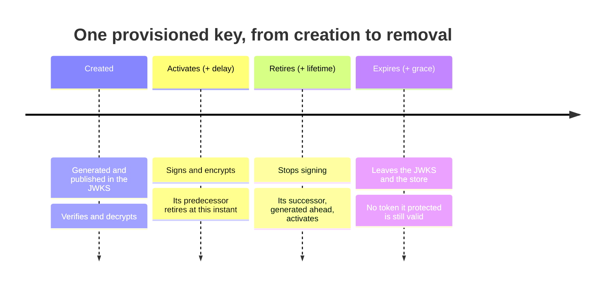

# Key Rollover

> **Every tenant's signing and encryption keys roll over on a schedule, without an outage and without an operator.**
> Each successor is published before the first token it signs, and each retired key stays published until every token
> it protected has expired.

|                    |                                                                                                                                                                                                                                                                                    |
| ------------------ | ---------------------------------------------------------------------------------------------------------------------------------------------------------------------------------------------------------------------------------------------------------------------------------- |
| **Status**         | Available: the keys the server provisions for every tenant                                                                                                                                                                                                                         |
| **Packages**       | `NCode.Identity.OpenId.Core` (the planner, the rollover and the background pass), `NCode.Identity.Secrets.Persistence.Abstractions` (the lifecycle on the stored secret), `NCode.Identity.Jose` and `NCode.Identity.JsonWebTokens` (selection and validation), `NCode.Identity.OpenId.Authentication` (the key set) |
| **Key decisions**  | [ADR-1403](../decisions/1403-a-stored-secret-has-an-active-window-inside-its-validity-window-and-every-use-of-a-key-honors-them.md), [ADR-1404](../decisions/1404-a-tenants-provisioned-keys-roll-over-ahead-of-retirement-and-expire-after-a-grace.md), [ADR-1169](../decisions/1169-every-tenant-is-provisioned-with-persisted-keys.md) |
| **Operator guide** | The tenant settings `tenant_key_lifetime`, `tenant_key_activation_delay` and `tenant_key_retirement_grace`; the configuration section `OpenId:Tenant:KeyRollover`                                                                                                                |

## The promises

|     | Promise                                                                                                                                                                                      |
| --- | -------------------------------------------------------------------------------------------------------------------------------------------------------------------------------------------- |
| 1   | A provisioned key signs or encrypts for a bounded time, 90 days by default, and is then replaced.                                                                                            |
| 2   | A successor is published in the tenant's JSON Web Key Set before it signs, two days by default, so a verifier that caches the set already holds it.                                           |
| 3   | A retired key stays published, and verifies, for a grace that is never shorter than the longest token lifetime plus the clock skew, so no token outlives the key that verifies it.          |
| 4   | Exactly one key per algorithm signs at any instant, and the hand-over is the clock passing an instant on every replica, with no coordination and no gap.                                     |
| 5   | A tenant is never left without a key that signs: the seed that runs whenever the tenant is served, and the background pass, both repair it.                                                  |
| 6   | A key the server generated for an algorithm the tenant stops using retires, and an expired key the server generated leaves the store. A key an operator supplied is never retired or removed. |
| 7   | Every change the server makes to a key is an audit event with the `system` actor, and never carries key material.                                                                            |
| 8   | The management API shows where every key stands: when it activates, retires and expires.                                                                                                      |

## Why this matters

A signing key that never changes is a key whose compromise is never bounded: every token a thief mints with it is
accepted until someone notices. The current guidance (NIST SP 800-57, FAPI, OpenID Connect Core §10.1.1) bounds a
key's cryptoperiod and rotates on a schedule, but a rotation done wrong is an outage: a verifier that cached the key
set before the new key appeared refuses every token the new key signs, and a key removed too soon refuses tokens that
are still valid. Rollover is only safe when publication leads use and retirement leads removal by enough, on every
replica, every time.

## How it works, in one picture

1. When a tenant is seeded it gets one key per algorithm it uses, active at once.
2. When a key retires within the activation delay plus the pass interval, its successor is generated, published now and
   activating at the hand-over.
3. At the hand-over the credential selector on every replica picks the successor, because the predecessor has retired
   and the successor is active; the key set still publishes both.
4. After the grace the predecessor expires: it is no longer published or tried, and the next pass removes it.
5. Every step is recorded in the audit trail.

## Why this design

| Approach                                     | Publication leads use | Retirement leads removal | Replicas agree              | Idle tenants roll over |
| -------------------------------------------- | --------------------- | ------------------------ | --------------------------- | ---------------------- |
| **Lifecycle instants on the key (chosen)**   | Yes, by the delay     | Yes, by the grace        | Yes, by the clock           | Yes, by the pass       |
| A state column a job advances                | Only as fast as the job | Only as fast as the job | Only after the job's write  | Yes                    |
| Rotate on access only                        | Yes                   | Yes                      | Yes                         | No                     |
| Operator-driven rotation only                | Depends on the operator | Depends on the operator | Yes                         | No                     |

Options we rejected

- Rotating on the job dispatcher, rotating only on access, rotating only in the background, an overlap of two active
  keys, keeping expired keys, a fixed grace, and an `activated` event at every hand-over:
  [ADR-1404, Options considered](../decisions/1404-a-tenants-provisioned-keys-roll-over-ahead-of-retirement-and-expire-after-a-grace.md#options-considered).
- Two instants with the overlap expressed by two keys, a state column, nullable inner instants, expiry judged without
  tolerance, and filtering expired keys out of the collection:
  [ADR-1403, Options considered](../decisions/1403-a-stored-secret-has-an-active-window-inside-its-validity-window-and-every-use-of-a-key-honors-them.md#options-considered).

## The lifecycle of a stored secret

Every stored secret, a tenant's key, a client's key or shared secret, a server's or a resource server's key, carries
four instants: `CreatedWhen`, `ActivatesWhen`, `RetiresWhen` and `ExpiresWhen`, in that order. The active window, from
activation to retirement, is when the key signs or encrypts; the validity window, from creation to expiry, is when it
verifies, decrypts and is published. A secret with no lifecycle of its own, such as a client's shared secret, is active
for its whole validity. The windows are judged at each use: the credential selector picks only an active key, the JSON
Web Token validator tries only an unexpired key (with the clock skew as tolerance), and the JSON Web Key Set publishes
only an unexpired key.

> [!TIP]
> [ADR-1403](../decisions/1403-a-stored-secret-has-an-active-window-inside-its-validity-window-and-every-use-of-a-key-honors-them.md),
> `PersistedSecret`, `SecretLifecycle`, `KeyMetadataExtensions`, `DefaultCredentialSelector`, `DefaultJwtValidator`,
> `DefaultJwksEndpointHandler`.

## The settings

| Setting                        | Default | Merge         | Meaning                                                                                                                                   |
| ------------------------------ | ------- | ------------- | ----------------------------------------------------------------------------------------------------------------------------------------- |
| `tenant_key_lifetime`          | 90 days | `Min` (ceiling) | How long a provisioned key signs or encrypts.                                                                                           |
| `tenant_key_activation_delay`  | 2 days  | `Max` (floor) | How long a successor is published before it activates.                                                                                    |
| `tenant_key_retirement_grace`  | 7 days  | `Max` (floor) | How long a retired key stays published. Raised to the longest lifetime of the tokens the tenant protects with its keys plus `clock_skew`. |

`OpenId:Tenant:KeyRollover:TokenLifetimeSettings` names the settings whose lifetimes the grace covers (by default the
ID token, access token, JWT-secured authorization response and request object lifetimes), and
`OpenId:Tenant:KeyRollover:Interval` (one hour) is how often the background pass runs. Rollover runs only while key
provisioning (`OpenId:Tenant:KeyProvisioning`) is enabled; a deployment that brings its own keys manages their
lifecycle through the management API, which accepts `activatesWhen` and `retiresWhen` on every create, import and
update.

> [!TIP]
> [ADR-1404](../decisions/1404-a-tenants-provisioned-keys-roll-over-ahead-of-retirement-and-expire-after-a-grace.md),
> `DefaultSettingDescriptorDataSource`, `OpenIdTenantKeyRolloverOptions`, `TenantKeyLifetimes`.

## The planner and the two paths

One planner, `DefaultTenantKeyRolloverPlanner`, decides from the keys a tenant holds and its effective settings what
changes at an instant: the keys to generate, the published keys to activate at once, the keys to retire and the expired
keys to remove. The seed contributor applies the plan whenever the tenant is materialized, in the seed's unit of work,
and `TenantKeyRolloverService` applies it in the background: one replica per interval takes a lease on the shared-state
port and walks every seeded tenant, each in its own unit of work under the tenant's optimistic concurrency, so an
overlapping seed or pass loses the race for that tenant and leaves it to the winner. A tenant the pass changed is
announced, so every replica evicts it and serves its keys as they are.

> [!TIP]
> [ADR-1404](../decisions/1404-a-tenants-provisioned-keys-roll-over-ahead-of-retirement-and-expire-after-a-grace.md),
> `DefaultTenantKeyRolloverPlanner`, `DefaultTenantKeyRollover`, `TenantKeyRolloverService`, `TenantKeySeedHandler`.

## The audit trail

Every change is a `tenant.key.generated`, `tenant.key.activated`, `tenant.key.retired` or `tenant.key.removed` event
in the `key` category with the `system` actor, the key's secret and its tenant as resources, and the reason, key
identifier, type, algorithm, use and the three instants as details. See [audit records](../audit-records.md).

## Limits and roadmap

- **A compromised key is retired by deleting it.** The management API's `DELETE` retires a key at once; the next seed
  or pass generates its replacement. There is no endpoint that rotates a tenant key on demand with a chosen hand-over.
- **Only a tenant's provisioned keys roll over on their own.** A server's or a resource server's keys, and the keys an
  operator supplies, keep the instants their creator gave them; the windows are honored, the successors are not
  generated.
- **The management console shows a key's instants, not its state.** The state follows from the instants
  (`SecretLifecycleStates`).

## Further reading

- Decisions: [ADR-1403](../decisions/1403-a-stored-secret-has-an-active-window-inside-its-validity-window-and-every-use-of-a-key-honors-them.md),
  [ADR-1404](../decisions/1404-a-tenants-provisioned-keys-roll-over-ahead-of-retirement-and-expire-after-a-grace.md),
  [ADR-1169](../decisions/1169-every-tenant-is-provisioned-with-persisted-keys.md),
  [ADR-1320](../decisions/1320-a-rotated-client-secret-overlaps-its-replacement-until-it-expires-or-is-deleted.md)
- Code: [`Tenants/Keys`](../../src/NCode.Identity.OpenId.Core/Tenants/Keys),
  [`SecretLifecycle`](../../src/NCode.Identity.Secrets.Persistence.Abstractions/SecretLifecycle.cs),
  [`DefaultCredentialSelector`](../../src/NCode.Identity.Jose/Credentials/DefaultCredentialSelector.cs),
  [`DefaultJwtValidator`](../../src/NCode.Identity.Jwt/Validation/DefaultJwtValidator.cs),
  [`DefaultJwksEndpointHandler`](../../src/NCode.Identity.OpenId.Authentication/Endpoints/Jwks/DefaultJwksEndpointHandler.cs)
