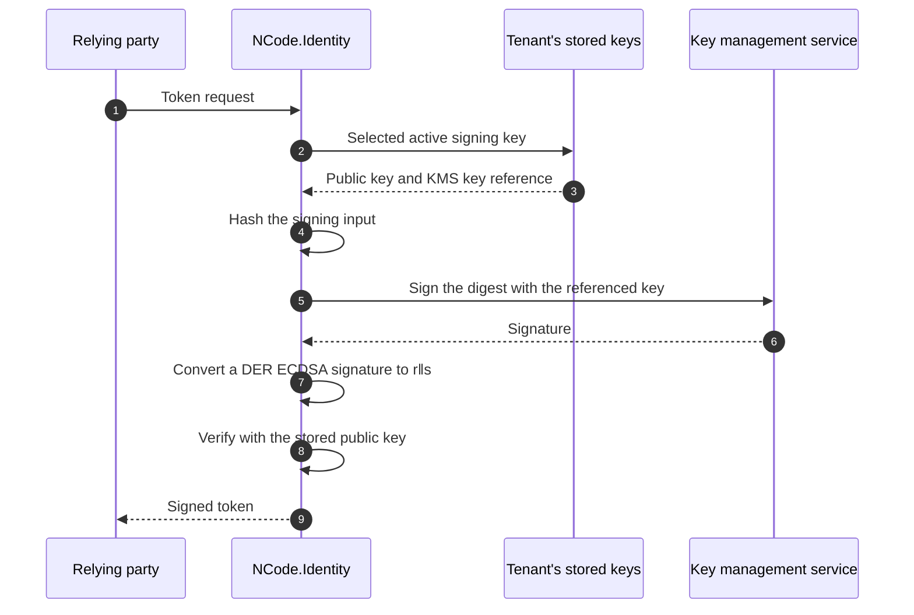

# Remote Keys

> **A tenant's signing and encryption keys can stay inside AWS KMS, Azure Key Vault or Google Cloud KMS.** The service
> signs every token and unwraps every content key sent to the tenant, and the private key never reaches the server.

|                    |                                                                                                                                                                                                                                                                                                                       |
| ------------------ | --------------------------------------------------------------------------------------------------------------------------------------------------------------------------------------------------------------------------------------------------------------------------------------------------------------------- |
| **Status**         | Available: a tenant's signing and encryption keys, in AWS KMS, Azure Key Vault (and Managed HSM) and Google Cloud KMS, chosen per tenant; a background sweep of the keys no stored secret names                                                                                                                         |
| **Packages**       | `NCode.Identity.Secrets.Abstractions` (the remote vocabulary), `NCode.Identity.Secrets` and `NCode.Identity.Secrets.Persistence` (the key, its storage and its destruction), `NCode.Identity.Jose.Abstractions` and `NCode.Identity.Jose` (the asynchronous signing and decryption seams), `NCode.Identity.Secrets.AwsKms`, `.AzureKeyVault` and `.GoogleCloudKms` (the providers), `NCode.Identity.OpenId.Core` (the setting, the rollover and the sweep) |
| **Key decisions**  | [ADR-1471](../decisions/1471-a-tenants-signing-keys-can-be-held-in-a-key-management-service-that-signs-every-token.md), [ADR-1472](../decisions/1472-signing-is-asynchronous-from-the-signature-algorithm-to-every-caller.md), [ADR-1473](../decisions/1473-a-key-management-service-adapter-package-is-named-for-its-service.md), [ADR-1474](../decisions/1474-a-remote-key-provider-is-described-by-data-creates-a-key-once-and-signs-into-the-callers-buffer.md), [ADR-1475](../decisions/1475-the-management-api-creates-a-tenants-key-in-a-key-management-service-and-binds-one-that-proves-it-signs.md), [ADR-1476](../decisions/1476-a-bound-kms-keys-public-half-is-read-from-its-service-and-the-console-offers-each-providers-algorithms.md), [ADR-1477](../decisions/1477-a-tenants-encryption-keys-can-be-held-in-a-key-management-service-that-decrypts-every-content-key.md), [ADR-1478](../decisions/1478-a-background-job-destroys-the-key-management-service-keys-that-no-stored-secret-names.md), [ADR-1489](../decisions/1489-a-remote-key-provider-registers-without-a-key-creation-location-and-only-one-that-has-one-creates-and-sweeps-keys.md), [ADR-1485](../decisions/1485-the-host-chart-enables-server-kms-vendors-and-holds-console-key-rings-under-the-consoles-identity.md), [ADR-1404](../decisions/1404-a-tenants-provisioned-keys-roll-over-ahead-of-retirement-and-expire-after-a-grace.md) |
| **Operator guide** | The reference host's [Remote keys](../../hosts/NCode.Identity.OpenId.Host/README.md#remote-keys); the tenant setting `tenant_key_provider`; the configuration sections `SecretProtection:RemoteKeys` and `SecretProtection:RemoteKeyProviders`; the Helm chart's `secretProtection.remoteKeys` and `secretProtection.remoteKeyProviders` values, in its [Tenant keys in a key management service](../../charts/ncode-identity-host/README.md#tenant-keys-in-a-key-management-service) |

## The promises

|     | Promise                                                                                                                                                                                                                                  |
| --- | ---------------------------------------------------------------------------------------------------------------------------------------------------------------------------------------------------------------------------------------- |
| 1   | **The private key never leaves the KMS.** The server stores each key's public half and a reference to it, and asks the KMS to sign or decrypt.                                                                                           |
| 2   | **Every signature is verified.** The server checks what the KMS returned with the key's stored public half before a token carries it, so a wrong signature fails the token and never reaches a relying party.                           |
| 3   | **Publishing a key never calls the KMS.** The key set serves the stored public halves, so a verifier's fetch costs no request and a KMS outage does not stop verification.                                                                |
| 4   | **A tenant opts in.** The tenant setting `tenant_key_provider` chooses the service for one tenant, or for every tenant beneath a team or the platform, and holds every key the tenant provisions; empty keeps the keys local.                  |
| 5   | **A change of custody hands over after the activation delay.** The successor is generated in the selected service and published for the whole delay before it signs, so a verifier that cached the key set already holds it.             |
| 6   | **A successor is a further version of the same KMS key.** A rollover adds a Google crypto key version or an Azure key version to the tenant's key for that algorithm; AWS KMS has no versions of an asymmetric key, so it creates one key. |
| 7   | **A key the server created is destroyed after the commit that removes its record, and a key it created but could not read, check or record is destroyed at once.** Never before, and never a key the server did not create.            |
| 8   | **Repeatable calls are retried; a creation is made once.** Each SDK retries a throttled or unavailable read, signature or destruction with jittered back-off in one layer; a key creation is never retried, so a lost response cannot create a second key. |
| 9   | **A host that cannot serve a key does not start.** A registered provider that has no mapping for a provisioned signature or encryption key stops the host, and a stored remote key that cannot be read stops its tenant from loading.  |
| 10  | **A bound key proves itself.** A key an operator brings is stored only after it signs a challenge that the supplied public half verifies, or decrypts a challenge that the server encrypts to the supplied public half, and the server never destroys it. |
| 11  | **Every content key is unwrapped by the KMS and authenticated by the JWE's tag.** The server sends the encrypted content key, or the sender's ephemeral public key, to the service, and a result that is not the sender's key fails at the tag. |
| 12  | **A KMS key no stored secret names is swept.** A background job destroys, after a grace period, every key the deployment created that no stored secret references, and audits each destruction. |

## Why this matters

A stored private key is protected under the tenant's master key
([Encryption at Rest](./encryption-at-rest.md)), but a running replica holds every key it loaded, so a process that is
read holds every private key its tenants sign and decrypt with. A key management service narrows that exposure: the
private half is generated inside it and never leaves, so a compromised replica can ask the service to sign or unwrap a
content key only while it holds the credentials to ask, and a copied heap holds no key to take away. Regulated
deployments often require exactly this: the key lives in a service backed by a hardware security module, with its own
access log and its own permissions.

## How it works, in one picture

1. The tenant's setting names a service, so each key the rollover provisions, signature or encryption, is created inside
   it. The server reads the created key's public half, records it with the key's reference, and never sees the private
   half.
2. To sign, the server hashes the signing input and asks the service to sign the digest with the referenced key; a
   service that signs the whole input receives it instead. To decrypt, the server asks the service to unwrap the JWE's
   encrypted content key, or to agree a shared secret with the JWE's ephemeral public key.
3. A service that returns an ECDSA signature as a DER sequence is converted to the concatenation `r‖s` that JOSE and
   COSE carry.
4. The server verifies the signature with the stored public key. A signature that does not verify is an error and
   no token carries it.
5. The key set publishes the stored public halves, so a verifier never causes a call to the service.

## Why this design

| Approach                                           | Private key stays out of the server | Wrong signature caught before it leaves | Verification survives a KMS outage | One setting per tenant |
| -------------------------------------------------- | ----------------------------------- | --------------------------------------- | ---------------------------------- | ---------------------- |
| **Sign in the KMS, verify locally (chosen)**       | Yes                                 | Yes                                     | Yes, from the stored public key    | Yes                    |
| Sign in the KMS and trust the signature            | Yes                                 | No                                      | Yes                                | Yes                    |
| Fetch the public key from the KMS per request      | Yes                                 | Yes                                     | No                                 | Yes                    |
| Keep the key local under a master key              | No                                  | n/a                                     | Yes                                | n/a                    |

Options we rejected

- A remote key that is not an RSA or ECC key class, fetching public keys per request, trusting the service's
  signature unverified, a retry layer of the family's over the SDK's, separate provider packages, a host-only switch or
  a setting per algorithm, switching custody at once, deleting an Azure key per rollover and
  protecting the reference under the master key:
  [ADR-1471, Options considered](../decisions/1471-a-tenants-signing-keys-can-be-held-in-a-key-management-service-that-signs-every-token.md#options-considered).
- Asynchronous twins beside the synchronous members, blocking on a task, signing before encoding and a callback on the
  credentials: [ADR-1472, Options considered](../decisions/1472-signing-is-asynchronous-from-the-signature-algorithm-to-every-caller.md#options-considered).
- A custody setting per use, synchronous twins beside the asynchronous decode members, verifying a remote decryption
  another way, Azure `Decrypt` in place of `UnwrapKey`, exporting a key to agree locally, wrapping and unwrapping a
  content key directly, and a console that offers signing keys only:
  [ADR-1477, Options considered](../decisions/1477-a-tenants-encryption-keys-can-be-held-in-a-key-management-service-that-decrypts-every-content-key.md#options-considered).
- Sweeping inside the rollover pass, relying on a dedicated account, vault or key ring alone, destroying without a
  grace period, and running the sweep inline rather than through the dispatcher:
  [ADR-1478, Options considered](../decisions/1478-a-background-job-destroys-the-key-management-service-keys-that-no-stored-secret-names.md#options-considered).

## The signing seam

Signing is asynchronous from the signature algorithm to every caller: JWS, JWT, DPoP proofs, SD-JWT and COSE and CWT
await it. A local key completes without waiting, so a tenant with local keys pays nothing for the seam, and a remote
key awaits the service. A remote key is an RSA or ECC key class that holds the stored public half, so every
algorithm's key-type and curve checks, the key's JWK and every verification apply unchanged, and the key refuses to
sign with any algorithm other than the one it is bound to.

> [!TIP]
> [ADR-1472](../decisions/1472-signing-is-asynchronous-from-the-signature-algorithm-to-every-caller.md),
> `SignatureAlgorithm.SignAsync`, `IRemoteSecretKey`, `RemoteKeySigning`, `JoseEncoder`.

## The decryption seam

Decryption is asynchronous to every caller, as signing is. `KeyManagementAlgorithm.UnwrapKeyAsync` unwraps a content key
and `IJoseSerializer.DecodeAsync` and `DeserializeAsync` (each with a `CancellationToken`) are the decode members; a
JWS decode completes synchronously behind its `ValueTask`, and `VerifyJws` stays synchronous. A local key completes
without waiting, and a remote key awaits the service.

- **RSA-OAEP asks the service to decrypt.** The family delegates to the remote key's `DecryptAsync`, which sends the
  encrypted content key to the service.
- **`ECDH-ES` asks the service to agree.** The algorithm sends the JWE's `epk` as a `SubjectPublicKeyInfo` to the
  service, which returns the shared secret, and runs the Concat KDF locally; `ECDH-ES+A128KW`, `+A192KW` and `+A256KW`
  also run the AES key unwrap locally.
- **A remote key refuses an algorithm other than its row's** and a kind it does not hold: an RSA remote key signs or
  decrypts, and an ECC remote key signs or agrees.
- **A malformed token never reaches a service.** The serializer decodes every binary segment before the unwrap,
  and RSA-OAEP refuses an encrypted key that is not the size of the key's modulus, which fails at the tag like a refused
  ciphertext.
- **A refused ciphertext fails at the tag.** A `CryptographicException`, `JoseException` or `ArgumentException` from an
  unwrap substitutes a random content key (RFC 7516 §11.5), so the JWE fails authentication and a sender cannot tell
  why. Any other exception (transport, `IOException`, cancellation) propagates, and ends the decode of a JSON-serialized
  JWE rather than moving to its next recipient.
- **The tag authenticates every remote result.** A wrong key, or a service that answers with another key's result,
  fails the content decryption.
- **A header's `kid` narrows the keys.** When the JWE header names a `kid` that an eligible decryption key has, the JWT
  validator tries only the keys with that id, so a well-addressed token costs at most one service call
  per key, and a token whose `kid` names a held key that does not decrypt it is refused.
- **COSE never uses a remote key.** COSE and CWT decryption is synchronous, and the synchronous `TryUnwrapKey` of these
  algorithms refuses a remote key.

> [!TIP]
> [ADR-1477](../decisions/1477-a-tenants-encryption-keys-can-be-held-in-a-key-management-service-that-decrypts-every-content-key.md),
> `KeyManagementAlgorithm.UnwrapKeyAsync`, `IJoseSerializer.DecodeAsync`, `IRemoteSecretKey.DecryptAsync`,
> `IRemoteSecretKey.DeriveSharedSecretAsync`.

## What each service holds

A mapping row names, for one JOSE algorithm and key, the service's key specification and the operation the key
performs. A signing row also names the service's signing algorithm, the digest the service signs, and whether it
returns ECDSA as DER. A row has the use of its kind: signing rows are `sig`, and decryption and key agreement rows are
`enc`. The rows are open data: each package registers an `IRemoteKeyDescriptorSource` that describes its provider and
contributes its rows, and a package registers another source to add an algorithm.

### Signing rows

| Provider           | `alg`                        | Key                       | `KeySpec`                                                     | `SigningAlgorithm`                    | Digest          | DER |
| ------------------ | ---------------------------- | ------------------------- | ------------------------------------------------------------- | ------------------------------------- | --------------- | --- |
| `aws-kms`          | RS256/384/512                | RSA 2048, 3072, 4096 each | `RSA_{n}`                                                     | `RSASSA_PKCS1_V1_5_SHA_{256,384,512}` | SHA-256/384/512 | no  |
| `aws-kms`          | PS256/384/512                | RSA 2048, 3072, 4096 each | `RSA_{n}`                                                     | `RSASSA_PSS_SHA_{256,384,512}`        | SHA-256/384/512 | no  |
| `aws-kms`          | ES256 / ES384 / ES512        | P-256 / P-384 / P-521     | `ECC_NIST_P256/P384/P521`                                     | `ECDSA_SHA_256/384/512`               | SHA-256/384/512 | yes |
| `google-cloud-kms` | RS256                        | RSA 2048, 3072, 4096      | `RSA_SIGN_PKCS1_{n}_SHA256`                                   | = `KeySpec`                           | SHA-256         | no  |
| `google-cloud-kms` | RS512 / PS512                | RSA 4096                  | `RSA_SIGN_PKCS1_4096_SHA512` / `RSA_SIGN_PSS_4096_SHA512`     | = `KeySpec`                           | SHA-512         | no  |
| `google-cloud-kms` | PS256                        | RSA 2048, 3072, 4096      | `RSA_SIGN_PSS_{n}_SHA256`                                     | = `KeySpec`                           | SHA-256         | no  |
| `google-cloud-kms` | ES256 / ES384                | P-256 / P-384             | `EC_SIGN_P256_SHA256` / `EC_SIGN_P384_SHA384`                 | = `KeySpec`                           | SHA-256/384     | yes |
| `azure-key-vault`  | RS256/384/512, PS256/384/512 | RSA 2048, 3072, 4096 each | `RSA`                                                         | the `alg`                             | SHA-256/384/512 | no  |
| `azure-key-vault`  | ES256 / ES384 / ES512        | P-256 / P-384 / P-521     | `EC`                                                          | the `alg`                             | SHA-256/384/512 | no  |

The provisioned signing defaults, RS256 and PS256 at 3072 bits and ES256 on P-256, are held by all three providers.

### Decryption and key agreement rows

| Provider           | `alg`                                                    | Key                       | `KeySpec`                                                 | Operation                                             |
| ------------------ | -------------------------------------------------------- | ------------------------- | --------------------------------------------------------- | ----------------------------------------------------- |
| `aws-kms`          | RSA-OAEP / RSA-OAEP-256                                  | RSA 2048, 3072, 4096 each | `RSA_{n}`                                                 | `Decrypt` with `RSAES_OAEP_SHA_1` / `RSAES_OAEP_SHA_256` |
| `aws-kms`          | ECDH-ES, ECDH-ES+A128KW, ECDH-ES+A192KW, ECDH-ES+A256KW  | P-256 / P-384 / P-521     | `ECC_NIST_P256/P384/P521`                                 | `DeriveSharedSecret` with `ECDH`                      |
| `azure-key-vault`  | RSA-OAEP / RSA-OAEP-256                                  | RSA 2048, 3072, 4096 each | `RSA`                                                     | `UnwrapKey` with the `alg`                            |
| `google-cloud-kms` | RSA-OAEP / RSA-OAEP-256                                  | RSA 2048, 3072, 4096 each | `RSA_DECRYPT_OAEP_{n}_SHA1` / `RSA_DECRYPT_OAEP_{n}_SHA256` | `AsymmetricDecrypt`                                 |
| `google-cloud-kms` | RSA-OAEP-512                                             | RSA 4096                  | `RSA_DECRYPT_OAEP_4096_SHA512`                            | `AsymmetricDecrypt`                                   |

Azure Key Vault and Google Cloud KMS agree no keys, so they hold no `ECDH-ES` key. Azure unwraps the content key rather
than decrypting: unwrapping a content key is the operation, and the key is created with the `unwrapKey` operation only.
A deployment that registers Azure Key Vault or Google Cloud KMS provisions `RSA-OAEP*` encryption keys rather than
`ECDH-ES` ones.

> [!TIP]
> [ADR-1471](../decisions/1471-a-tenants-signing-keys-can-be-held-in-a-key-management-service-that-signs-every-token.md),
> [ADR-1474](../decisions/1474-a-remote-key-provider-is-described-by-data-creates-a-key-once-and-signs-into-the-callers-buffer.md),
> [ADR-1477](../decisions/1477-a-tenants-encryption-keys-can-be-held-in-a-key-management-service-that-decrypts-every-content-key.md),
> `AwsKmsRemoteKeyDescriptors`, `AzureKeyVaultRemoteKeyDescriptors`, `GoogleCloudKmsRemoteKeyDescriptors`,
> `IRemoteKeyDescriptorSource`, `RemoteKeyAlgorithm`, `RemoteSigningAlgorithm`, `RemoteDecryptionAlgorithm`,
> `RemoteKeyAgreementAlgorithm`.

## Configuration

A deployment registers a provider with `AddAwsKmsRemoteKeyProvider`, `AddAzureKeyVaultRemoteKeyProvider` or
`AddGoogleCloudKmsRemoteKeyProvider`, which bind their options strictly from a configuration section, validate them
when the host starts and reuse the key wrapper's client with the deployment's own identity. A provider whose region,
vault URI or key ring is set creates and lists keys (`RemoteKeyProviderDescriptor.CreatesKeys`), and the host does not
start unless every such provider holds every provisioned signature and encryption key. A provider registered without
one reads, signs with, decrypts with and destroys keys by their identifiers and binds a key a KMS already holds, but
creates and lists none: `tenant_key_provider` cannot name it, the management API refuses to create a key in it, and the
sweep skips it. Each package's `AddAwsKmsRemoteKeyProviderIfConfigured`,
`AddAzureKeyVaultRemoteKeyProviderIfConfigured` and `AddGoogleCloudKmsRemoteKeyProviderIfConfigured` method registers
its provider only when its section exists, and the reference host calls them. The providers register on the secrets
library's builder (`IServiceBuilder<SecretsLibrary>`), so a BFF host registers them too. A BFF host, which creates no
keys, registers the providers with `Add<Vendor>RemoteKeyProvider` and no section. A host without secret persistence,
such as a BFF, needs no `SecretProtection:RemoteKeys`.

| Provider                    | Section                                                  | Settings                                                                                 |
| --------------------------- | -------------------------------------------------------- | ---------------------------------------------------------------------------------------- |
| `aws-kms`                   | `SecretProtection:RemoteKeyProviders:AwsKms`             | `Region` (optional: where keys are created); `PendingWindowInDays`, 7 to 30 (default 30) |
| `azure-key-vault`           | `SecretProtection:RemoteKeyProviders:AzureKeyVault`      | `VaultUri` (optional: where keys are created); `HardwareProtected` (default `true`)      |
| `google-cloud-kms`          | `SecretProtection:RemoteKeyProviders:GoogleCloudKms`     | `KeyRing` (optional: where keys are created); `HardwareProtected` (default `true`)       |

The deployment names itself and tunes the sweep ([Orphaned keys](#orphaned-keys)) in `SecretProtection:RemoteKeys`,
which binds strictly. The `SecretProtection` section recognizes the `RemoteKeys` and `RemoteKeyProviders` children.

| Setting                                  | Default  | Meaning                                                                                                              |
| ---------------------------------------- | -------- | -------------------------------------------------------------------------------------------------------------------- |
| `SecretProtection:RemoteKeys:Deployment` | none     | Names this deployment: lowercase letters and digits in hyphen-separated groups, at most 40 characters. Required when a provider that creates keys is registered. |
| `SweepEnabled`                           | `true`   | Turns the sweep of orphaned keys on or off.                                                                          |
| `SweepInterval`                          | one day  | How often the sweep runs: at least one minute, at most the timer maximum.                                            |
| `SweepGracePeriod`                       | one day  | How old a key is before the sweep may destroy it: between one hour and 365 days.                                     |

The reference host's Helm chart configures them with the `secretProtection.remoteKeyProviders` values
(`awsKms.enabled`, `region` and `pendingWindowInDays`, `azureKeyVault.enabled`, `vaultUri` and `hardwareProtected`,
`googleCloudKms.enabled`, `keyRing` and `hardwareProtected`) and the `secretProtection.remoteKeys` values (`deployment`,
`sweepEnabled`, `sweepInterval` and `sweepGracePeriod`). It registers a provider whose `enabled` is `true` and renders
its location only when set, so a release binds keys without creating any, and mounts that vendor's workload identity
into the pods
([ADR-1485](../decisions/1485-the-host-chart-enables-server-kms-vendors-and-holds-console-key-rings-under-the-consoles-identity.md));
see the chart README's
[Tenant keys in a key management service](../../charts/ncode-identity-host/README.md#tenant-keys-in-a-key-management-service).

A tenant, a team or the platform selects a provider with the setting `tenant_key_provider`, whose value is
empty (local keys) or one of the registered provider names. The setting chooses the provider of every key the tenant
provisions, signature and encryption alike. The setting is environment-bound, so each environment chooses
its own custody, and it carries from a platform or team document to the tenants beneath it, as
`OpenId:Platform:Settings:tenant_key_provider`. A change of the setting hands
the tenant's keys over after the activation delay, and the superseded keys retire with the reason
`custody_changed` ([Key Rollover](./key-rollover.md)).

> [!TIP]
> [ADR-1471](../decisions/1471-a-tenants-signing-keys-can-be-held-in-a-key-management-service-that-signs-every-token.md),
> [ADR-1477](../decisions/1477-a-tenants-encryption-keys-can-be-held-in-a-key-management-service-that-decrypts-every-content-key.md),
> [ADR-1478](../decisions/1478-a-background-job-destroys-the-key-management-service-keys-that-no-stored-secret-names.md),
> `AwsKmsRemoteKeyProviderOptions`, `AzureKeyVaultRemoteKeyProviderOptions`, `GoogleCloudKmsRemoteKeyProviderOptions`,
> `RemoteKeyOptions`, `OpenIdSettingKeys.TenantKeyProvider`.

## Management API

The management API shows which provider holds a key, creates a tenant's key in a provider and binds a key that a
provider already holds. Create and bind accept a signature or key-management algorithm, and the row gives the key its
use (`sig` or `enc`), so a request names no use. Remote keys belong to tenants only, so the routes sit under a tenant.

- **Reading.** A `remote` secret's `remoteKeyProvider` field names its provider, such as `aws-kms`, and is `null` for a
  key the server holds. The KMS key identifier is never returned.
- **Creating a key.** `POST /api/tenants/{tenantId}/secrets/remote` takes a `CreateRemoteSecretRequest`:
  `remoteKeyProvider`, `secretType` (`rsa` or `ecc`), `keySizeBits`, an optional `curve`, `algorithm`, `expiresWhen`
  and the optional `activatesWhen` and `retiresWhen`. It needs `Create` authority at the tenant, validates the request
  against the provider's mapping before it calls the KMS, and answers `201` with the secret. The key has `Origin`
  `generated`, so deleting the secret destroys the key in the KMS. A request that fails validation answers `400`, a
  missing tenant `404`, a secret identifier the tenant already holds `409` before the KMS is called, a write that
  lost a concurrency race `412` after the created key is destroyed and a KMS failure or refusal `502`.
- **Binding a key.** `POST /api/tenants/{tenantId}/secrets/remote/import` takes an `ImportRemoteSecretRequest`:
  `remoteKeyProvider`, `remoteKeyId`, `secretType` (`rsa` or `ecc`), `keySizeBits`, an optional `curve`, `algorithm`,
  `expiresWhen` and the optional `activatesWhen` and `retiresWhen`. The `remoteKeyId` is the service's identifier for
  the key: an AWS KMS key ARN, an Azure Key Vault versioned key identifier, or a Google Cloud KMS crypto key version
  resource name. It holds at most 8,000 characters together with the provider name and a colon, the stored reference
  `<provider>:<keyId>` (7,992 for `aws-kms`), and no control character and no leading or trailing white space. The
  server validates the request against the provider's mapping, reads the key's public half from the KMS, checks that it
  is a key of the request's type, size and curve, and stores the key only after it proves itself by its algorithm's
  kind: a signature algorithm signs 32 random bytes that the stored public half verifies, and a key-management
  algorithm decrypts a challenge, which the server encrypts to the stored public half as a compact JWE (`A256GCM`) and
  decodes through the key. The key has `Origin` `supplied`, so the server never destroys it. The
  route needs `Create` authority at the tenant and `Update` authority at the platform, because the deployment's
  identity reaches every key the KMS lets it use. A request that fails validation, a key the provider refuses or whose
  public half does not match the request, and a key that does not prove itself answer `400`; a secret identifier or
  `kid` the tenant already holds answers `409`; a KMS failure or refusal of the deployment's identity answers `502`.
- **Updating.** An update keeps the algorithm of a `remote` secret: a different algorithm answers `400`, because the
  key is bound to its algorithm.
- **Capabilities.** `remoteKeyProviders` lists the registered providers, sorted ordinally, each with `createsKeys` and
  `algorithms`: the accepted rows of every kind, each with its `use` (`sig` or `enc`), `secretType`, `keySizeBits` and
  `curve`, limited to
  the rows the secret validator accepts (`ISecretValidator.ValidateRemoteKey`, the check a create and a bind run), so a
  client offers exactly what a create or bind accepts.
- **Console.** A tenant's Secrets tab in the management console creates a key in a registered provider through the
  create-secret form's custody choice, and binds a key a provider holds through its **Bind KMS key** dialog, which takes
  the provider, the key identifier and one of the provider's algorithms. Both offer signing and encryption rows, each
  labelled with its use; each refusal shows the route's problem detail.

> [!TIP]
> [ADR-1475](../decisions/1475-the-management-api-creates-a-tenants-key-in-a-key-management-service-and-binds-one-that-proves-it-signs.md),
> [ADR-1476](../decisions/1476-a-bound-kms-keys-public-half-is-read-from-its-service-and-the-console-offers-each-providers-algorithms.md),
> [ADR-1477](../decisions/1477-a-tenants-encryption-keys-can-be-held-in-a-key-management-service-that-decrypts-every-content-key.md),
> `CreateRemoteSecretRequest`, `ImportRemoteSecretRequest`, `RemoteKeyProviderCapabilityResource`,
> `TenantRemoteSecretApiEndpointHandler`.

## Orphaned keys

A key that a seed, a rollover or a management create made can end up with no stored secret that names it: a creation
that lost its commit race or whose process crashed, or a destruction that failed. A background job finds such keys and
destroys them.

- **A deployment names itself.** `SecretProtection:RemoteKeys:Deployment` tags every created key
  (`ncode-identity:deployment` on AWS, `ncode-identity-deployment` on Azure tags and Google crypto key labels) and is
  hashed first into the key's `ncid-` group name, so deployments that share an AWS account, a vault or a key ring never
  share a group and never sweep each other's keys. A deployment is one database of stored secrets: every replica and
  release that shares the database uses its name, and no other deployment in the same AWS account, vault or key ring
  uses it, because each deployment destroys every key of its name that its own database does not name.
- **Each service lists the deployment's keys.** The provider lists the enabled keys (key versions) in its configured
  location that carry an `ncid-` group and the deployment, as a stream. AWS lists the region's keys, reads their tags
  and describes each (customer-managed and `Enabled`); Azure lists the keys named `ncid-*`, then their enabled versions
  tagged with the deployment; Google lists the key ring's crypto keys labelled with the deployment and an `ncid-`
  group, then their `ENABLED` versions. A key whose tags cannot be read is skipped.
- **A hosted service dispatches the sweep.** `RemoteKeySweepService` waits for the platform, then at start and every
  `SweepInterval`, under the shared-state lease `remote-key-sweep:platform` that lasts half the interval, dispatches one
  `RemoteKeySweepJob` per described provider that creates keys through `IJobDispatcher`, so each provider has its own
  retries and a durable dispatcher can run it. `SweepEnabled` set to `false` turns it off. A provider whose dispatch
  fails is logged, and the others are dispatched.
- **A job sweeps one provider.** `RemoteKeySweepJobHandler` lists the provider's keys created at or before the time of
  the pass minus `SweepGracePeriod`, only then reads every stored reference of that provider for every owner, and
  destroys each listed key that no reference names through the destroyer's bounded, logged path. Listing before reading
  means a key recorded during the pass is never swept, and the grace period means a key whose creation is in flight is
  never swept. A failed list or read throws so the dispatcher retries, and a repeated sweep is harmless.
- **A destruction is audited.** A destroyed key emits the event `remote_key.destroyed` (category `key`, actor
  `system`, resource `remote_key` identified by the reference `provider:keyId`, reason `orphaned`) in the control-plane
  tenant, because the KMS key identifier never reaches a tenant's audit trail. The details carry the provider, the key
  identifier, the group, the owner and secret identifier when the tags carry them, and when the key was created.
- **Every destruction stays recoverable for the service's window.** AWS schedules a pending deletion, Azure disables the
  version and Google schedules the destruction.

> [!TIP]
> [ADR-1478](../decisions/1478-a-background-job-destroys-the-key-management-service-keys-that-no-stored-secret-names.md),
> `RemoteKeySweepService`, `RemoteKeySweepJobHandler`, `IRemoteKeyProvider.ListKeysAsync`,
> `IRemoteKeyReferenceStore`, `RemoteKeyAuditEvent`.

## Client keys

A protocol client's key ring and a BFF's key rings can hold keys that a KMS holds, with the same providers and the same
rows as a tenant's keys.

- **A key ring entry holds an `IRemoteSecretKey`.** `IRemoteKeyResolver` finds the provider and the row of the entry's
  algorithm without a KMS call and reads the key's public half from the KMS, and `IRemoteKeyProver` proves that the KMS
  holds the private half. A host that composes a protocol client's key ring in code reads each key with the resolver
  and proves it with the prover before the ring is first resolved.
- **A BFF names its remote keys in its configuration.** `Bff:KeyRings:{name}:RemoteKeys:{kid}` holds `Provider`,
  `KeyId`, `Algorithm`, `SecretType`, `KeySizeBits` and `Curve`, next to or instead of the ring's `PemFiles`; a ring
  lists at least one key and no id twice.
- **The row decides whether the key signs or decrypts.** A signing row gives a `private_key_jwt` assertion key or a DPoP
  proof key, a decryption row gives the key that decrypts an encrypted ID token, UserInfo response or logout token, so
  one ring can hold both, and `/bff/jwks` publishes each half with its `use`.
- **A key is read and proved when the host starts.** Every ring loads before the server serves. The public half comes
  from the KMS, and the key signs or decrypts a challenge that the half verifies, so a key that the deployment's
  identity cannot read or use stops the host, and `/bff/jwks` makes no KMS call.
- **A DPoP key costs a KMS signature per proof.** Every token request and every forwarded call with a DPoP-bound token
  is a round trip, a fee where the service bills by request, and a share of the service's quota. Hold the
  client-authentication key and the decryption key in the KMS, and keep the DPoP key local unless the threat model
  needs it and the request rate fits the quota. A per-session ephemeral DPoP key never goes to a KMS.
- **The key is the operator's.** Neither a protocol client nor a BFF creates, tags or destroys a KMS key, and no stored
  secret names it, so the sweep ([Orphaned keys](#orphaned-keys)) never lists it unless it carries an `ncid-` group name
  and the deployment's tag. Give it neither, and keep it in a scope of its own.
- **The Helm chart holds the management console's keys.** `managementConsole.keyRings.client` and `.dpop` name each key
  ring's PEM Secret and remote keys, the chart registers each vendor a remote key names, and the console reaches it
  through its own workload identity under `managementConsole.secretProtection`; see
  [The console's keys in a key management service](../../charts/ncode-identity-host/README.md#the-consoles-keys-in-a-key-management-service).

> [!TIP]
> [ADR-1479](../decisions/1479-a-protocol-clients-and-a-bffs-keys-can-be-held-in-a-key-management-service-read-and-proved-at-start.md),
> [ADR-1485](../decisions/1485-the-host-chart-enables-server-kms-vendors-and-holds-console-key-rings-under-the-consoles-identity.md),
> [Backend for Frontend](../backend-for-frontend.md), `IRemoteKeyResolver`, `IRemoteKeyProver`,
> `RemoteKeyRefusedException`.

## Permissions

The deployment's identity, resolved by each SDK's default credential chain, needs these permissions. No credential is
read from configuration.

- **AWS:** `kms:CreateKey`, `kms:TagResource`, `kms:GetPublicKey`, `kms:Sign`, `kms:Decrypt`,
  `kms:DeriveSharedSecret`, `kms:ScheduleKeyDeletion`, `kms:DescribeKey`, `kms:ListKeys` and `kms:ListResourceTags`.
- **Azure:** the `Key Vault Crypto Officer` role on the vault (keys create, sign, unwrap, update and list).
- **Google:** `cloudkms.cryptoKeys.create`, `cloudkms.cryptoKeys.list` and `cloudkms.cryptoKeyVersions.create`, `.list`,
  `.get`, `.viewPublicKey`, `.useToSign`, `.useToDecrypt` and `.destroy` on the key ring.

A key an operator binds needs the read of its public half and its own operation, because the server reads the half and
proves the key before it stores it: AWS `kms:GetPublicKey` plus `kms:Sign`, `kms:Decrypt` or `kms:DeriveSharedSecret`
as the key's row says, Azure `Key Vault Crypto User` on the key, Google `cloudkms.cryptoKeyVersions.viewPublicKey` plus
`.useToSign` or `.useToDecrypt`. A provider registered without its location needs only these.

A key ring's remote key needs the permissions of a bound key, because the host reads and proves it when it starts.

**Scoping the identity to the deployment's keys.**

- **AWS:** condition `kms:ScheduleKeyDeletion` on `aws:ResourceTag/ncode-identity:deployment` equal to the deployment
  name, and `kms:CreateKey` and `kms:TagResource` on `aws:RequestTag/ncode-identity:deployment` equal to it, so the
  identity can create and destroy only keys of its deployment. `kms:ListKeys` names no resource, and a bound key carries
  no such tag, so its own operation stays unconditioned.
- **Azure:** a role assignment cannot be conditioned on a key's tags, so give each deployment a vault of its own. A
  custom role with `Microsoft.KeyVault/vaults/keys/read`, `Microsoft.KeyVault/vaults/keys/create/action`,
  `Microsoft.KeyVault/vaults/keys/update/action`, `Microsoft.KeyVault/vaults/keys/sign/action` and
  `Microsoft.KeyVault/vaults/keys/unwrap/action` grants what the server calls and leaves out delete and purge.
- **Google:** a grant on a key ring covers every crypto key in it, so give each deployment a key ring of its own.

The server creates sign-only or decrypt-only keys, hardware-protected by default on Azure and Google, and destroys only
the keys it created. Its logs carry identifiers only, never an input, a digest, a signature, a content key or a shared
secret. A content key, a key encryption key and a shared secret live in sensitive buffers that are zeroed after use, and
the ECDH shared secret of one message passes through the replica, never the key.

## Limits and roadmap

- **Every token and every encrypted token costs a round trip, and a fee where the service bills by request.** A
  throttled service slows issuance and decryption; the SDKs' bounded retry absorbs a brief limit, not a sustained one. A
  throttled creation fails its seed or rollover pass, which runs again.
- **A KMS outage stops issuance for the tenants whose keys it holds, and the decryption of tokens sent to them.**
  Verification, the key set and every tenant with local keys continue.
- **A key created by a seed or a rollover that loses its commit race stays in the service until the sweep.** It is
  unused and tagged with its group and the deployment; the sweep destroys it after the grace period
  ([Orphaned keys](#orphaned-keys)).
- **A key whose tags cannot be read is never swept.** A provider that strips tags leaves its keys in place.
- **A Google crypto key is permanent.** Its versions are destroyed, the crypto key stays.
- **Azure versions accumulate disabled.** Key Vault deletes whole keys only, so removing a record disables its version.
- **Azure Key Vault and Google Cloud KMS hold no `ECDH-ES` key.** A tenant in either holds `RSA-OAEP*` encryption keys.
- **COSE decryption never uses a remote key.** COSE and CWT decryption is synchronous, so a COSE message encrypted to a
  remote key does not decrypt.
- **The platform's, clients' and resource servers' keys stay local.** A tenant's keys, and a protocol client's or a
  BFF's key ring keys, can be held in a service.

## Further reading

- Decisions: [ADR-1471](../decisions/1471-a-tenants-signing-keys-can-be-held-in-a-key-management-service-that-signs-every-token.md),
  [ADR-1472](../decisions/1472-signing-is-asynchronous-from-the-signature-algorithm-to-every-caller.md),
  [ADR-1473](../decisions/1473-a-key-management-service-adapter-package-is-named-for-its-service.md),
  [ADR-1474](../decisions/1474-a-remote-key-provider-is-described-by-data-creates-a-key-once-and-signs-into-the-callers-buffer.md),
  [ADR-1475](../decisions/1475-the-management-api-creates-a-tenants-key-in-a-key-management-service-and-binds-one-that-proves-it-signs.md),
  [ADR-1476](../decisions/1476-a-bound-kms-keys-public-half-is-read-from-its-service-and-the-console-offers-each-providers-algorithms.md),
  [ADR-1477](../decisions/1477-a-tenants-encryption-keys-can-be-held-in-a-key-management-service-that-decrypts-every-content-key.md),
  [ADR-1478](../decisions/1478-a-background-job-destroys-the-key-management-service-keys-that-no-stored-secret-names.md),
  [ADR-1479](../decisions/1479-a-protocol-clients-and-a-bffs-keys-can-be-held-in-a-key-management-service-read-and-proved-at-start.md),
  [ADR-1404](../decisions/1404-a-tenants-provisioned-keys-roll-over-ahead-of-retirement-and-expire-after-a-grace.md),
  [ADR-1169](../decisions/1169-every-tenant-is-provisioned-with-a-persisted-key-for-each-configured-algorithm-it-uses.md),
  [ADR-1351](../decisions/1351-work-that-follows-a-committed-change-runs-on-its-own-bounded-token.md)
- Code: [`RemoteKeys`](../../src/NCode.Identity.Secrets.Abstractions/RemoteKeys),
  [`RemoteKeySigning`](../../src/NCode.Identity.Secrets/RemoteKeys/RemoteKeySigning.cs),
  [`IRemoteKeyResolver`](../../src/NCode.Identity.Secrets.Abstractions/RemoteKeys/IRemoteKeyResolver.cs),
  [`IRemoteKeyProver`](../../src/NCode.Identity.Jose.Abstractions/IRemoteKeyProver.cs),
  [`SignatureAlgorithm`](../../src/NCode.Identity.Jose.Abstractions/Algorithms/SignatureAlgorithm.cs),
  [`DefaultRemoteSecretDestroyer`](../../src/NCode.Identity.Secrets.Persistence/DefaultRemoteSecretDestroyer.cs),
  [`AwsKmsRemoteKeyProvider`](../../src/NCode.Identity.Secrets.AwsKms/AwsKmsRemoteKeyProvider.cs),
  [`AzureKeyVaultRemoteKeyProvider`](../../src/NCode.Identity.Secrets.AzureKeyVault/AzureKeyVaultRemoteKeyProvider.cs),
  [`GoogleCloudKmsRemoteKeyProvider`](../../src/NCode.Identity.Secrets.GoogleCloudKms/GoogleCloudKmsRemoteKeyProvider.cs),
  [`DefaultTenantKeyPolicy`](../../src/NCode.Identity.OpenId.Core/Tenants/Keys/DefaultTenantKeyPolicy.cs),
  [`RemoteKeySweepService`](../../src/NCode.Identity.OpenId.Core/SecretProtection/RemoteKeySweepService.cs),
  [`RemoteKeySweepJobHandler`](../../src/NCode.Identity.OpenId.Core/SecretProtection/RemoteKeySweepJobHandler.cs)
