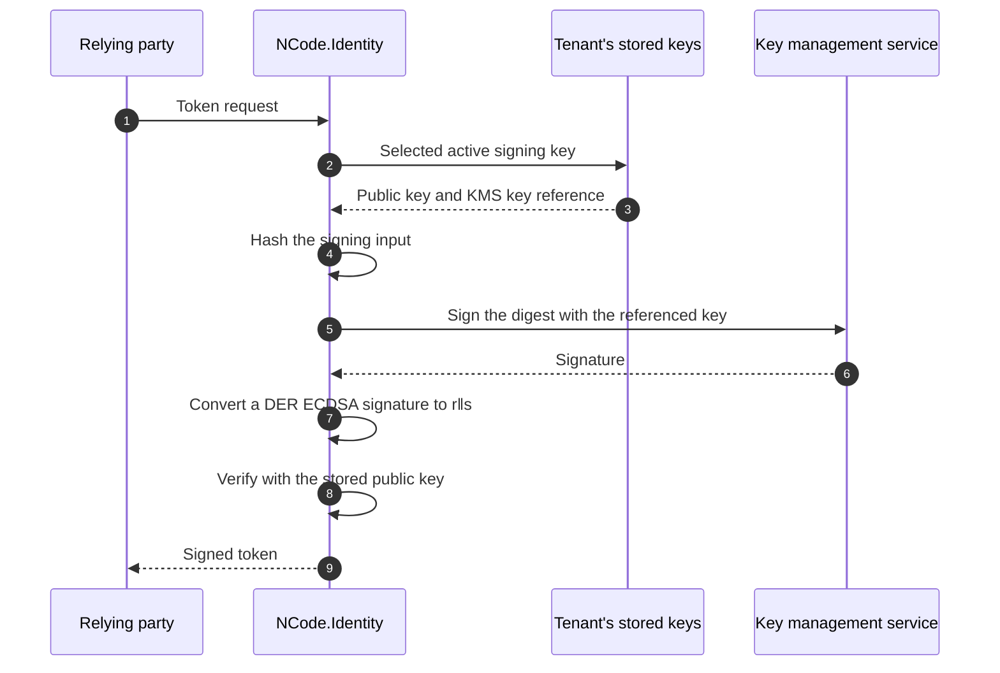

# Remote Signing Keys

> **A tenant's signing keys can stay inside AWS KMS, Azure Key Vault or Google Cloud KMS.** Every token is signed there
> and verified before it leaves the server, and the private key never reaches the server.

|                    |                                                                                                                                                                                                                                                                                                                       |
| ------------------ | --------------------------------------------------------------------------------------------------------------------------------------------------------------------------------------------------------------------------------------------------------------------------------------------------------------------- |
| **Status**         | Available: a tenant's signing keys, in AWS KMS, Azure Key Vault (and Managed HSM) and Google Cloud KMS, chosen per tenant                                                                                                                                                                                             |
| **Packages**       | `NCode.Identity.Secrets.Abstractions` (the remote vocabulary), `NCode.Identity.Secrets` and `NCode.Identity.Secrets.Persistence` (the key, its storage and its destruction), `NCode.Identity.Jose.Abstractions` and `NCode.Identity.Jose` (the asynchronous signing seam), `NCode.Identity.Secrets.KeyWrapping.AwsKms`, `.AzureKeyVault` and `.GoogleCloudKms` (the providers), `NCode.Identity.OpenId.Core` (the setting and the rollover) |
| **Key decisions**  | [ADR-1471](../decisions/1471-a-tenants-signing-keys-can-be-held-in-a-key-management-service-that-signs-every-token.md), [ADR-1472](../decisions/1472-signing-is-asynchronous-from-the-signature-algorithm-to-every-caller.md), [ADR-1404](../decisions/1404-a-tenants-provisioned-keys-roll-over-ahead-of-retirement-and-expire-after-a-grace.md), [ADR-1475](../decisions/1475-the-management-api-creates-a-tenants-key-in-a-key-management-service-and-binds-one-that-proves-it-signs.md) |
| **Operator guide** | The reference host's [Remote signing keys](../../src/NCode.Identity.OpenId.Host/README.md#remote-signing-keys); the tenant setting `tenant_signing_key_provider`; the configuration sections under `SecretProtection:RemoteKeyProviders`; the Helm chart's `secretProtection.remoteKeyProviders` values, in its [Tenant signing keys](../../charts/ncode-identity-host/README.md#tenant-signing-keys)                                                                          |

## The promises

|     | Promise                                                                                                                                                                                                                                  |
| --- | ---------------------------------------------------------------------------------------------------------------------------------------------------------------------------------------------------------------------------------------- |
| 1   | **The private key never leaves the KMS.** The server stores each key's public half and a reference to it, and asks the KMS to sign.                                                                                                      |
| 2   | **Every signature is verified.** The server checks what the KMS returned with the key's stored public half before a token carries it, so a wrong signature fails the token and never reaches a relying party.                           |
| 3   | **Publishing a key never calls the KMS.** The key set serves the stored public halves, so a verifier's fetch costs no request and a KMS outage does not stop verification.                                                                |
| 4   | **A tenant opts in.** The tenant setting `tenant_signing_key_provider` chooses the service for one tenant, or for every tenant beneath a team or the platform; empty keeps the keys local.                                                |
| 5   | **A change of custody hands over after the activation delay.** The successor is generated in the selected service and published for the whole delay before it signs, so a verifier that cached the key set already holds it.             |
| 6   | **A successor is a further version of the same KMS key.** A rollover adds a Google crypto key version or an Azure key version to the tenant's key for that algorithm; AWS KMS has no versions of an asymmetric key, so it creates one key. |
| 7   | **A key the server created is destroyed after the commit that removes its record.** Never before, and never a key the server did not create.                                                                                              |
| 8   | **Retries are bounded and jittered.** Each service's SDK retries a throttled or unavailable call with exponential back-off and jitter, up to a small fixed number of attempts, in one layer.                                              |
| 9   | **A host that cannot serve a key does not start.** A registered provider that has no mapping for a provisioned signature key stops the host, and a stored remote key that cannot be read stops its tenant from loading.                    |
| 10  | **A bound key proves it signs.** A key an operator brings is stored only after it signs a challenge that the supplied public half verifies, and the server never destroys it. |

## Why this matters

A stored private key is protected under the tenant's master key
([Encryption at Rest](./encryption-at-rest.md)), but a running replica holds every key it loaded, so a process that is
read holds every private key its tenants sign with. A key management service narrows that exposure: the private half is
generated inside it and never leaves, so a compromised replica can ask the service to sign only while it holds the
credentials to ask, and a copied heap holds no key to take away. Regulated deployments often require exactly this: the
signing key lives in a service backed by a hardware security module, with its own access log and its own permissions.

## How it works, in one picture

1. The tenant's setting names a service, so each signature key the rollover provisions is created inside it. The server
   reads the created key's public half, records it with the key's reference, and never sees the private half.
2. To sign, the server hashes the signing input and asks the service to sign the digest with the referenced key; a
   service that signs the whole input receives it instead.
3. A service that returns an ECDSA signature as a DER sequence is converted to the concatenation `r‖s` that JOSE and
   COSE carry.
4. The server verifies the signature with the stored public key. A signature that does not verify is an error and
   no token carries it.
5. The key set publishes the stored public halves, so a verifier never causes a call to the service.

## Why this design

| Approach                                           | Private key stays out of the server | Wrong signature caught before it leaves | Verification survives a KMS outage | One setting per tenant |
| -------------------------------------------------- | ----------------------------------- | --------------------------------------- | ---------------------------------- | ---------------------- |
| **Sign in the KMS, verify locally (chosen)**       | Yes                                 | Yes                                     | Yes, from the stored public key    | Yes                    |
| Sign in the KMS and trust the signature            | Yes                                 | No                                      | Yes                                | Yes                    |
| Fetch the public key from the KMS per request      | Yes                                 | Yes                                     | No                                 | Yes                    |
| Keep the key local under a master key              | No                                  | n/a                                     | Yes                                | n/a                    |

Options we rejected

- A remote key that is not an RSA or ECC key class, fetching public keys per request, trusting the service's
  signature unverified, a retry layer of the family's over the SDK's, separate provider packages, a host-only switch or
  a setting per algorithm, switching custody at once, remote encryption keys, deleting an Azure key per rollover and
  protecting the reference under the master key:
  [ADR-1471, Options considered](../decisions/1471-a-tenants-signing-keys-can-be-held-in-a-key-management-service-that-signs-every-token.md#options-considered).
- Asynchronous twins beside the synchronous members, blocking on a task, signing before encoding and a callback on the
  credentials: [ADR-1472, Options considered](../decisions/1472-signing-is-asynchronous-from-the-signature-algorithm-to-every-caller.md#options-considered).

## The signing seam

Signing is asynchronous from the signature algorithm to every caller: JWS, JWT, DPoP proofs, SD-JWT and COSE and CWT
await it. A local key completes without waiting, so a tenant with local keys pays nothing for the seam, and a remote
key awaits the service. A remote key is an RSA or ECC key class that holds the stored public half, so every
algorithm's key-type and curve checks, the key's JWK and every verification apply unchanged, and the key refuses to
sign with any algorithm other than the one it is bound to.

> [!TIP]
> [ADR-1472](../decisions/1472-signing-is-asynchronous-from-the-signature-algorithm-to-every-caller.md),
> `SignatureAlgorithm.SignAsync`, `IRemoteSecretKey`, `RemoteKeySigning`, `JoseEncoder`.

## What each service signs

A mapping row names, for one JOSE algorithm and key, the service's key specification and signing algorithm, the
digest the service signs, and whether it returns ECDSA as DER. The rows are open data: a package registers another
source of rows to add an algorithm.

| Provider           | `alg`                        | Key                       | `KeySpec`                                                     | `SigningAlgorithm`                    | Digest          | DER |
| ------------------ | ---------------------------- | ------------------------- | ------------------------------------------------------------- | ------------------------------------- | --------------- | --- |
| `aws-kms`          | RS256/384/512                | RSA 2048, 3072, 4096 each | `RSA_{n}`                                                     | `RSASSA_PKCS1_V1_5_SHA_{256,384,512}` | SHA-256/384/512 | no  |
| `aws-kms`          | PS256/384/512                | RSA 2048, 3072, 4096 each | `RSA_{n}`                                                     | `RSASSA_PSS_SHA_{256,384,512}`        | SHA-256/384/512 | no  |
| `aws-kms`          | ES256 / ES384 / ES512        | P-256 / P-384 / P-521     | `ECC_NIST_P256/P384/P521`                                     | `ECDSA_SHA_256/384/512`               | SHA-256/384/512 | yes |
| `google-cloud-kms` | RS256                        | RSA 2048, 3072, 4096      | `RSA_SIGN_PKCS1_{n}_SHA256`                                   | = `KeySpec`                           | SHA-256         | no  |
| `google-cloud-kms` | RS512 / PS512                | RSA 4096                  | `RSA_SIGN_PKCS1_4096_SHA512` / `RSA_SIGN_PSS_4096_SHA512`     | = `KeySpec`                           | SHA-512         | no  |
| `google-cloud-kms` | PS256                        | RSA 2048, 3072, 4096      | `RSA_SIGN_PSS_{n}_SHA256`                                     | = `KeySpec`                           | SHA-256         | no  |
| `google-cloud-kms` | ES256 / ES384                | P-256 / P-384             | `EC_SIGN_P256_SHA256` / `EC_SIGN_P384_SHA384`                 | = `KeySpec`                           | SHA-256/384     | yes |
| `azure-key-vault`  | RS256/384/512, PS256/384/512 | RSA 2048, 3072, 4096 each | `RSA`                                                         | the `alg`                             | SHA-256/384/512 | no  |
| `azure-key-vault`  | ES256 / ES384 / ES512        | P-256 / P-384 / P-521     | `EC`                                                          | the `alg`                             | SHA-256/384/512 | no  |

The provisioned defaults, RS256 and PS256 at 3072 bits and ES256 on P-256, are held by all three providers.

> [!TIP]
> [ADR-1471](../decisions/1471-a-tenants-signing-keys-can-be-held-in-a-key-management-service-that-signs-every-token.md),
> `AwsKmsSigningAlgorithms`, `AzureKeyVaultSigningAlgorithms`, `GoogleCloudKmsSigningAlgorithms`,
> `RemoteSigningAlgorithm`.

## Configuration

A deployment registers a provider with `AddAwsKmsRemoteKeyProvider`, `AddAzureKeyVaultRemoteKeyProvider` or
`AddGoogleCloudKmsRemoteKeyProvider`, which bind their options strictly from a configuration section, validate them
when the host starts and reuse the key wrapper's client with the deployment's own identity. Registering a provider
selects it: the host does not start unless it holds every provisioned signature key. Each package's
`AddAwsKmsRemoteKeyProviderIfConfigured`, `AddAzureKeyVaultRemoteKeyProviderIfConfigured` and
`AddGoogleCloudKmsRemoteKeyProviderIfConfigured` method registers its provider only when its section exists, and the
reference host calls them.

| Provider                    | Section                                                  | Settings                                                                          |
| --------------------------- | -------------------------------------------------------- | --------------------------------------------------------------------------------- |
| `aws-kms`                   | `SecretProtection:RemoteKeyProviders:AwsKms`             | `Region`; `PendingWindowInDays`, 7 to 30 (default 30)                             |
| `azure-key-vault`           | `SecretProtection:RemoteKeyProviders:AzureKeyVault`      | `VaultUri`; `HardwareProtected` (default `true`)                                  |
| `google-cloud-kms`          | `SecretProtection:RemoteKeyProviders:GoogleCloudKms`     | `KeyRing`; `HardwareProtected` (default `true`)                                   |

The reference host's Helm chart configures them with the `secretProtection.remoteKeyProviders` values (`awsKms.region`
and `pendingWindowInDays`, `azureKeyVault.vaultUri` and `hardwareProtected`, `googleCloudKms.keyRing` and
`hardwareProtected`). It registers a provider when its first value is set and mounts that vendor's workload identity
into the pods; see the chart README's
[Tenant signing keys](../../charts/ncode-identity-host/README.md#tenant-signing-keys).

A tenant, a team or the platform selects a provider with the setting `tenant_signing_key_provider`, whose value is
empty (local keys) or one of the registered provider names. The setting is environment-bound, so each environment chooses
its own custody, and it carries from a platform or team document to the tenants beneath it, as
`OpenId:Platform:Settings:tenant_signing_key_provider`. Encryption keys are always local. A change of the setting hands
the tenant's signature keys over after the activation delay, and the superseded keys retire with the reason
`custody_changed` ([Key Rollover](./key-rollover.md)).

> [!TIP]
> [ADR-1471](../decisions/1471-a-tenants-signing-keys-can-be-held-in-a-key-management-service-that-signs-every-token.md),
> `AwsKmsRemoteKeyProviderOptions`, `AzureKeyVaultRemoteKeyProviderOptions`, `GoogleCloudKmsRemoteKeyProviderOptions`,
> `OpenIdSettingKeys.TenantSigningKeyProvider`.

## Management API

The management API shows which provider holds a key, creates a tenant's key in a provider and binds a key that a
provider already holds. Remote keys belong to tenants only, so the routes sit under a tenant.

- **Reading.** A `remote` secret's `remoteKeyProvider` field names its provider, such as `aws-kms`, and is `null` for a
  key the server holds. The KMS key identifier is never returned.
- **Creating a key.** `POST /api/tenants/{tenantId}/secrets/remote` takes a `CreateRemoteSecretRequest`:
  `remoteKeyProvider`, `secretType` (`rsa` or `ecc`), `keySizeBits`, an optional `curve`, `algorithm`, `expiresWhen`
  and the optional `activatesWhen` and `retiresWhen`. It needs `Create` authority at the tenant, validates the request
  against the provider's mapping before it calls the KMS, and answers `201` with the secret. The key has `Origin`
  `generated`, so deleting the secret destroys the key in the KMS. A request that fails validation answers `400`, a
  missing tenant `404`, a secret identifier the tenant already holds `409` before the KMS is called, a write that
  lost a concurrency race `412` after the created key is destroyed and a KMS failure or refusal `502`.
- **Binding a key.** `POST /api/tenants/{tenantId}/secrets/remote/import` takes an `ImportRemoteSecretRequest`:
  `remoteKeyProvider`, `remoteKeyId`, the key's public half as `secretType`, `format` and `keyMaterial`, `algorithm`,
  `expiresWhen` and the optional `activatesWhen` and `retiresWhen`. The `remoteKeyId` is the service's identifier for
  the key: an AWS KMS key ARN, an Azure Key Vault versioned key identifier, or a Google Cloud KMS crypto key version
  resource name. It holds at most 8,000 characters together with the provider name and a colon, the stored reference
  `<provider>:<keyId>` (7,992 for `aws-kms`), and no control character and no leading or trailing white space. The
  server stores the key only after it signs 32 random bytes through the referenced key and the
  supplied public half verifies the signature. The key has `Origin` `supplied`, so the server never destroys it. The
  route needs `Create` authority at the tenant and `Update` authority at the platform, because the deployment's identity
  reaches every key the KMS lets it use. A key that does not prove it signs, an unregistered provider or an algorithm that is not a registered signature algorithm
  for the key's type answers `400`; a secret identifier or `kid` the tenant already holds answers `409`; a KMS failure
  or refusal answers `502`.
- **Updating.** An update keeps the algorithm of a `remote` secret: a different algorithm answers `400`, because the
  key is bound to its algorithm.
- **Capabilities.** The capabilities list the registered provider names in `remoteKeyProviders`, sorted ordinally, so a
  client offers only the providers a deployment registers.

> [!TIP]
> [ADR-1475](../decisions/1475-the-management-api-creates-a-tenants-key-in-a-key-management-service-and-binds-one-that-proves-it-signs.md),
> `CreateRemoteSecretRequest`, `ImportRemoteSecretRequest`, `TenantRemoteSecretApiEndpointHandler`.

## Permissions

The deployment's identity, resolved by each SDK's default credential chain, needs these permissions. No credential is
read from configuration.

- **AWS:** `kms:CreateKey`, `kms:TagResource`, `kms:GetPublicKey`, `kms:Sign`, `kms:ScheduleKeyDeletion` and
  `kms:DescribeKey`.
- **Azure:** the `Key Vault Crypto Officer` role on the vault (keys create, sign and update).
- **Google:** `cloudkms.cryptoKeys.create` and `cloudkms.cryptoKeyVersions.create`, `.get`, `.viewPublicKey`,
  `.useToSign` and `.destroy` on the key ring.

A key an operator binds needs only signing: AWS `kms:Sign`, Azure `Key Vault Crypto User` on the key, Google
`cloudkms.cryptoKeyVersions.useToSign`.

The server creates sign-only keys, hardware-protected by default on Azure and Google, and destroys only the keys it
created. Its logs carry identifiers only, never an input, a digest or a signature.

## Limits and roadmap

- **Every token costs a round trip, and a fee where the service bills by request.** A throttled service slows
  issuance; the SDKs' bounded retry absorbs a brief limit, not a sustained one.
- **A KMS outage stops issuance for the tenants whose keys it holds.** Verification, the key set and every tenant with
  local keys continue.
- **A key created by a seed or a rollover that loses its commit race stays in the service.** It is unused and tagged
  with its group; the server destroys only the keys whose records it removes.
- **A Google crypto key is permanent.** Its versions are destroyed, the crypto key stays.
- **Azure versions accumulate disabled.** Key Vault deletes whole keys only, so removing a record disables its version.
- **Encryption keys are local.** Only a tenant's signing keys can be held in a service; decryption stays local, as do
  the platform's, clients', resource servers', the protocol client's, DPoP and BFF keys.

## Further reading

- Decisions: [ADR-1471](../decisions/1471-a-tenants-signing-keys-can-be-held-in-a-key-management-service-that-signs-every-token.md),
  [ADR-1472](../decisions/1472-signing-is-asynchronous-from-the-signature-algorithm-to-every-caller.md),
  [ADR-1404](../decisions/1404-a-tenants-provisioned-keys-roll-over-ahead-of-retirement-and-expire-after-a-grace.md),
  [ADR-1169](../decisions/1169-every-tenant-is-provisioned-with-persisted-keys.md),
  [ADR-1468](../decisions/1468-a-security-effect-that-follows-a-committed-change-runs-on-its-own-bounded-token.md)
- Code: [`RemoteKeys`](../../src/NCode.Identity.Secrets.Abstractions/RemoteKeys),
  [`RemoteKeySigning`](../../src/NCode.Identity.Secrets/RemoteKeys/RemoteKeySigning.cs),
  [`SignatureAlgorithm`](../../src/NCode.Identity.Jose.Abstractions/Algorithms/SignatureAlgorithm.cs),
  [`DefaultRemoteSecretDestroyer`](../../src/NCode.Identity.Secrets.Persistence/DefaultRemoteSecretDestroyer.cs),
  [`AwsKmsRemoteKeyProvider`](../../src/NCode.Identity.Secrets.KeyWrapping.AwsKms/AwsKmsRemoteKeyProvider.cs),
  [`AzureKeyVaultRemoteKeyProvider`](../../src/NCode.Identity.Secrets.KeyWrapping.AzureKeyVault/AzureKeyVaultRemoteKeyProvider.cs),
  [`GoogleCloudKmsRemoteKeyProvider`](../../src/NCode.Identity.Secrets.KeyWrapping.GoogleCloudKms/GoogleCloudKmsRemoteKeyProvider.cs),
  [`DefaultTenantKeyPolicy`](../../src/NCode.Identity.OpenId.Core/Tenants/Keys/DefaultTenantKeyPolicy.cs)
