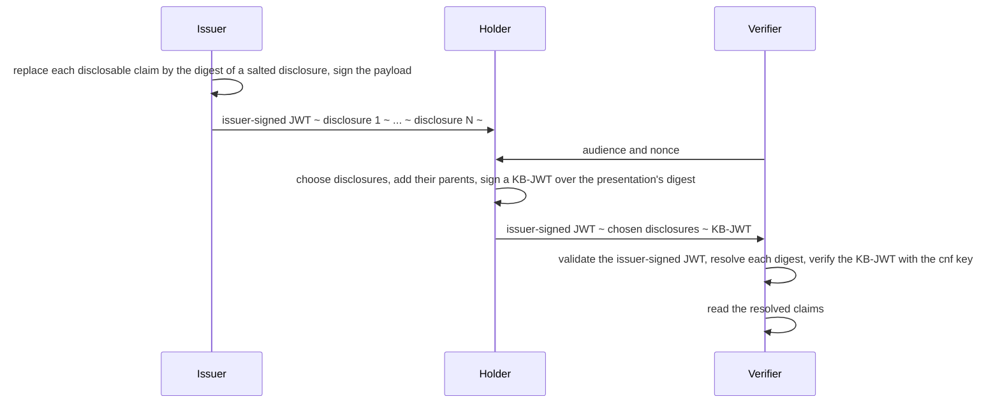

# Selective Disclosure (SD-JWT)

> **Issue a credential once, and let its holder reveal only the claims each verifier needs.** The issuer's signature
> still covers every claim, the verifier can count none of the withheld ones, and a presentation can be bound to the
> holder's own key.

|                    |                                                                                                                                                                                                                                                          |
| ------------------ | -------------------------------------------------------------------------------------------------------------------------------------------------------------------------------------------------------------------------------------------------------- |
| **Status**         | Available: issuance, presentation and verification of SD-JWTs (RFC 9901) and the SD-JWT VC profile                                                                                                                                                      |
| **Packages**       | `NCode.Identity.Jose.SdJwt` over `NCode.Identity.Jwt` and `NCode.Identity.Jose`                                                                                                                                                                         |
| **Key decisions**  | [ADR-1405](../decisions/1405-selective-disclosure-jwts-are-an-opt-in-package-that-issues-presents-and-verifies-over-the-jwt-validator.md) |
| **Operator guide** | None: the package is a library a host composes with `AddSdJwt()`                                                                                                                                                                                       |

## The promises

|     | Promise                                                                                                                                                                         |
| --- | ------------------------------------------------------------------------------------------------------------------------------------------------------------------------------- |
| 1   | A verifier learns only the claims the holder discloses; a withheld claim leaves nothing but a salted digest it cannot invert, and decoys hide how many claims were withheld.    |
| 2   | Every disclosed claim is covered by the issuer's signature, through the digest the issuer signed over the disclosure exactly as issued.                                         |
| 3   | A presentation can be bound to the holder's key: the verifier checks a Key Binding JWT against the key the issuer wrote to `cnf`, its own audience and nonce, and the digest of the presentation it accompanies. |
| 4   | A presentation that breaks a rule of RFC 9901 is refused with a machine-readable code: a repeated digest, a disclosure nothing references, a claim disclosed twice, a reserved name, a disclosure of the wrong kind. |
| 5   | The work a presentation can demand is bounded: the number of disclosures and the depth of the resolved claims are limits the host configures and the start validates.           |
| 6   | Every salt comes from the platform's cryptographically secure random number generator and is at least 128 bits.                                                                 |
| 7   | An SD-JWT VC is the same SD-JWT under a profile: `dc+sd-jwt`, a required `vct`, and claims that stay in the signed payload.                                                      |
| 8   | A protected claim is plaintext in its entirety: `iss`, `nbf`, `exp` and `cnf` under every profile, and the profile's claims such as `status` and the claims it requires, are never disclosable in whole or in part, so a withheld part of one can never pass as a decoy. |

## Why this matters

A credential is issued once and presented many times, to parties that need different parts of it. A plain JWT reveals
every claim to every verifier, and a credential issued per verifier would need the issuer at every presentation. An
SD-JWT lets the issuer sign once over salted digests and the holder reveal, per presentation, the disclosures that
match the claims a verifier needs, while a Key Binding JWT proves the presenter holds the key the credential was
issued to.

## How it works, in one picture

1. The issuer walks the claims depth first and moves each disclosable member or element into a salted disclosure,
   writing its digest in the `_sd` array of its object or as a `{"...": digest}` placeholder in its array.
2. The holder resolves where each disclosure lands and presents the chosen ones with the disclosures they depend on.
3. When the verifier supplied an audience and a nonce, the holder appends a `kb+jwt` Key Binding JWT whose `sd_hash`
   is the digest of everything before it.
4. The verifier validates the issuer-signed JWT, a compact JWS, under the JWT library's policy, resolves the
   disclosures into the payload, drops the decoys, refuses any digest beneath a protected claim, and verifies the Key
   Binding JWT with the holder key from `cnf`.
5. The result is one JSON object with every disclosed value in place and the selective disclosure members removed.

## Why this design

| Concern                        | This design                                                                      | Usual alternative                                              |
| ------------------------------ | -------------------------------------------------------------------------------- | -------------------------------------------------------------- |
| Signature and key policy       | The JWT validator, with the caller's whole policy in its parameters              | A second verifier with its own allow-lists                     |
| Which claims are disclosable   | JSON Pointers into the claims document, nested pointers for recursive disclosure | A parallel claims builder                                      |
| Hash algorithms and `cnf` methods | Registered data, open to another hash or confirmation method                  | A fixed `sha-256` and `jwk`                                    |
| Profiles                       | Data the issuer and the verifier both apply                                      | A separate SD-JWT VC code path                                 |

Options we rejected

See the Options considered of [ADR-1405](../decisions/1405-selective-disclosure-jwts-are-an-opt-in-package-that-issues-presents-and-verifies-over-the-jwt-validator.md#options-considered).

## Issuing

`ISdJwtIssuer.IssueAsync` takes `SdJwtIssuanceOptions`: the signing credentials (an asymmetric key), the claims as a JSON
object, the JSON Pointers of the disclosable claims such as `/given_name`, `/address/street_address` or
`/nationalities/1`, the number of decoy digests, the `_sd_alg` algorithm, the holder's public JSON Web Key for `cnf`,
and the profile. It returns the SD-JWT with every disclosure, whose `ToString()` is the combined format handed to the
holder.

> [!TIP]
> [ADR-1405](../decisions/1405-selective-disclosure-jwts-are-an-opt-in-package-that-issues-presents-and-verifies-over-the-jwt-validator.md) decision 2;
> `DefaultSdJwtIssuer` and `IssuanceWalk` in `NCode.Identity.Jose.SdJwt`.

## Presenting

`ISdJwtHolder.Parse` reads the combined format, `ResolveDisclosures` maps each disclosure to the claim it discloses
and the disclosure that carries its digest, and `CreatePresentationAsync` builds the presentation from the chosen
disclosures, their parents, and the Key Binding JWT when `SdJwtKeyBindingOptions` names the holder's key, the
audience and the nonce.

> [!TIP]
> [ADR-1405](../decisions/1405-selective-disclosure-jwts-are-an-opt-in-package-that-issues-presents-and-verifies-over-the-jwt-validator.md) decision 2;
> `DefaultSdJwtHolder` in `NCode.Identity.Jose.SdJwt`.

## Verifying

`ISdJwtVerifier.VerifyAsync` takes the presentation and `SdJwtVerificationParameters`: the `JwtValidationParameters`
of the issuer-signed JWT, whose signature algorithms must be named, the `SdJwtKeyBindingRequirement` with the
verifier's audience, nonce, accepted algorithms and the Key Binding JWT's maximum age, and the profile. The result
carries the resolved claims, where each disclosure landed, the decoded issuer-signed JWT and the verified key binding,
or the `SdJwtVerificationFailureCodes` code of the rule the presentation failed.

> [!TIP]
> [ADR-1405](../decisions/1405-selective-disclosure-jwts-are-an-opt-in-package-that-issues-presents-and-verifies-over-the-jwt-validator.md) decisions 3
> and 4; `DefaultSdJwtVerifier` and `SdJwtPayloadProcessor` in `NCode.Identity.Jose.SdJwt`.

## Limits and roadmap

- The verifier resolves no status mechanism: the `status` claim of an SD-JWT VC reaches the verified claims as the
  issuer wrote it, for a status checker the application brings.
- The built-in confirmation-key resolver reads `cnf.jwk`; a `kid` or `jku` resolver is an application's own
  `IConfirmationKeyResolver`, and each `cnf` member has exactly one resolver.
- The OpenID provider issues no SD-JWT of its own; the package is a library for issuers, wallets and verifiers.

## Further reading

- [ADR-1405](../decisions/1405-selective-disclosure-jwts-are-an-opt-in-package-that-issues-presents-and-verifies-over-the-jwt-validator.md)
- [RFC 9901](https://datatracker.ietf.org/doc/html/rfc9901),
  [draft-ietf-oauth-sd-jwt-vc](https://datatracker.ietf.org/doc/html/draft-ietf-oauth-sd-jwt-vc)
- `src/NCode.Identity.Jose.SdJwt`, `tests/NCode.Identity.Jose.SdJwt.Tests`
