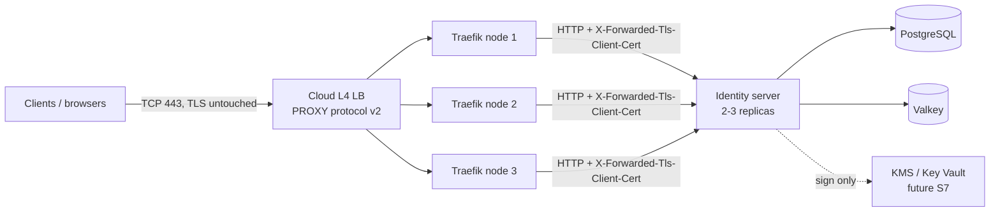

# Hosting analysis — entry-level production hosting

- **Status:** Research / pre-decision (no vendor chosen yet)
- **Prices captured:** 2026-10-18, list **monthly USD, excluding tax**, from each vendor's live pricing page or public
  read-only API (Vultr `api.vultr.com/v2/plans`, Akamai `api.linode.com/v4/*`). Prices drift — re-verify in the vendor
  console before purchase. Anything not verified live is marked _(verify)_.

## 1. Requirements

| Must-have                                                                 | Nice-to-have                                                    |
| ------------------------------------------------------------------------- | --------------------------------------------------------------- |
| 100% IaC with Terraform/OpenTofu, applied from GitHub Actions             | Near Denver, CO                                                 |
| Low-ish latency                                                           | Managed control plane (self-managed k3s is acceptable)          |
| Containerized services (Kubernetes / k3s)                                 | TLS + mTLS termination **and** pass-through                     |
| ≥ 3 nodes for service HA                                                  | Traefik sourcing tenant PKI / mTLS config from our datastores   |
| Traefik as the load balancer, with mTLS                                   | Mix-and-match vendors (compute, Postgres, Valkey, KMS)          |
| Entry-level, shared CPU OK, monthly billing                               |                                                                 |
| Backing services: **PostgreSQL** (EF Core / Npgsql) and **Valkey** (cache) | Remote keys (Azure Key Vault et al.) — backlog `S7`             |

Every option is judged against the platform's operating principles — cattle not pets, immutable artifacts, everything as
code, stateless services, redundancy by default, proven recoverability, and secure by default
([ADR-0134](adr/0134-cloud-native-operating-principles.md)).

## 2. Summary and ranked recommendations

**Goal:** the most reliability and capacity per dollar for an **all-in budget of about $100/month** — always-on, dev/test
first, production-ready without re-platforming. Vendors may differ per service, and free, reliable third-party services
fill every gap they can. Every topology meets the must-haves (OpenTofu from GitHub Actions, containers on ≥ 3 nodes,
Traefik behind one L4 load balancer). Ranking weighs, in order: HA of the tiers the service depends on (database
first — it is the system of record), how much of that is managed, capacity, latency to Denver, and budget headroom.

### Ranked topologies at ~$100/month

| Rank  | Topology                                   | What runs where                                                                                                                                                                                                                         | Monthly total                                                    | What the money buys                                                                                     | Trade-offs                                                                                                                                                       |
| ----- | ------------------------------------------ | --------------------------------------------------------------------------------------------------------------------------------------------------------------------------------------------------------------------------------------- | ---------------------------------------------------------------- | ------------------------------------------------------------------------------------------------------- | ---------------------------------------------------------------------------------------------------------------------------------------------------------------- |
| **1** | **Akamai Dallas — managed HA**             | **Kubernetes:** LKE, 4 × Linode 2 GB (4 vCPU / 8 GB, workers only — control plane is managed) · **LB:** NodeBalancer · **Postgres:** Akamai managed, **3-node HA**, same DC · **Valkey:** in-cluster, primary + replica + Sentinel · **Keys:** Azure Key Vault, South Central US (federated identity) | 4 × $12 + NB $10 + PG $37 = **$95**                              | HA in every tier except the free, non-HA control plane; managed failover, backups, and patching for the database; ~15–20 ms | x86; 2 GB nodes leave modest headroom. Variants: 3 × 4 GB + HA DB = $119, or 3 × 4 GB + single-node DB = $98.                                                   |
| **2** | **OCI Phoenix — maximum capacity**         | **Kubernetes:** k3s HA (3 servers, embedded etcd) on 3 × Ampere A1 (2 OCPU / 12 GB each = 6 vCPU / 36 GB), one per availability domain · **LB:** OCI Network LB (free) · **Postgres:** CloudNativePG, 3 instances, backups → S3 (Object Lock) or OCI Object Storage · **Valkey:** in-cluster HA · **Keys:** OCI Vault (instance principal, no secret) | A1 beyond the free allowance $27.74 + block storage ~$4 = **~$32** | ~3× rank 1's capacity; HA in every tier **including** the control plane, spread across 3 availability domains; 10 TB free egress | You operate k3s and Postgres; arm64 images; A1 capacity can be scarce; home region fixed at sign-up. A 3 × 1 OCPU / 8 GB cluster fits the free allowance (~$4). |
| **3** | **Vultr Dallas — lean nodes, HA DB**       | **Kubernetes:** VKE, 3 × 1 vCPU / 2 GB · **LB:** Vultr LB · **Postgres:** Vultr managed, 2 GB + 1 replica · **Valkey:** in-cluster · **Keys:** Azure Key Vault, South Central US                                                                 | $30 + LB $10 + PG $50 = **$90**                                  | Managed control plane and HA database                                                                  | One fewer node and a 2-node (not 3-node) database vs. rank 1 for about the same money; VKE HA control-plane price unpublished. Variant: k3s on 3 × 2 vCPU / 4 GB + single-node DB = $97.    |
| **4** | **DigitalOcean Kansas City — closest**     | **Kubernetes:** DOKS, 3 × 2 GiB Premium Intel · **LB:** DO LB · **Postgres:** DO managed, 1 GiB single node · **Valkey:** in-cluster · **Keys:** Azure Key Vault, Central US                                                                     | $48 + LB $12 + PG $15.15 = **~$75**                              | Lowest latency (~10–15 ms); managed control plane and database                                         | **No database HA within budget** (2 GiB + standby is $60.90 → ~$121); MKC1 offers Premium-Intel droplets and limited DB plans only _(verify)_.                 |
| **5** | **Civo NYC1 — free egress**                | **Kubernetes:** Civo managed k3s, 3 × 4 GB · **LB:** Civo LB · **Postgres:** CloudNativePG in-cluster · **Valkey:** in-cluster · **Keys:** Azure Key Vault, East US                                                                              | $65.19 + LB $10.86 = **~$76**                                    | 6 cores / 12 GB; unlimited free egress                                                                  | You operate Postgres (Civo's managed PG starts at $43.45 → ~$119); east-coast latency (35–45 ms); no published HA control plane.                                |

Every row adds the shared free services below. Key Vault usage is excluded: backlog `S7` isn't built yet, and it is
cents per month once it is.

**Why this order:**

- **Rank 1** spends the budget where an identity provider needs it most — a managed, replicated system of record — and
  leaves nothing important as a single point of failure. A managed control plane also frees each node of the ~0.6–0.9
  GiB k3s server overhead, so 4 × 2 GB carries the [§4](#4-compute-sizing) workload with N-1 headroom.
- **Rank 2** delivers the most for the least and is the only multi-AD option, but makes you the database operator.
  Pick it over rank 1 if you're comfortable running CloudNativePG, or to bank ~$68/month of budget.
- **Ranks 3–5** each give up something rank 1 keeps: a node and a database replica (3), database HA (4), or managed
  Postgres and latency (5).

**Not recommended at this budget:** Hetzner US (3 × CPX21 + LB11 = $122.76, all self-managed, plans showing
"unavailable"); Hostinger (Boston only, 24-month prepay, no LB or private network); always-on Azure (the Visual Studio
credit forbids it; paid ≈ 3 × B2pls v2 $88.26 + Standard LB $18.25 + IP $3.65 + PostgreSQL B1ms ~$19.37 ≈ **$130**);
Neon / Aiven free tiers as the always-on database (wrong region, scale-to-zero, or power-off).

### Environment model

Decided in [ADR-0131](adr/0131-hosted-platform-environment-model-and-hostname-scheme.md).

- **Customer environments are tenants on production.** A customer's dev, test, and prod are separate tenants on the one
  production platform (the Auth0 model): `acme-dev.auth.nidentity.io`, `acme-test.auth.nidentity.io`,
  `acme.auth.nidentity.io`. Their non-production runs on exactly the hardware, versions, and configuration their
  production does, so no customer incident can be blamed on environment drift, and promotion is tenant configuration
  (management API), not infrastructure.
- **The platform itself has two environments:** **production** — every customer tenant, plus internal `canary` and
  `conformance` tenants for post-deploy smoke tests and OpenID certification runs — and the **lab**, the platform
  owner's private proving ground for platform changes, upgrades, and conformance experiments, which never hosts a
  customer tenant. Lab hosts carry a `lab` label (`auth.lab.nidentity.io`) so a platform environment can't be confused
  with a customer's `-dev` tenant; `dev`, `test`, and `staging` are reserved for customers' tenants and never name a
  platform environment ([ADR-0131](adr/0131-hosted-platform-environment-model-and-hostname-scheme.md)).
- **Production therefore carries customers' dev/test traffic too:** per-tenant rate limits and quotas keep one
  tenant's load test from starving another (backlog `F45`).

### Recommended plan

1. **Now — the lab:** run it on OCI's Pay-As-You-Go A1 allowance in Phoenix as an **OKE Basic** cluster (free managed
   control plane) with a 3 × 1 OCPU / 8 GB node pool spread across the region's three availability domains
   (**~$0–4/month**) — managed node pools keep the lab disposable ([ADR-0134](adr/0134-cloud-native-operating-principles.md))
   — plus ephemeral load-test and topology runs on the Azure Visual Studio credit
   ([§10](#10-devtest-and-conformance-on-azure-visual-studio-credit), $0). The Kubernetes layer (Traefik, charts, app)
   is identical to production; only the cluster, LB, and database modules differ — acceptable because no customer
   tenant runs there. Publish multi-arch (amd64 + arm64) images.
2. **Before the first customer — production:** stand up rank 1 at its smallest (LKE 3 × 2 GB + NodeBalancer +
   single-node 1 GB Postgres = **$62/month**) to burn in deployments, then grow it in place to the **$95** configuration
   (4th node, 3-node HA database) at launch. Gate the production GitHub environment with required reviewers, and verify
   every release on the production `canary` tenant before customers see it — that is where any lab-vs-production
   platform difference (OKE/arm64/CloudNativePG vs. LKE/x86/managed Postgres) surfaces.

**All-in: ~$4 now; ~$66 during burn-in; at launch ~$95 (production) + ~$4 (lab) + $0 (Azure credit, free services) ≈
$99/month.** The next dollars, in order of value: 3 × 4 GB nodes (+$24), a 2 GB 3-node database (+$37), the LKE HA
control plane (+$60).

### Shared free services (every topology)

| Concern                                        | Service                                       | Free allowance (verified 2026-10-18 unless noted)                                                                        |
| ---------------------------------------------- | --------------------------------------------- | ------------------------------------------------------------------------------------------------------------------------ |
| Source, infrastructure code, CI, images        | GitHub Actions + GitHub Container Registry    | Free for public repositories and public packages, including environments with required reviewers ([ADR-0132](adr/0132-platform-infrastructure-as-code-is-public-on-github.md)) |
| DNS                                            | Cloudflare DNS                                | Free plan, incl. DNSSEC; registrar stays at Porkbun. Keep identity hosts **DNS-only** — proxying would terminate TLS at Cloudflare and drop the client certificate |
| Server certificates                            | Let's Encrypt via cert-manager                | Free                                                                                                                     |
| OpenTofu state, Postgres backups, vendor tokens | AWS S3 + SSM Parameter Store (dedicated account) | **Not free — cents/month at this size:** S3 Standard $0.023/GB-month, $5/M writes, $0.40/M reads; SSM standard parameters free |
| Metrics, logs, traces, synthetics, load tests  | Grafana Cloud Free                            | 10k active series, 50 GB logs, 50 GB traces, 14-day retention, 3 users, 100k synthetic API checks, 500 k6 VU-hours       |
| Uptime alerts (alternative)                    | UptimeRobot Free                              | 50 monitors, 5-minute interval (positioned for hobby / non-profit use)                                                   |
| Signing keys on OCI (production-capable)       | OCI Vault                                     | Software keys free; first 20 HSM key versions free, then $0.5334/version/month                                           |
| Key Vault experiments, ephemeral conformance   | Azure via the Visual Studio credit            | $50/month, dev/test only ([§10](#10-devtest-and-conformance-on-azure-visual-studio-credit))                               |
| Inbound email (`security@`, vendor accounts)   | Cloudflare Email Routing                      | Free; receive-and-forward only (sending needs Workers Paid)                                                              |
| Outbound email, when needed                    | OCI Email Delivery                            | 3,000 emails/month                                                                                                       |

### Key findings

- **Best value at ~$100:** Akamai Dallas — managed Kubernetes, 4 nodes, a NodeBalancer, and a **3-node managed
  PostgreSQL** for $95. The only other managed-HA database that fits is Vultr's 2-node option ($90 total, one fewer
  node); DigitalOcean's pushes past $120.
- **OCI is the "max-free" option:** a Pay-As-You-Go tenancy gets the first **3,000 Ampere A1 OCPU-hours and 18,000
  GB-hours free every month** (≈ 4 Arm vCPU + 24 GB always-on, double the Always Free tier), plus a free network LB,
  10 TB egress, 200 GB block storage, a free OKE Basic control plane, and free Vault keys.
- **Closest to Denver:** DigitalOcean's **MKC1 (Kansas City)** datacenter is the nearest mainstream-cloud region of any
  vendor surveyed (DOKS, load balancers, managed Postgres + Valkey all available there; Basic droplets are Premium-Intel
  only in MKC1). Next tier: **Dallas** (Vultr, Akamai), **Phoenix** (OCI), **Chicago** (Vultr, Akamai).
- **Cheapest real HA:** self-managed **k3s on 3 VMs** (all three are control-plane servers with embedded etcd **and**
  schedulable workers) behind one L4 load balancer — HA control plane and HA workers for the price of 3 small VMs + 1 LB.
- **Cheapest managed-HA Postgres:** Akamai — **3-node, 1 GB managed PostgreSQL for $37/mo**.
- **Free database tiers** (Neon / Aiven free Postgres, Aiven free Valkey) suit ad-hoc dev only — no HA, scale-to-zero /
  power-off, and no region choice put them far from the cluster.
- **Valkey can be self-hosted in-cluster** for $0 — it's a cache (DPoP replay/nonce stores), not a system of record.
- **Hetzner US is no longer entry-level:** US shared plans now start at $21.09 (2 vCPU / 2 GB) with 1 TB traffic, and
  several plans showed "currently unavailable".
- **Three server gaps found** while validating Traefik mTLS (tracked as `F43`, `F44`, `F47` in
  [`BACKLOG.md`](../BACKLOG.md)); see [§8](#8-traefik-mtls-and-tenant-pki).
- **Dev/test + conformance on Azure:** the Visual Studio Professional **$50/month Azure credit** covers ephemeral
  conformance / load-test / mTLS-topology environments and the Key Vault (`S7`) experiments — **not** production or
  always-on staging; see [§10](#10-devtest-and-conformance-on-azure-visual-studio-credit).

## 3. Reference architecture

- The cloud LB must be **L4 TCP pass-through** (never TLS-terminating, never an L7/CDN proxy) so Traefik sees the client
  certificate; PROXY protocol v2 preserves the client IP.
- Traefik terminates TLS, **requests** the client certificate on the mTLS host, and forwards it with the
  `passTLSClientCert` middleware; the server reads it via `OpenId:MutualTls:CertificateHeaderName`
  ([ADR-0097](adr/0097-sender-constrained-access-tokens-dpop-and-mtls.md)).
- RFC 8705 §5 mTLS endpoint aliases map naturally to a dedicated mTLS hostname (`mtls_endpoint_alias_authority`), so
  only that host asks for client certificates (per-tenant alias hosts need backlog `F47`).

### Domain and DNS — `nidentity.io`

The domain is registered at **Porkbun** (expires 2027-04-11). Registration stays there; DNS hosting moves to
**Cloudflare DNS (free)** — Porkbun's managed DNS is not used.

**Manual steps** — the only ones outside IaC, each done once — are written step by step, with verification, in the
[platform bootstrap runbook](platform-bootstrap.md): registrar hardening at Porkbun, the GitHub organization and the
public infrastructure repository, the Cloudflare account and a short-lived bootstrap token, the AWS member account with
IAM Identity Center (home region `us-west-2`), the OCI tenancy for the lab (home region Phoenix), running the bootstrap
stack, the registrar delegation, and the email-routing verification.

**Bootstrap stack** ([ADR-0132](adr/0132-platform-infrastructure-as-code-is-public-on-github.md)) — OpenTofu run once
from the owner's machine with those short-lived credentials (local state, then migrated into the bucket it creates):
the S3 **state bucket** (versioning, encryption, public-access block, TLS-only policy) and **backup bucket** (Object
Lock in compliance mode, archive lifecycle); the GitHub OIDC provider with a read-only **plan** role and an **apply**
role that trusts only the repository's protected `production` environment; the zone (`cloudflare_zone`, which outputs
the nameservers) and DNSSEC (`cloudflare_zone_dnssec`, which outputs the DS record); scoped Cloudflare tokens
(`cloudflare_account_token`) stored as SSM `SecureString`s; and, through `integrations/github`, the repository's
environments and rulesets. Revoke the bootstrap token afterwards.

**Everything else is OpenTofu** (official `cloudflare/cloudflare` provider) from GitHub Actions in the public
`NCodeGroup/identity-platform` repository, with zone-scoped tokens read from SSM — one for OpenTofu, a separate
DNS-edit-only token for certificate issuance: DNS records (`cloudflare_dns_record`), zone settings
(`cloudflare_zone_setting`), Email Routing, and notification policies. Records that track cluster IPs can alternatively
be owned by external-dns in-cluster.

**Certificates:** cert-manager with the Cloudflare DNS-01 solver issues Let's Encrypt certificates (wildcards included)
into Kubernetes Secrets that Traefik serves. Traefik's built-in ACME client keeps state per instance and doesn't share
it across 3 replicas, so it isn't used.

**Hostnames** — the issuer URL is baked into every client's configuration, so choose these once (decided in
[ADR-0131](adr/0131-hosted-platform-environment-model-and-hostname-scheme.md)). The scheme uses
**functional namespaces** under the apex — `auth` for the OpenID protocol, `mtls` for its certificate-bound aliases,
`manage` for the management plane — mirroring Auth0 (`{tenant}.us.auth0.com` for tenants, `manage.auth0.com` for the
dashboard):

| Hostname                                        | Serves                                                                                                   | Certificate                    |
| ----------------------------------------------- | -------------------------------------------------------------------------------------------------------- | ------------------------------ |
| `auth.nidentity.io`                             | Root (control-plane) tenant issuer — where admins sign in and management-API tokens are issued ([ADR-0031](adr/0031-control-plane-management-resource-server-and-root-tenant-seeding.md)) | `auth.nidentity.io`            |
| `{tenant}.auth.nidentity.io`                    | Workload tenant issuers, resolved by `DynamicByHost` (e.g. `acme.auth.nidentity.io`)                     | `*.auth.nidentity.io`          |
| `mtls.nidentity.io`, `{tenant}.mtls.nidentity.io` | RFC 8705 mTLS endpoint aliases — the only hosts where Traefik requests a client certificate. Per-tenant alias hosts need `F47`: `DynamicByHost` routes only on the issuer's host today | `mtls.…` + `*.mtls.nidentity.io` |
| `manage.nidentity.io`                           | Management API (`/api`) and admin console — the control-plane surface ([ADR-0042](adr/0042-management-api-route-driven-tenant-scope.md)) | `manage.nidentity.io`          |
| `nidentity.io`, `www.nidentity.io`              | Project site / docs                                                                                      | Hosting provider               |

Why this shape:

- **`auth`, not `id` or `login`:** the hosts serve machine-to-machine token, discovery, and JWKS endpoints as well as
  the login UI, and `auth.<domain>` is the convention developers expect.
- **Tenants nest under a function label rather than the apex** (`acme.auth.nidentity.io`, not `acme.nidentity.io`): no
  tenant name can ever collide with a service host (`www`, `manage`, `mtls`, `status`, `docs`, `dev`, …), so there is no
  reserved-name list to maintain, and each function gets one wildcard certificate. A tenant can still be moved to a
  dedicated deployment ([ADR-0024](adr/0024-control-plane-and-per-tenant-planes.md)) by changing its DNS record, without
  changing its issuer.
- **`mtls` is a sibling namespace, not `mtls.{tenant}.auth…`:** a wildcard covers one label only, so nesting would need a
  certificate per tenant.
- **`manage` is separate from `auth`:** the management plane gets its own CORS, rate-limit, and IP-allow-list policy at
  Traefik, and `/api` is routed **only** on `manage` (blocked on `auth` / `mtls` hosts) as defense in depth.
- **Custom domains later** (Auth0 parity): the tenant's issuer is its single origin — it both routes the tenant and
  anchors every published URL ([ADR-0129](adr/0129-the-tenant-issuer-is-the-single-authoritative-origin.md)) — so a
  custom domain (`login.customer.com`, CNAME'd to the platform) *becomes* the tenant's issuer. Choose it before clients
  integrate; cert-manager issues its certificate over HTTP-01.

**Environments.** Customer environments are just tenants on production (`acme-dev.auth.nidentity.io`), so they need no
extra hostnames. The platform's private **lab** inserts a `lab` label after the function: `auth.lab.nidentity.io`,
`{tenant}.auth.lab.nidentity.io`, `{tenant}.mtls.lab.nidentity.io`, `manage.lab.nidentity.io`. Ephemeral Azure runs use
one host each, `{run}.ci.nidentity.io`. The lab shares the production zone, so it must never hold a token that can edit
it: only the OpenTofu pipeline writes DNS (production changes gated by required reviewers), and lab/CI clusters obtain
certificates over HTTP-01 for their specific hosts — or, if they need wildcards, over DNS-01 with each
`_acme-challenge` name CNAME-delegated to a separate, throwaway validation zone, so a compromised lab cluster can't
alter production records.

All identity hosts are **DNS-only** in Cloudflare (no proxy), so TLS reaches Traefik untouched.

**Day-one records** (before any hosting exists):

- **CAA:** `0 issue "letsencrypt.org"` and `0 issuewild "letsencrypt.org"` (optionally pinned to the ACME account
  with `accounturi=`) — no other CA may issue for the domain. Cloudflare Universal SSL silently adds CAA records for
  its own CAs, so the `cloudflare-zone` module keeps it off; DNS-only hosts never use its edge certificates, and a host
  proxied through Cloudflare later needs an advanced certificate from a listed CA.
- **Inbound mail only:** Cloudflare Email Routing (free, receive-only; `cloudflare_email_routing_settings` / `_dns` /
  `_address` / `_rule`) forwards per-purpose addresses — `security@` for `security.txt`, `platform@` as the owner of
  every cloud resource ([ADR-0135](adr/0135-one-resource-tagging-strategy-across-every-vendor.md)), and one per vendor account
  such as `npm@`, `gitlab@`, `docker-ncodegroup@` — to the owner's personal mailbox; no catch-all. Its MX and SPF
  records replace a null MX; DMARC stays `v=DMARC1; p=reject` because nothing sends as the domain yet — an identity
  domain is a prime phishing target.
- **Account recovery:** the registrar, DNS host, and GitHub owner accounts recover through an **off-domain** personal
  mailbox, so a broken domain or DNS host can't lock out the accounts needed to fix it. Other vendor accounts (npm,
  GitLab, Docker Hub) use per-purpose `@nidentity.io` routing addresses, which can be re-pointed to another admin
  without touching each account.

**Cookies:** tenants share the registrable domain, so session cookies must stay host-only (`__Host-` prefix, no
`Domain` attribute) to keep one tenant's host from reading or setting another's.

**`.io` caveat:** the `.io` ccTLD's long-term status has been questioned since the 2024–25 Chagos sovereignty
agreement; no retirement is scheduled _(verify)_. Because the issuer URL is effectively permanent, consider registering
a fallback name while it is cheap.

**Domain portfolio (RDAP, 2026-10-18):** `nidentity.com` is held at Name.com since 2007-07-10 (expires 2027-07-10) and
listed for sale on Spaceship as make-offer (minimum offer $250); `nidentity.net`, `nidentity.dev`, and `nidentity.app` are unregistered.
Decide the **primary issuer domain before the first real client** — switching is free now and breaking later. Owning the
`.com` also keeps a look-alike of an identity brand out of a phisher's hands. A separate non-production domain is not
needed: subdomains plus the token isolation above give the same protection.

**`nidentity.com` due diligence (2026-10-18):** Wayback history shows a 2001–03 redirect to `nidsolutions.com`, PPC
parking ("may be for sale") from at least 2009, and a for-sale lander since; not listed on Spamhaus DBL, SURBL, or
URIBL; no MX record; nameservers point at Spaceship, so the listing is controlled by whoever controls the domain. The
GitHub organization `nidentity` belongs to an unrelated party (created 2021-10-17, no public repositories); repositories
and container images stay under `NCodeGroup` (`ghcr.io/ncodegroup/…`), which doesn't need to match the product domain.
The GitLab group [`gitlab.com/nidentity`](https://gitlab.com/nidentity) is held defensively (public, 2FA required,
no code — it points to GitHub); GitHub remains the single home for source, infrastructure code, CI, and packages
([ADR-0132](adr/0132-platform-infrastructure-as-code-is-public-on-github.md)). On npm the `@ncode` scope
belongs to an unrelated party, so JavaScript packages publish under the org-owned `@ncodegroup` scope (matching the
GitHub organization and GitHub Packages' scope rule), and `@nidentity` is held defensively (both orgs enforce 2FA); the
frontend's `@ncode/*`
workspace packages are private and resolve only through `workspace:*`, so they are renamed only if and when one is
published.
Further checks: Google Safe Browsing reports no unsafe content; **no `NIDENTITY` trademark** in the USPTO or the WIPO
Global Brand Database; other uses of the name are minor and unrelated or dormant — four `NIdentity.*` NuGet packages
(published December 2022, ~2k downloads each, source repository gone; no conflict, since this family publishes under
the reserved, verified `NCode.` prefix), a small personal GitHub repository, a music
account on X, and an art workshop. On Spaceship, Make Offer negotiations carry a 10% seller commission that the parties
may agree to split, and a seller can require an upfront "Quality Offer" deposit.

## 4. Compute sizing

No production load data exists yet, so these are **planning estimates**; confirm with a load test (see below).

| Component                                    | Replicas                     | CPU request | Memory request / limit |
| -------------------------------------------- | ---------------------------- | ----------- | ---------------------- |
| Identity server (ASP.NET Core, .NET 10)      | 2–3                          | 100–250m    | 256 Mi / 512 Mi        |
| Traefik                                      | 3 (DaemonSet)                | 50m         | 64 Mi / 128 Mi         |
| Valkey (in-cluster, primary + replica)       | 2 (+3 Sentinel if HA)        | 50m         | 128 Mi / 256 Mi        |
| cert-manager                                 | 1                            | 10m         | 64 Mi                  |
| CloudNativePG (only if Postgres in-cluster)  | 2                            | 250m        | 1 Gi / 1 Gi            |
| k3s server overhead (apiserver, etcd, …)     | per node                     | 250–500m    | ~0.6–0.9 GiB per node  |

- **Size for N-1:** after one node fails, the remaining two must still fit every pod.
- **Recommended baseline: 3 × (2 vCPU, 4 GB)** shared CPU. N-1 leaves ~8 GB for workloads — comfortable, and room for
  in-cluster Postgres if chosen.
- **Floor: 3 × (1–2 vCPU, 2 GB)** — workable for staging without in-cluster Postgres, but no N-1 headroom.
- **CPU is not the constraint.** A token issuance is a few DB round-trips plus one or two signatures (ES256 ≪ 1 ms,
  PS256 ~1 ms), so 2 shared vCPUs serve far more than entry-level traffic. DB latency dominates request time (§6).
- **Postgres:** 1 vCPU / 1–2 GB / 10–25 GB disk is ample initially. Cap the Npgsql pool (`Maximum Pool Size`) per
  replica so `replicas × pool` stays under the managed plan's connection limit (or use the vendor's PgBouncer pool).
- **Valkey:** 256 MB–1 GB is plenty.
- **Bandwidth is not a cost driver.** Token responses are a few KB; even 1M interactive logins/month at ~500 KB of
  assets each is ~0.5 TB, below every vendor's included transfer.
- **Multi-replica readiness:** Data Protection keys already persist to Postgres
  ([ADR-0073](adr/0073-postgres-dev-database-and-aspire-migration-worker.md); encryption at rest is `S10`); the DPoP
  nonce and the DPoP-proof and client-assertion replay records go to Valkey once there is >1 replica — set the `valkey`
  connection string ([ADR-0164](adr/0164-replicas-share-single-use-state-through-an-atomic-expiring-key-set.md)); the
  in-process job dispatcher does not coordinate across nodes (backlog `D5`).

**Measure before buying:** run the host (`NCode.Identity.OpenId.Host`) with `dotnet-counters` attached, drive the token
endpoint with k6 (`client_credentials` and authorization-code flows), and record working set and CPU-ms per request;
set requests/limits from those numbers.

## 5. What "HA" means and what it costs

| Layer                | Managed Kubernetes                                                                                               | Self-managed k3s                                                                                               |
| -------------------- | ---------------------------------------------------------------------------------------------------------------- | -------------------------------------------------------------------------------------------------------------- |
| **Control plane**    | Free single control plane on DO / Vultr / Akamai / Civo. HA upgrade: **DO +$40**, **Akamai +$60**, Vultr optional HA (price shown in console, _(verify)_), Civo none published. | **3 server nodes with embedded etcd** = HA, tolerates 1 node loss. $0 extra when servers also run workloads. |
| **Workers**          | ≥ 3 nodes, ≥ 2 replicas per service, PodDisruptionBudget + topology spread.                                       | Same — the 3 servers are also the workers.                                                                    |
| **Load balancer**    | Vendor LB is itself HA (one LB is enough).                                                                        | Same; or $0 via k3s ServiceLB + multi-A DNS (slower failover).                                                 |
| **Postgres**         | Managed primary + standby (see §6).                                                                               | CloudNativePG with 2 instances + object-storage backups.                                                       |
| **Valkey**           | Managed primary + replica, or in-cluster.                                                                         | Primary + replica + 3 Sentinels.                                                                               |

- A **non-HA managed control plane is acceptable at entry level**: running pods keep serving if it fails; only
  scheduling/changes pause. **Worker HA is what keeps the service up.**
- All options are **single-datacenter**; a whole-DC outage takes everything down. Accepted for entry level.

## 6. Vendor price sheets (verified 2026-10-18)

### Kubernetes compute, load balancer, bandwidth

| Vendor                          | US locations (nearest Denver first)                                         | ~2 vCPU / 4 GB shared node                         | Control plane (HA)                 | Load balancer                                                  | Bandwidth                                                       | IaC provider              |
| ------------------------------- | --------------------------------------------------------------------------- | -------------------------------------------------- | ---------------------------------- | -------------------------------------------------------------- | --------------------------------------------------------------- | ------------------------- |
| **DigitalOcean** (DOKS)         | **MKC1 Kansas City**, MEM1 Memphis, ATL1, SFO2/3, NYC1-3, RIC1              | $24 Regular; **$32 Premium Intel (MKC1 only option)** | Free (**+$40**)                    | Regional **$12**/node; Network LB **$15** (L4, 50 Mbps/unit)   | 4,000 GiB with that node, **pooled**; **$0.01/GiB** over; inbound free | `digitalocean/digitalocean` |
| **Vultr** (VKE or k3s)          | Dallas, Chicago, Silicon Valley, LA, Seattle, Atlanta, Miami, NJ           | $24 High Perf (5 TB); $20 Regular (3 TB)           | Free (optional HA, _(verify)_)     | **$10**                                                        | Per plan; **$0.01/GB** over                                     | `vultr/vultr`             |
| **Akamai / Linode** (LKE)       | Dallas, Chicago, LA, Fremont, Seattle, Atlanta, Miami, Newark, Washington  | **$24** (4 TB)                                     | Free (**+$60**)                    | NodeBalancer **$10**                                           | Per plan, **pooled**; **$0.005/GB** over                        | `linode/linode`           |
| **Civo** (managed k3s)          | **NYC1 only** (PHX1 no longer listed)                                       | **$21.73** (2 cores / 4 GB)                        | Free (no HA tier published)        | **$10.86** per 10k concurrent requests                         | **Free & unlimited** ingress + egress                           | `civo/civo`               |
| **Hetzner** (k3s only)          | Ashburn, Hillsboro                                                          | CPX21 3 vCPU / 4 GB **$38.09** (2 TB); CPX11 2 vCPU / 2 GB $21.09 (1 TB) | No managed Kubernetes              | LB11 **$8.49** (1 TB incl.)                                    | Per server; **$1.20/TB** over (US)                              | `hetznercloud/hcloud`     |
| **Hostinger** (k3s only)        | **Boston only**                                                             | KVM 1 (1 vCPU / 4 GB) $6.49 **with 24-month prepay** (renews $11.99; list $19.49); KVM 2 (2 vCPU / 8 GB) $8.99 prepay (list $24.49) | No managed Kubernetes              | None (DNS round-robin / VIP)                                   | 4–8 TB per VPS                                                  | Vendor provider _(verify maturity)_ |
| **Oracle OCI** (Always Free / Pay-As-You-Go) | Home region fixed at sign-up (Phoenix, San Jose, Chicago, Ashburn)   | **Always Free:** 2 A1 OCPU + 12 GB + 2 AMD micro VMs. **Pay-As-You-Go:** first 3,000 A1 OCPU-h + 18,000 GB-h free (≈ 4 OCPU / 24 GB), then $0.01/OCPU-h + $0.0015/GB-h (1 A1 OCPU = 1 vCPU) | OKE Basic **free** (Enhanced $0.10/h) / k3s | **Network LB free**; flexible LB 10 Mbps free (paid $0.0113/h + bandwidth) | **10 TB/month free**, then $0.0085/GB                          | `oracle/oci`              |

Smaller plans for reference: DO Regular 1 GiB $6, 2 GiB $12, 2 vCPU/2 GiB $18 · Vultr Regular 1 GB $5, 2 GB $10 ·
Vultr High Perf 1 GB $6, 2 GB $12 · Akamai 1 GB $5, 2 GB $12 · Civo 1 GB $5.43, 2 GB $10.86.

Notes:

- **Hetzner:** the US site marked several shared plans "currently unavailable"; US pricing roughly tripled vs. EU-era
  expectations. Not entry-level anymore in the US.
- **Hostinger:** advertised prices require paying 24 months upfront; month-to-month pricing must be confirmed in the
  cart. No private-network / LB / Kubernetes products — weakest fit for 100% IaC HA.
- **OCI:** Always Free instances idle for 7 days (<20% CPU, network, and memory) may be reclaimed — use a
  Pay-As-You-Go tenancy, which also doubles the A1 allowance (reclamation exemption _(verify)_). "Out of host capacity"
  is common for A1; A1 is **arm64** (.NET publishes `linux-arm64`; Traefik, Valkey, and CloudNativePG ship arm64
  images). Block volumes beyond the free 200 GB cost $0.0255/GB-month plus performance units. Managed OCI Database with
  PostgreSQL ($0.098/OCPU-h + storage) is not entry-level — run Postgres in-cluster on OCI.

### PostgreSQL

| Option                          | Smallest single node                              | Smallest HA                                  | Region / latency fit                                   | Notes                                                       |
| ------------------------------- | ------------------------------------------------- | -------------------------------------------- | ------------------------------------------------------ | ----------------------------------------------------------- |
| **In-cluster (CloudNativePG)**  | $0 + node RAM/disk                                | $0 (2 instances)                             | Same cluster — best                                    | You own backups (object storage; e.g. Vultr $18/mo for 1 TB), upgrades, failover |
| **Akamai managed**              | 1 GB **$16**                                      | **3 × 1 GB $37**                             | Same DC as LKE _(verify region list)_                  | Cheapest managed HA found; powered by Aiven; daily backups kept 14 days with point-in-time recovery, restored into a new cluster (backups can't be downloaded) |
| **Vultr managed**               | 1 GB / 25 GB **$15**                              | 2 GB + 1 replica **$50**                     | Same DC as cluster                                     | High-Perf 1 GB $18                                          |
| **DigitalOcean managed**        | 1 GiB **$15.15**                                  | 2 GiB + standby **$60.90**                   | Same DC (MKC1: limited plans, Premium Intel _(verify)_) | 1 GiB tier has no standby option                            |
| **Civo managed**                | 4 GB / 2 cores **$43.45**                         | + 1 node **$76.04**                          | NYC1                                                   | No small tier                                               |
| **Aiven**                       | **Free** (1 CPU / 1 GB / 1 GB disk); Developer **$5** (8 GB, 20 conns); Hobbyist **$12** | Business from **$180**                       | Free/Developer: **no region choice**; Hobbyist: DO / GCP / OVH region | Free powers off when idle; can colocate with a DO cluster  |
| **Neon**                        | **Free** (1 GB/project, 100 CU-h/month, ≤ 2 CU)   | Storage multi-AZ by default                  | **AWS us-east-1 / us-east-2 / us-west-2 only**          | Scale-to-zero after 5 min (cold starts); Launch: $0.106/CU-h + $0.35/GB-mo (~$19/mo for an always-on 0.25 CU) |
| Hetzner / Hostinger             | —                                                 | —                                            | —                                                      | No managed Postgres; self-host                              |

**Mixing vendors:** an identity server issues several queries per request, so a cross-metro database (10–30 ms RTT)
adds tens to hundreds of milliseconds per token request. Keep Postgres **in the same datacenter** as the cluster.
Cross-vendor only works when co-located (e.g. Aiven Hobbyist placed in the same DigitalOcean region as a DOKS
cluster). Neon and Aiven Free/Developer are fine for dev/staging, not for a production cluster outside their region.

### Valkey

| Option                          | Smallest single node               | Smallest HA                          | Notes                                                              |
| ------------------------------- | ---------------------------------- | ------------------------------------ | ------------------------------------------------------------------ |
| **In-cluster (self-hosted)**    | **$0**                             | **$0** (primary + replica + Sentinel) | Use the official `valkey/valkey` image or an operator; avoid depending on Bitnami charts/images (free catalog restricted in 2025) |
| **DigitalOcean managed**        | 1 GiB **$15**                      | Standby node via "additional nodes" _(verify)_ | Same DC as DOKS                                                |
| **Vultr managed**               | 1 GB **$15**                       | 2 GB + 1 replica **$60**             |                                                                    |
| **Aiven**                       | **Free** (1 GB, no region choice)  | Business from **$70**                | Hobbyist $19                                                       |
| **Akamai managed**              | 4 GB dedicated **$59**             | 3-node **$176**                      | Not entry-level; Valkey is in limited availability (Akamai docs, 2026-10-14) — re-verify plans |

**Self-hosting is the recommended default.** Valkey backs the shared-state port that records DPoP nonces and the
single-use DPoP-proof and client-assertion `jti`s
([ADR-0164](adr/0164-replicas-share-single-use-state-through-an-atomic-expiring-key-set.md)); losing it on restart only
reopens a replay window bounded by the proof and assertion lifetimes. Enable AOF persistence if that window matters.
Address it with the `valkey` connection string (TLS and an access-control user in production:
`valkey:6380,ssl=true,user=identity,password=…`); a replica that cannot reach it reports not ready on the `valkey`
health check and fails those checks closed.

## 7. Cost scenarios (3 nodes × 2 vCPU / 4 GB, one LB)

| Scenario                                                        | Cluster                                    | Postgres                    | Valkey         | **Monthly**                    |
| --------------------------------------------------------------- | ------------------------------------------ | --------------------------- | -------------- | ------------------------------ |
| **A. Vultr Dallas, self-managed k3s (HA control plane)**        | 3 × $24 + LB $10 = $82                     | $15 single / $50 HA         | In-cluster $0  | **$97** / **$132** HA DB       |
| **B. Akamai Dallas, LKE**                                       | 3 × $24 + NB $10 = $82 (+$60 HA CP)        | $16 single / **$37 HA**     | In-cluster $0  | **$98** / **$119** HA DB       |
| **C. DigitalOcean MKC1 (closest), DOKS**                        | 3 × $32 + LB $12 = $108 (+$40 HA CP)       | ~$15.15 single / ~$60.90 HA | In-cluster $0  | **~$123** / **~$169** HA DB    |
| **D. Civo NYC1, managed k3s**                                   | 3 × $21.73 + LB $10.86 = $76.05            | $43.45                      | In-cluster $0  | **~$120** (free egress)        |
| **E. Hetzner Ashburn/Hillsboro, k3s**                           | 3 × $38.09 + LB $8.49 = $122.76            | In-cluster $0               | In-cluster $0  | **~$123** (all self-managed)   |
| **F. OCI Phoenix, all in-cluster** (§2 rank 2)                  | 3 × A1 within the PAYG allowance + free NLB | CloudNativePG in-cluster    | In-cluster $0  | **~$0–5**                      |

These are single-vendor baselines; [§2](#2-summary-and-ranked-recommendations) ranks the mixed-vendor topologies.
Lowest-cost paid all-in-cluster option (Postgres via CloudNativePG too): Scenario A without managed DB ≈ **$82 + backup
storage**.

## 8. Traefik, mTLS, and tenant PKI

Verified against Traefik v3.7 documentation and source:

- **Forwarded certificate format.** `passTLSClientCert` with `pem: true` sets `X-Forwarded-Tls-Client-Cert` to the
  certificate's PEM body with delimiters and newlines removed (i.e. bare base64 DER), and comma-separates multiple
  certificates when the client presents a chain.
- **Spoofing protection.** Traefik deletes incoming `X-Forwarded-Tls-Client-Cert(-Info)` headers (and their underscore
  variants) from untrusted remote addresses. Do **not** enable `forwardedHeaders.insecure`, and do not trust an L7 hop
  in front of Traefik; enable the entry point's header-alias protection.
- **Client-auth modes.** TLS options are bound **per router / SNI** and evaluated at the handshake:
  `RequestClientCert`, `RequireAnyClientCert` (no chain verification), `VerifyClientCertIfGiven`,
  `RequireAndVerifyClientCert` (against `clientAuth.caFiles` / Kubernetes `secretNames`).
- **Dynamic configuration.** TLS certificates, options, and stores are configurable **only** through the file provider
  — or, in Kubernetes, through Secrets and the `TLSOption` CRD. The HTTP provider (default 5 s poll) covers routers,
  services, and middlewares, not TLS options.

### Server gaps found (tracked in the backlog)

- **`F44` — chain in the forwarded header.** `MutualTlsClientCertificateFormat.Base64Der` decodes a single certificate;
  a client presenting its chain produces a comma-separated value that fails to parse, and the resolver silently treats
  the request as having no certificate.
- **`F43` — `tls_client_auth` trusts the TLS layer for chain validation.** The handler matches only subject DN / SAN.
  Therefore the proxy must `RequireAndVerifyClientCert` against a CA bundle, which (a) rejects
  `self_signed_tls_client_auth` certificates on the same host, (b) cannot pick a per-tenant CA when tenants share a
  hostname (`DynamicByPath`), and (c) **becomes an authentication bypass** if the proxy is set to
  `RequireAnyClientCert` — a self-signed certificate carrying the registered subject DN would match.
- **`F47` — the mTLS alias host doesn't route to a tenant.** `mtls_endpoint_alias_authority` advertises
  `{tenant}.mtls…`, but `DynamicByHost` resolves tenants only by the host of their issuer
  ([ADR-0129](adr/0129-the-tenant-issuer-is-the-single-authoritative-origin.md)), so requests to a per-tenant alias
  host find no tenant.

**Interim rule until `F43` lands:** on the mTLS host, either use `RequireAndVerifyClientCert` with the trusted CA bundle
and register only `tls_client_auth` clients, **or** use `RequireAnyClientCert` and register only
`self_signed_tls_client_auth` clients. Never combine `RequireAnyClientCert` with `tls_client_auth` clients.

### Can Traefik read tenant PKI from our datastores?

Yes, indirectly — but it is not the recommended long-term design:

- **How:** a small sync controller reads tenant CA bundles / server certificates from the identity store and writes
  Kubernetes Secrets + `TLSOption` + `IngressRoute` objects; Traefik's CRD provider applies them live. (The file
  provider with a generated file works the same way outside Kubernetes.)
- **Limits:** client-CA selection happens at the TLS handshake by SNI, before any tenant routing — per-tenant CAs at the
  proxy require **per-tenant hostnames** (`DynamicByHost`). Self-signed and PKI clients still cannot share a host.
- **Recommended:** keep the proxy simple — **request** the certificate on the mTLS host and forward it — and enforce
  per-tenant / per-client trust anchors **in the server** (`F43`). Tenant changes then apply immediately, without proxy
  reloads, and both RFC 8705 methods share one mTLS alias host. Use proxy-side dynamic config only for what must live at
  the edge: per-tenant custom-domain routers and their server certificates (cert-manager).

### TLS pass-through alternative

An `IngressRouteTCP` with `tls.passthrough: true` can route the mTLS hostname by SNI straight to Kestrel
(`ClientCertificateMode.AllowCertificate`). The server then reads the certificate from the connection — no forwarded
header to trust — at the cost of Traefik's L7 features for that host. Per-tenant trust still needs `F43`.

## 9. Remote keys / KMS (backlog `S7`, `S9`)

| Service                    | Key cost                                         | Sign-operation cost                                            | Throughput notes                                                         |
| -------------------------- | ------------------------------------------------ | -------------------------------------------------------------- | ------------------------------------------------------------------------ |
| **Azure Key Vault** Std    | Software keys: no per-key fee                    | RSA-2048 **$0.03/10k**; RSA-3072/4096 & **EC $0.15/10k**       | Software keys: 4,000 ops / 10 s per vault (RSA-2048, EC); RSA-4096: 500  |
| **Azure Key Vault** Premium | HSM RSA-2048 **$1/key/mo**; HSM EC / RSA-3072+ **$5/key/mo** | Same as Standard                                               | HSM keys: 2,000 ops / 10 s (RSA-2048, EC)                                |
| Azure Managed HSM          | **$3.20/hour per pool** (~$2.3k/mo)              | —                                                              | Not entry-level                                                          |
| **AWS KMS**                | **$1/key/mo**                                    | Asymmetric sign **$0.15/10k** (excluded from the 20k free tier) |                                                                          |
| **OCI Vault**              | Software keys **free**; HSM keys: **first 20 key versions free**, then $0.5334/version/mo | No per-operation fee listed                                    | Secret-free auth only from inside OCI (instance / workload principals); from elsewhere it needs an API signing key |
| OpenBao / Vault Transit    | $0 (self-hosted in-cluster)                      | $0                                                             | Local latency; you operate unseal (auto-unseal via a cloud KMS)          |

Example: 1M token signatures/month with an ES256 key ≈ **$15/mo** (Key Vault Standard or AWS KMS), +$5/mo for an HSM EC
key on Key Vault Premium.

Design considerations for `S7`:

- **Latency:** every remote signature is a network round-trip plus service time on the token path. Put the vault in the
  Azure region nearest the cluster — Central US (Iowa) for Kansas City, South Central US (Texas) for Dallas, North
  Central US (Illinois) for Chicago, West US 3 (Arizona) for Phoenix — and serve JWKS from cached public keys.
- **Throttling:** ~400 EC signatures/s per Key Vault (software keys) is far above entry-level load, but the signer must
  handle `429` with back-off.
- **Credentials:** authenticate the cluster to Azure with **workload identity federation** (a Kubernetes
  service-account token as a federated credential) — no client secrets. GitHub Actions likewise uses OIDC federation
  for `azurerm`.
- **Cross-vendor is fine here:** unlike Postgres, KMS calls are few per request and public keys are cacheable.
- **Experiment on the Visual Studio credit** ([§10](#10-devtest-and-conformance-on-azure-visual-studio-credit)): a
  Standard vault costs only per operation, so `S7` prototyping is effectively free.

## 10. Dev/test and conformance on Azure (Visual Studio credit)

The Visual Studio Professional subscription includes a **$50/month Azure credit**. Its offer terms (verified
2026-10-18) match the intended use — **dev, test, and conformance only**:

- Individual dev/test use only; production requires a paid subscription. No financially backed SLA; capacity is
  best-effort; some regions/services may be restricted and quotas may be lower than paid subscriptions.
- **Any VM / cloud-service instance running continuously for more than 120 hours may be suspended** — environments
  must be **ephemeral** (create → test → destroy), not an always-on staging cluster.
- Spending cap: services stop when the month's credit is used up and resume when it refreshes. Keep the cap on.
- Personal benefit, no pooling. Because it comes through work, confirm employer policy allows using it for this project.

**Region:** West Central US (Wyoming) is the closest Azure region to Denver and prices AKS and PostgreSQL Flexible
Server; fall back to Central US if the Visual Studio subscription restricts it.

Prices — West Central US, Linux, pay-as-you-go, from the public Azure Retail Prices API (`prices.azure.com`):

| Resource                                   | Monthly (730 h)   | Hourly    |
| ------------------------------------------ | ----------------- | --------- |
| VM B2pts v2 (2 vCPU Arm, 1 GiB)            | $7.37             | ~$0.010   |
| VM B2ats v2 (2 vCPU, 1 GiB)                | $8.25             | ~$0.011   |
| VM B2pls v2 (2 vCPU Arm, 4 GiB)            | $29.42            | ~$0.040   |
| VM B2als v2 (2 vCPU, 4 GiB)                | $32.92            | ~$0.045   |
| AKS control plane, Free tier               | $0 _(verify)_     | —         |
| Standard Load Balancer (first 5 rules)     | $18.25            | $0.025 + $0.005/GB processed |
| Standard public IPv4                       | $3.65             | $0.005    |
| PostgreSQL Flexible Server B1ms            | $14.89 + $0.14/GB-mo storage | ~$0.020 |
| Internet egress                            | First 100 GB/mo free, then ~$0.08–$0.09/GB | — |
| Key Vault                                  | See [§9](#9-remote-keys--kms-backlog-s7-s9) | — |

VM prices exclude the OS managed disk (a few dollars per month, _(verify)_).

**What fits in $50/month:**

| Pattern                                                                                      | Cost                                    |
| -------------------------------------------------------------------------------------------- | --------------------------------------- |
| **Conformance run** — 1 × B2als v2 + public IP; Postgres + Valkey as containers; Traefik with a real ACME certificate | ~$0.05/h → a 2-hour nightly run ≈ **$3/mo** |
| **Topology rehearsal** — 3 × B2als v2 (k3s, or AKS Free tier) + Standard LB + public IP       | ~$0.165/h → ~**300 h/mo** within the credit |
| **Key Vault `S7` experiments** — Standard vault, EC P-256 software key                        | 100k test signatures ≈ **$1.50**        |
| Always-on 3-node staging                                                                     | ~$120/mo + 120-hour rule → **doesn't fit** |

**What Azure adds over the local Docker conformance harness (`T1`):**

- A **publicly reachable HTTPS OP**, which the OpenID Foundation's hosted conformance suite (official certification)
  needs; the local harness only targets `host.docker.internal`. Once production exists, certification runs can target
  its `conformance` tenant instead.
- The **production-shaped path**: L4 LB → Traefik → forwarded client certificate (`F43` / `F44`), multiple replicas
  sharing Valkey, Postgres over the network — including the mTLS/FAPI plans.
- k6 **load tests** that produce the real sizing numbers for [§4](#4-compute-sizing).
- **Remote signing** against Key Vault (`S7`), including latency measurement.

The plain nightly `T1` run needs no Azure at all — it runs in Docker on a GitHub-hosted runner.

**Automation:** a `workflow_dispatch` / scheduled GitHub Actions job authenticates with **GitHub OIDC federation**
(no stored secret) → `tofu apply` (azurerm) → deploy → run the suite / load test → upload results → `tofu destroy`
in an `if: always()` step. Add a subscription budget alert, tag every resource with an expiry, and run a scheduled
janitor that destroys anything older than a few hours — that also keeps every VM well under the 120-hour limit.

## 11. IaC and delivery

- **Terraform/OpenTofu providers** exist for every shortlisted vendor (see §6) plus `aiven/aiven`, `hashicorp/azurerm`,
  `hashicorp/aws`, `cloudflare/cloudflare` (DNS, Email Routing), and `integrations/github`. Manual steps are limited to
  account creation and 2FA, short-lived bootstrap credentials, and the registrar delegation; a bootstrap stack creates
  the buckets, OIDC roles, zone, and vendor tokens (§3). Prefer **OpenTofu** for client-side **state and plan
  encryption** (state and plans contain connection strings and keys).
- **Repository:** the public `NCodeGroup/identity-platform`, with the guardrails in
  [ADR-0132](adr/0132-platform-infrastructure-as-code-is-public-on-github.md) — no secrets in Git (push protection,
  `gitleaks`), no credentials for untrusted pull requests, no plans in public logs or artifacts, operator-specific values
  in SSM.
- **Same artifacts as self-hosters** ([ADR-0133](adr/0133-we-ship-and-run-the-same-deployment-artifacts.md)): the host's
  Helm chart ships from the library repository as a signed OCI chart. `NCodeGroup/identity-platform` layers small
  **component modules** (`modules/`: e.g. `cloudflare-zone`, `aws-state-backend`, `akamai-lke`, `akamai-postgres`,
  `oci-k3s`, `flux-bootstrap`) and **in-cluster components** (`kubernetes/components/`: `traefik`, `cert-manager`,
  `valkey`, `identity`) under opinionated **stacks** (`stacks/akamai`, `stacks/oci`) — pick a component, a whole stack,
  or fork a stack. Releases are semver-versioned and immutable (protected tags, signed OCI artifacts on GHCR); the
  platform's `live/` and `clusters/` consume them only by released version, and a CI check rejects local sources there.
- **State backend:** S3 in the platform's AWS account (home region `us-west-2`, a different geography from the Dallas
  production cluster) — versioned, encrypted, with OpenTofu's native lockfile locking.
- **GitHub Actions:** authenticate to AWS through **GitHub OIDC** (no stored cloud credential): a read-only plan role,
  and an apply role trusted only for the protected `production` environment (required reviewers are free on public
  repositories). Vendor API tokens (Cloudflare, Akamai, …) are SSM `SecureString`s read through those roles; Azure also
  uses OIDC federation.
- **Layering:** OpenTofu owns cloud resources (VMs or managed cluster, LB, firewall, managed DBs, DNS); in-cluster
  state (Traefik, cert-manager, Valkey, CloudNativePG, the identity server) is reconciled by **Flux** from the same
  repository, pulling signed images by digest from GHCR — so no deploy credential flows from the library repository.

## 12. Latency from Denver (estimates — measure before deciding)

| Metro                                    | Vendors                         | Est. RTT from Denver |
| ---------------------------------------- | ------------------------------- | -------------------- |
| Cheyenne, WY                             | Azure West Central US (dev/test only) | ~3–8 ms        |
| Kansas City                              | DigitalOcean MKC1               | ~10–15 ms            |
| Dallas                                   | Vultr, Akamai                   | ~15–20 ms            |
| Phoenix                                  | OCI                             | ~15–20 ms            |
| Chicago                                  | Vultr, Akamai, OCI              | ~20–28 ms            |
| LA / Silicon Valley / Fremont            | Vultr, Akamai, DO (SFO)         | ~25–32 ms            |
| Seattle / Hillsboro                      | Vultr, Akamai, Hetzner          | ~30–35 ms            |
| East coast (NYC / NJ / Boston / Ashburn) | Civo, Hostinger, Hetzner, DO, … | ~35–45 ms            |

These are typical RTT ranges, not measurements. Before committing, ping each candidate's published looking-glass /
speed-test endpoint from the Denver network the users are on.

## 13. Pre-launch considerations

**Must-do before customers (code and composition, tracked in the backlog):**

- **The Data Protection key ring is unencrypted at rest.** The host persists the ring to the same Postgres database as
  the secrets it protects, with no `ProtectKeysWith…`, so any database backup or dump holds everything needed to
  decrypt the signing keys. Production must wrap the ring with a key held outside the database — backlog `S10` (pairs
  with `S7` / `S9`).
- **Kubernetes deployment artifacts** — backlog `F46`. `NCode.Identity.OpenId.Host` already trusts forwarded headers
  only from configured proxies (set `ReverseProxy:KnownNetworks` to the pod CIDR so Traefik's `X-Forwarded-Proto` /
  `Host` are honored) and refuses development-only settings in Production (developer keys, wildcard `AllowedHosts`,
  developer CORS, seeders). Still needed: a hardened multi-arch image (non-root, port 8080 — today's Dockerfile is
  development-shaped), readiness checks separate from liveness, a Helm chart, `Host.MigrationService` as a pre-deploy
  Job with expand/contract schema changes so a rolling update never breaks the running version, and a production gate
  for a missing tenant issuer ([ADR-0129](adr/0129-the-tenant-issuer-is-the-single-authoritative-origin.md)).
- **mTLS gaps** `F43` / `F44` / `F47` and **per-tenant rate limits** `F45` (above).

**Operations:**

- **Backups and disaster recovery:** the managed database's point-in-time recovery (Akamai: daily backups kept 14 days)
  is the primary restore path, but it lives in the same vendor account. A nightly `pg_dump`, encrypted client-side with
  `age` (it contains signing keys and the Data Protection key ring), goes off-vendor to the AWS backup bucket — Object
  Lock in compliance mode, write-only credentials, 14 daily + 12 monthly copies with monthly ones moved to an archive
  tier ([ADR-0132](adr/0132-platform-infrastructure-as-code-is-public-on-github.md)). A restore drill before launch and
  quarterly; written RPO / RTO targets.
- **Cluster secrets** never sit in Git as plaintext: SOPS + age (free) or External Secrets Operator syncing from the
  key vault.
- **Alerting:** Grafana Cloud alerts on token-endpoint error rate and p95 latency, certificate expiry, database
  connections and replication lag, and node/disk pressure; on-call via Grafana IRM's free tier; a public status page
  (`status.nidentity.io`, UptimeRobot free).
- **Audit events** ([ADR-0047](adr/0047-auditing-and-events-observation-seam.md)): decide retention and customer export —
  they contain PII.
- **Cost guardrails:** billing alerts on every vendor, an Azure budget alert, and bandwidth-overage alerts.

**Security hardening:**

- **Supply chain:** GitHub secret scanning with push protection, Dependabot, image scanning (Trivy), and signed images
  with SBOM / provenance via GitHub artifact attestations; deploy by signed digest only.
- **Kubernetes:** Pod Security `restricted`, default-deny NetworkPolicies (only Traefik → app and app →
  Postgres / Valkey / key vault), read-only root filesystems, the Kubernetes API reachable only from the pipeline, no
  SSH.
- **Management plane:** `manage.` behind an IP allow-list or operator mTLS in addition to OAuth.
- **Accounts:** passkeys / hardware 2FA on every vendor account (Porkbun, Cloudflare, Akamai, OCI, AWS, GitHub, GitLab,
  npm, Spaceship, Azure, Grafana), least-privilege API tokens, recovery codes stored offline, and a second trusted admin.
- **Web:** HSTS with `includeSubDomains` (HSTS preload for `nidentity.io` once stable) and an RFC 9116
  `/.well-known/security.txt` pointing to [`SECURITY.md`](../SECURITY.md).

**Business and legal (before onboarding customers):** privacy policy, terms, a DPA and subprocessor list (Akamai,
Cloudflare, Grafana Labs, and the key-vault provider); data residency is US-only (Dallas) — EU customers will need a
separate EU deployment later ([ADR-0024](adr/0024-control-plane-and-per-tenant-planes.md)); an SLA no higher than a
single-datacenter platform supports (~99.9%); an incident-response runbook.

**Outbound email (future):** verification, password reset, and email MFA need a sending provider — OCI Email Delivery
(3,000 emails/month free) or Cloudflare Email Sending (Workers Paid, $5/month; its SMTP endpoint also lets the owner
reply as `security@` from an existing mailbox). Send transactional mail from a subdomain to isolate its reputation, add
the provider's SPF include and DKIM keys, and keep DMARC at `p=reject`.

## 14. Open decisions

1. **Topology:** Akamai Dallas managed HA (rank 1, $95, managed 3-node Postgres) vs. OCI Phoenix maximum capacity
   (rank 2, ~$32, you operate Postgres) — see [§2](#2-summary-and-ranked-recommendations).
2. **Managed vs. self-managed Kubernetes:** DOKS / LKE / VKE (free control plane) vs. k3s on 3 VMs (HA control plane
   included).
3. **Postgres:** managed same-DC (Akamai 3-node $37 is the HA sweet spot) vs. CloudNativePG in-cluster.
4. **Environments — decided** ([ADR-0131](adr/0131-hosted-platform-environment-model-and-hostname-scheme.md)):
   customer dev/test/prod are tenants on production; the platform runs production plus a private lab
   on the OCI Pay-As-You-Go A1 allowance (~$4) and ephemeral Azure runs on the Visual Studio credit (§2, §10,
   backlog `T9`).
5. **Server prerequisites before mTLS goes live:** `F43` (in-app chain validation), `F44` (Traefik header format), and
   `F47` (route per-tenant mTLS alias hosts).
6. **Primary domain:** acquire `nidentity.com` ($250 offer pending) or stay on `nidentity.io` (§3).
